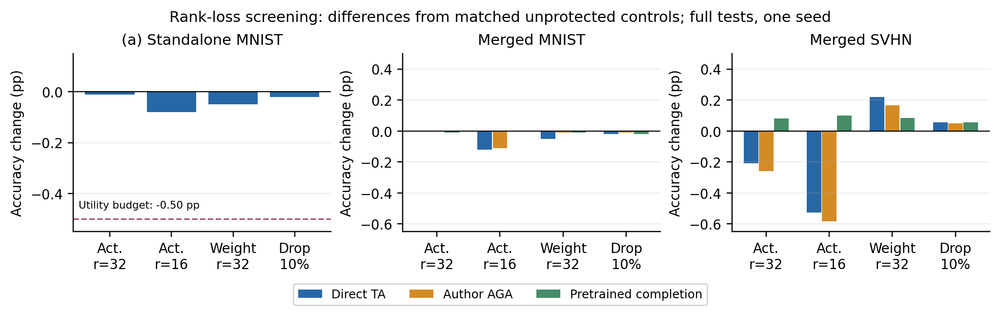
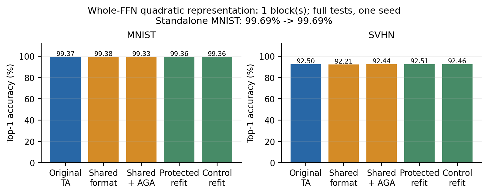
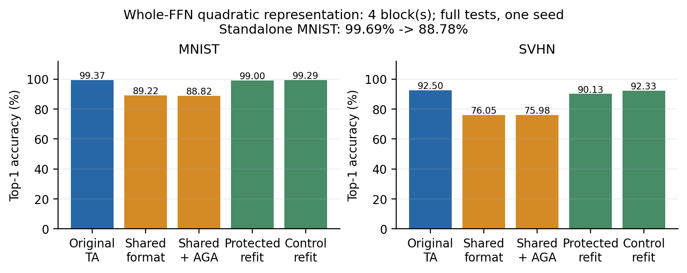
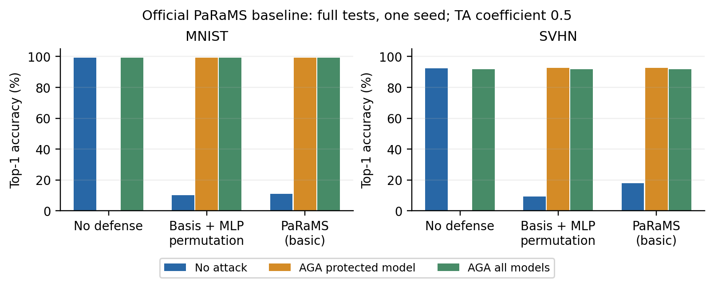

# 2026-10-09 组会：无微调的模型融合保护

## 研究问题

对已经训练好的模型增加后处理保护：不再微调，尽量不使用原始训练数据，保持 standalone utility，阻止未经授权融合，并抵抗恢复攻击。

目标不仅是隐藏对应关系，而是让攻击者完成重新匹配后，仍难恢复有用的可融合表示。参数误差只能解释机制；安全结论必须落到攻击后的融合效用，并注明攻击所需信息与计算量。

今天没有额外微调专家模型；结构候选及功能重构使用公开合成校准、闭式拟合新映射。完成 56 条机制验证与 193 条真实完整测试评估，含 50 条秩编辑、40 条 FFN 重表示配置。这些是评估配置数，不是独立重复实验数。尚未得到可抵抗自适应攻击的强防御。

## 当前重点：不可逆编辑与完整 FFN 功能表示

### 不可逆秩编辑

| 最后四层 V 编辑 | 独立 MNIST (%) | 损失 (pp) | 直接融合 MNIST / SVHN (%) | pretrained 补全融合 MNIST / SVHN (%) |
|---|---|---|---|---|
| unprotected | 99.69 | 0.00 | 99.37 / 92.50 | 99.37 / 92.50 |
| activation_rank32 | 99.68 | 0.01 | 99.37 / 92.29 | 99.36 / 92.58 |
| activation_rank16 | 99.61 | 0.08 | 99.25 / 91.97 | 99.37 / 92.60 |
| weight_rank32 | 99.64 | 0.05 | 99.32 / 92.72 | 99.36 / 92.58 |
| random_drop10 | 99.67 | 0.02 | 99.35 / 92.56 | 99.35 / 92.56 |

四个预设配置的独立效用损失均在 0.5 pp 预算内，但直接融合已经有效。rank 16 删去 75% 的单 head 输出维度，独立损失 0.08 pp；公开 pretrained 补全后融合恢复 99.37% / 92.60%。局部秩下界没有转化为融合保护，停止继续扫描该配置族。不能仅凭此实验断言是哪一层保留了任务信息。

图：完整测试、单种子；准确率相对各自未保护对照的差值，单位 pp。补全无需数据或秘密投影。

### 完整 FFN 二次重表示：1 层

| 设置 | MNIST (%) | SVHN (%) |
|---|---|---|
| 重表示 MNIST 专家独立 | 99.6900 | 50.0768 |
| 原始未保护融合 | 99.3700 | 92.4977 |
| 共同格式直接融合 | 99.3800 | 92.2057 |
| 共同格式兼容层 AGA 后融合 | 99.3300 | 92.4401 |
| 保护模型原架构重构后融合 | 99.3600 | 92.5131 |
| 未保护模型同攻击后融合 | 99.3600 | 92.4554 |

独立 MNIST 损失 0.00 pp，满足预设 0.5 pp 预算。每层原 FFN 的 4,722,432 个参数被 430,848 个系数及公开基替代，不保留该块 W1/W2。需要 32 张合成校准图像作闭式拟合，没有额外微调专家。攻击者用另一 seed 的 32 张合成图像、公开 pretrained 和发布模型拟合回原架构，融合为 99.36% / 92.51%。共同格式融合也接近未保护融合，本次未形成保护。

AGA 明确跳过 1 个替换 FFN；共同格式攻击使用公开 defender 基与校准协议，原架构攻击使用独立图像。独立行的非所属任务数值表示迁移性能。

图：完整测试、单种子；系数 0.5，纵轴从零开始，无统计误差条。

### 完整 FFN 二次重表示：4 层

| 设置 | MNIST (%) | SVHN (%) |
|---|---|---|
| 重表示 MNIST 专家独立 | 88.7800 | 33.1323 |
| 原始未保护融合 | 99.3700 | 92.4977 |
| 共同格式直接融合 | 89.2200 | 76.0526 |
| 共同格式兼容层 AGA 后融合 | 88.8200 | 75.9796 |
| 保护模型原架构重构后融合 | 99.0000 | 90.1314 |
| 未保护模型同攻击后融合 | 99.2900 | 92.3325 |

独立 MNIST 损失 10.91 pp，超出预设 0.5 pp 预算。每层原 FFN 的 4,722,432 个参数被 430,848 个系数及公开基替代，不保留该块 W1/W2。需要 32 张合成校准图像作闭式拟合，没有额外微调专家。攻击者用另一 seed 的 32 张合成图像、公开 pretrained 和发布模型拟合回原架构，融合为 99.00% / 90.13%。该配置已经损伤独立任务，融合下降无法作为保护证据。

AGA 明确跳过 4 个替换 FFN；共同格式攻击使用公开 defender 基与校准协议，原架构攻击使用独立图像。独立行的非所属任务数值表示迁移性能。 本配置因独立效用超预算淘汰；直接融合下降不能计作保护成功，不继续扩大覆盖或扫参数。

图：完整测试、单种子；系数 0.5，纵轴从零开始，无统计误差条。

数学依据、全部对照与有限查新边界见 [具体方向](candidate_direction.md)。两个原型均得到真实负结果；局部近似定理、结构格式差异和未恢复原权重均不足以证明安全。

## 论文与实现

AGA 用 pretrained 权重作 anchor：Attention 对 Q/K/V/O 分别逐 head 最小二乘对齐；MLP 用 cosine + Hungarian 恢复隐藏神经元顺序。ARF 在微调时扩大 Attention 与 anchor 的距离，因此不满足本课题的“仅后处理”。

作者公开代码未包含完整保护、ARF 训练和 checkpoint。今天使用 Task Arithmetic 官方 B/32 checkpoint，直接调用固定版本的 AGA、TaskVector 差分与求和、ImageClassifier 和 get_logits。新增部分是后处理候选、兼容入口及结果记录。当前正交 + 置换基线不直接标成 MergeLock、MergeBarrier 或 Table 6 的同配置方法。

## 已完成：机制验证

3 个固定种子；GELU MLP 宽度 48、隐藏维 96；Attention 宽度 96、12 heads。参数变化是合成扰动，不是下游训练。

| 机制；合成 task change = 1% | 保护输出误差 | AGA 参数误差 | AGA 输出误差 |
|---|---|---|---|
| MLP 置换 | 1.32e-07 | 0 | 0 |
| Attention QK/VO | 3.17e-07 | 2.86e-03 | 5.05e-03 |

MLP 的 15 个测试配置均 100% 恢复真实置换；恢复后的参数误差为零。Attention 在不同扰动幅度下仍保持保护函数等价，但 AGA 独立估计投影会留下恢复误差。

图 1：P0 的 3 个种子；阴影为 min-max，非置信区间。MLP 恢复误差为零，单独注记，未用正数替代零值绘制对数曲线。

## 已完成：真实 CLIP 对照

MNIST test：10,000；SVHN test：26,032。保护对象是 MNIST 微调模型，第二专家是 SVHN。两个融合系数预先固定，未使用测试集选择系数。测试仅评价，没有校准。

| 组别 | 系数 | MNIST | SVHN |
|---|---|---|---|
| A：未保护 MNIST 模型 | — | 99.69% | 49.23% |
| B：后处理保护 | — | 99.69% | 49.23% |
| C：B 经 AGA 恢复 | — | 99.68% | 49.08% |

表 1：standalone 对照。MNIST 是受保护任务；SVHN 是第二任务，standalone 在 SVHN 上的数值表示迁移性能。

| 保护 | 攻击 | TA 系数 | MNIST (%) | SVHN (%) | Avg (%) | ↑Δ (pp) |
|---|---|---|---|---|---|---|
| 未保护 | 无 | 0.2 | 95.29% | 77.31% | 86.30 | — |
| 正交基变换 + MLP 置换 | 无 | 0.2 | 11.31% | 15.58% | 13.45 | — |
| 正交基变换 + MLP 置换 | 仅保护模型 AGA | 0.2 | 94.79% | 76.83% | 85.81 | +72.36 |
| 未保护 | 全部模型 AGA | 0.2 | 94.64% | 74.96% | 84.80 | — |
| 正交基变换 + MLP 置换 | 全部模型 AGA | 0.2 | 94.64% | 74.96% | 84.80 | +71.35 |
| 未保护 | 无 | 0.5 | 99.37% | 92.50% | 95.93 | — |
| 正交基变换 + MLP 置换 | 无 | 0.5 | 10.28% | 9.35% | 9.81 | — |
| 正交基变换 + MLP 置换 | 仅保护模型 AGA | 0.5 | 99.30% | 92.78% | 96.04 | +86.23 |
| 未保护 | 全部模型 AGA | 0.5 | 99.32% | 91.77% | 95.55 | — |
| 正交基变换 + MLP 置换 | 全部模型 AGA | 0.5 | 99.32% | 91.77% | 95.55 | +85.73 |

表 2：参考论文表 1/4 的保护 × 攻击布局。Avg 为两个任务 Top-1 的等权算术平均，不是合并样本后的准确率。↑Δ 是攻击相对同系数“保护后直接融合”的恢复增量，单位为百分点。全部模型 AGA 是防御无关设置；未保护模型也做 AGA，衡量攻击自身带来的效用变化。双任务数值不能与论文八任务 Avg 横向比较。

保护前后 16 张真实图像上的特征相对误差为 9.66e-07。原模型与保护模型在两个完整测试集上的正确样本数相同。AGA 后全 checkpoint 参数相对误差为 4.34e-03；该指标含未参与视觉推理的遗留参数，不能替代 feature error 或 accuracy。AGA 特征误差为 0.0619。

图 2：全测试集、单种子，两档预设系数；纵轴从零开始。无重复实验时不画误差条。未在测试集选择融合系数。

图 3：参考论文 Fig. 3，分别展示 standalone utility 与受保护任务的融合效用。左图纵轴放大并标明范围，右图从零开始。模型均为 ViT-B/32，融合系数 0.5；候选只在 MNIST 上筛选。攻击后融合准确率越低，才表示防御越有效。

## 已完成：官方基础 PaRaMS

| 设置 | TA 系数 | MNIST (%) | SVHN (%) | Avg (%) | ↑Δ (pp) |
|---|---|---|---|---|---|
| 未保护；无攻击 | 0.2 | 95.29 | 77.31 | 86.30 | — |
| PaRaMS；直接融合 | 0.2 | 11.35 | 19.59 | 15.47 | — |
| PaRaMS；仅保护模型 AGA | 0.2 | 94.79 | 76.84 | 85.81 | +70.34 |
| 未保护；全部 AGA | 0.2 | 94.64 | 74.96 | 84.80 | — |
| PaRaMS；全部 AGA | 0.2 | 94.64 | 74.96 | 84.80 | +69.33 |
| 未保护；无攻击 | 0.5 | 99.37 | 92.50 | 95.93 | — |
| PaRaMS；直接融合 | 0.5 | 11.07 | 18.02 | 14.55 | — |
| PaRaMS；仅保护模型 AGA | 0.5 | 99.30 | 92.79 | 96.05 | +81.50 |
| 未保护；全部 AGA | 0.5 | 99.32 | 91.77 | 95.55 | — |
| PaRaMS；全部 AGA | 0.5 | 99.32 | 91.77 | 95.55 | +81.00 |

基础 PaRaMS 直接调用官方固定版本；不含原文 §6 的 dropout 加固。12 层 MLP 取最远 assignment，Attention 对角缩放 U(0.05,20)；独立 MLP 组使用一轮 assignment，未伪称与 Table 6 配置完全一致。源码实际共用 Q/V 缩放，与论文独立采样描述有差别。保护特征误差 6.08e-07；保护前后两个完整测试集的正确计数相同。全部 AGA 后保护/未保护对照的两个任务正确计数相同，未形成有效保护。

图：真实双任务、单种子；系数 0.5。分别展示原始融合、保护后直接融合与 AGA 后融合，纵轴从零开始。图中 PaRaMS 指本次运行的基础配置。

## 超出 AGA：配对保函数对齐

| 配置；融合系数 0.5 | MNIST (%) | SVHN (%) |
|---|---|---|
| 保护模型配对对齐 standalone | 99.69 | 49.23 |
| 未保护模型配对对齐 standalone | 99.69 | 49.23 |
| 仅保护模型配对对齐后融合 | 99.37 | 92.50 |
| 仅未保护模型配对对齐后融合 | 99.37 | 92.50 |
| 全部配对对齐；含保护 | 99.37 | 92.50 |
| 全部配对对齐；未保护 | 99.37 | 92.50 |

保护与未保护对照在配对对齐后取得相同正确计数，并恢复到原始未保护融合水平。该正交基线上的独立 AGA 不是能取得最高融合效用的攻击，后续防御需同时覆盖保函数的配对对齐。

复用 RotationSymmetry 的原始 Chunk_SVD_QK、Chunk_SVD_VO、Permute_IO；配对 Kabsch 保持 QK/VO 函数，联合 FFN 权重与 bias 匹配。求解用 float64，模型保持 float32；无数据、无训练。对齐前后最大特征误差 9.92e-07。本次仅测试正交保护与既定 head 对应关系，不含一般 GL 白化或跨 head matching；不能称全面强攻击。

## 已完成：后处理边界

对于 $W^p=W_{ft}P$、可逆 $P$，理想 LS 的拟合值为

$$
W^a=\Pi_{\operatorname{col}(W_{ft})}W_{pre},\qquad
W^a-W_{ft}=-\Pi_{ft}\tau.
$$

这一结论已在论文附录证明。我们的直接 LS 数值验证中，不同正交、对角及稠密保护矩阵与统一投影结果的最大相对差异为 2.40e-11。作者带正则的正规方程与 float32 转换在高条件数时偏离理想结果；这些数值误差不构成安全防御。

跨 head 置换保持函数，但会破坏原代码默认对应关系：

| 跨 head 置换 + 正交基变换 | 相对输出误差；3 seeds 平均 |
|---|---|
| 保护 standalone | 3.14e-07 |
| 原逐 head AGA | 0.9735 |
| 子空间 matching + AGA | 0.0049 |

自适应子空间 matching 在全部 3 个种子中 100% 恢复 head correspondence，故不把跨 head 置换当成强防御。

## 后处理候选：LayerNorm 空方向

若 $y=\gamma\odot z+\beta$ 且 $\mathbf1^Tz=0$，取归一化 $r\propto1/\gamma$，则 $r^T(y-\beta)=0$。对紧随 LayerNorm 的 Linear 作

$$
W'=W+ur^T,\qquad b'=b-u(r^T\beta),
$$

可改变参数列空间而保持该层在合法输入上的输出。它超出了“仅右乘可逆矩阵”的限制，且无需训练数据。候选施加在 QKV 与 MLP 第一层，再与基变换保护组合。

但 $r$ 由公开 LayerNorm 参数确定。攻击者可解析消去该方向：

$$
W_c=W-(Wr)r^T,\qquad b_c=b+(Wr)(r^T\beta).
$$

因此必须评价“canonicalization + AGA”，不能只观察原 AGA 是否失效。

| MNIST 全测试集 | 扰动强度 1 | 扰动强度 10 |
|---|---|---|
| 空方向扰动 standalone | 99.69% | 99.69% |
| 空方向 + 基变换 standalone | 99.69% | 99.69% |
| 原 AGA standalone | 99.67% | 99.67% |
| 投影消除 + AGA standalone | 99.68% | 99.68% |
| 原 AGA 后融合 | 99.32% | 99.12% |
| 投影消除 + AGA 后融合 | 99.30% | 99.30% |
| canonical 未保护融合对照 | 99.37% | 99.37% |

解析后处理，无训练、无校准数据。函数误差通过 $10^{-4}$ 阈值。攻击者只需公开 LayerNorm 参数即可消去空方向；canonical 未保护融合是相同参数表示下的对照。原 AGA 及自适应攻击后准确率均接近未保护融合，故该候选未形成有效保护。

图 4：两档扰动强度；单种子、MNIST 完整测试集。纵轴放大至高准确率区域；点表示准确率，不画统计误差条。

## 后处理候选：合成校准低活跃方向

使用 32 张无标签程序生成笔画图像，采集最后四层 LayerNorm 后激活的中心化协方差 $C$，取最低特征值的 64 维正交基 $N$。对 QKV 作 $\Delta W=UN^T$、$b'=b-\Delta W\mu$，扰动 Frobenius 范数为原权重的 1 倍，然后叠加正交与置换保护。参数、rank、层和强度在评价前固定；未使用 MNIST train/test 构造或调节扰动。

对单层有 $\mathbb E\|\Delta W(x-\mu)\|^2=\operatorname{tr}(\Delta W C\Delta W^T)\le\lambda_{64}(C)\|\Delta W\|_F^2$。这是校准分布上的局部约束，不能保证整个网络或真实数据上的效用。攻击者从发布模型重算合成激活方向，并对权重与 bias 作投影消除；anchor 和其他专家使用相同投影对照。

| 设置 | MNIST (%) |
|---|---|
| 保护后 standalone | 99.66 |
| AGA standalone | 99.58 |
| 低活跃投影 + AGA standalone | 99.67 |
| 保护后直接融合 | 10.28 |
| AGA 后融合 | 99.25 |
| 低活跃投影 + AGA 后融合 | 99.28 |
| 投影后的未保护融合对照 | 99.36 |

预设 standalone 损失预算 0.5 pp，本次损失 0.03 pp，通过预算。特征误差为 0.270，因此属于近似保效用后处理，不是函数等价变换。AGA 后融合 99.25%，自适应攻击后 99.28%，未得到明显保护。单任务、单种子结果不足以支持泛化或统计显著性。

这两种机制是本次筛选候选，均未形成有效保护。已定向审读七篇核心论文并补读相关工作，尚不构成全面查新，不宣称方法新颖性。

## 文献与方向审查

PaRaMS 原文已讨论恢复、剪枝和蒸馏；MergeLock 已涵盖一般可逆 Attention 变换；PLeaS-free 仍使用公开无标签数据，且当前公开代码用 Adam 拟合 LS 目标。MergeBarrier 的 FFN Taylor 重表示需要激活校准并改变部署；TaylorMLP 也已有系数比值提取攻击，不能仅因参数格式改变就宣称安全。

本轮已检验秩编辑和完整 FFN 重表示；高 standalone 效用并未阻止 pretrained 补全与功能重构。TSV-C、SVD-LLM 已有低秩压缩，MergeGuard 的第一阶段包含额外微调，第二阶段独立版本已在原文消融；均不能直接包装为本课题创新。下一项先检查任务特异信息删除的可识别性及功能恢复预算，避免继续扩大可逆变换或随意叠加机制。原文位置与边界见 [文献核对](literature_triage.md)、[方向审查](research_direction_review.md) 和 [本轮具体方向](candidate_direction.md)。

## 八任务推进

保持 ViT-B/32、TA 系数 0.2 和论文的一次仅保护一个专家设置。已取得全部分类 head；官方六个缺失专家再次遭遇 Drive 配额限制。沿 TSV 作者引用的 TALL 公开镜像取得一个 MNIST 候选，在仅统一 model. 前缀后，与原权重的 152 个视觉参数全部不一致，因此拒绝替代；没有继续下载其他大权重。

DTD 第 1 分割的 1,880 张 test 图像和 GTSRB 原作者入口的 12,630 张 test 图像已准备，并通过官方 pretrained + head 全测试推理；准确率 44.41% / 32.56%，仅作资源与入口检查，不是八任务融合结果。EuroSAT 原随机索引、RESISC45 split、SUN397 第 1 分割和 Cars 图片仍需补齐。

当前没有八任务准确率，也没有将未复现的 MergeGuard/ARF 写入结果。资源缺项记录于 `eight_task/status.md`；待权重和划分齐备后先跑未保护八任务基线，再补官方防御。仅扩展任务数量还不足以称为 Table 6 严格复现。

## 结论与下一步

1. 小任务变化下，置换和 head 内可逆变换可被 AGA 绕过；扩大变换幅度不改变理想投影结果。
2. 精确函数等价后处理确有可用自由度，但已知对称性往往也给攻击者提供 canonicalization。
3. 低活跃方向允许较大参数变化和很小准确率损失，但 AGA 仍恢复高融合效用；单靠“远离 anchor”或保持 standalone accuracy 均不足以构成保护。
4. 本轮秩收缩与完整 FFN 重表示均未阻止融合；隐藏原参数、降低局部秩或改变结构格式，都不足以证明功能表示难恢复。双任务继续用于开发，八任务复现并行补资源；有效候选才进入多种子、多任务及其他融合方法验证。

## 审读发现

MLP 附录的原始欧氏 margin 条件不能直接保证代码中的 cosine matching；固定反例满足条件却得到错误置换。ARF 印刷式 (19) 的 `min` 与正文 margin 行为不一致，已核对 PDF。由于 ARF 训练代码未公开，不能据此推断其实际实现或实验无效。详情见 `theory_notes.md`。

参考：[论文 v1](https://arxiv.org/abs/2606.30360v1)、[作者代码](https://github.com/krumpguo/secure-merge-attack)、[Task Arithmetic](https://github.com/mlfoundations/task_vectors)。数字均取自本次程序输出；论文数字未填入结果表。
