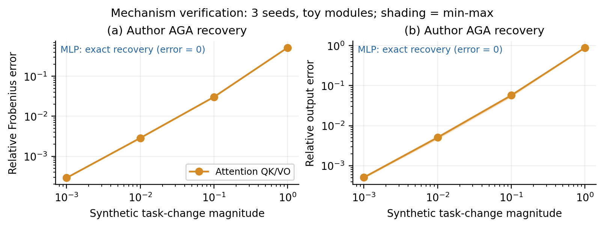
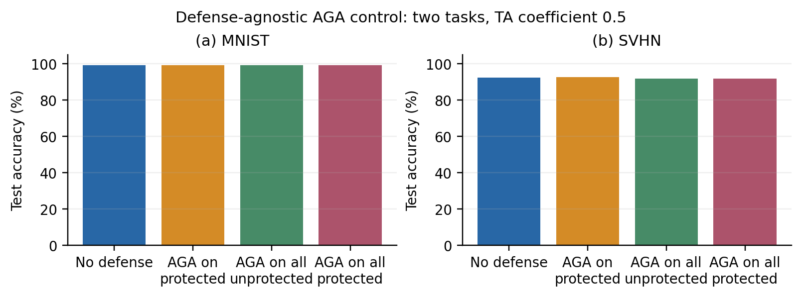
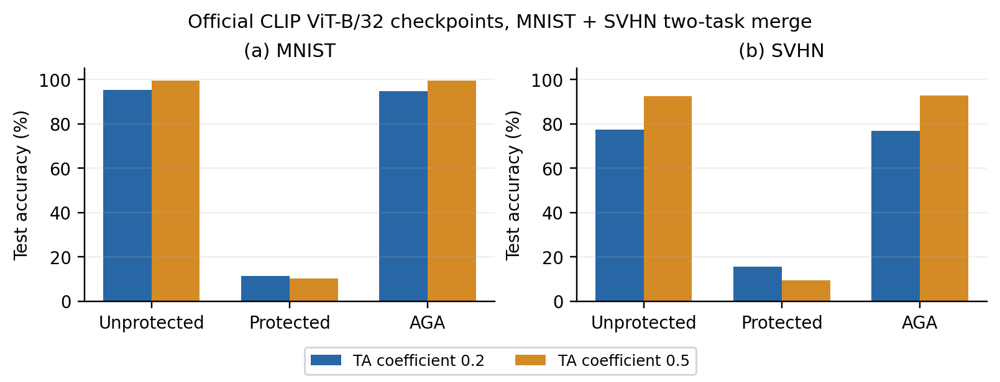
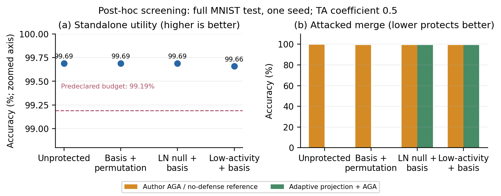
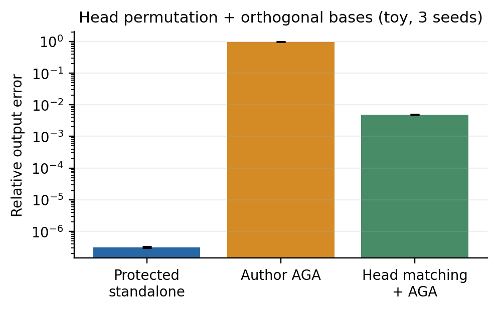
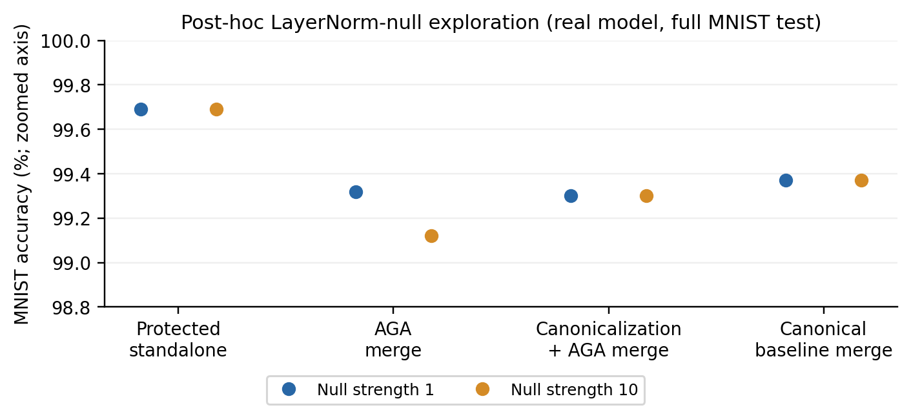

# 2026-10-09 组会：无微调的模型融合保护

## 研究问题

对已经训练好的模型增加后处理保护：不再微调，尽量不使用原始训练数据，保持 standalone utility，阻止未经授权融合，并抵抗恢复攻击。

目标不仅是隐藏对应关系，而是让攻击者完成重新匹配后，仍难恢复有用的可融合表示。参数误差只能解释机制；安全结论必须落到攻击后的融合效用，并注明攻击所需信息与计算量。

今天没有执行模型训练。完成 56 条机制验证、34 条双任务评估、16 条 LayerNorm 候选评估、7 条低活跃方向候选评估。这些是评估配置数，不是独立重复实验数。尚未得到可抵抗自适应攻击的强防御。

## 论文与实现

AGA 用 pretrained 权重作 anchor：Attention 对 Q/K/V/O 分别逐 head 最小二乘对齐；MLP 用 cosine + Hungarian 恢复隐藏神经元顺序。ARF 在微调时扩大 Attention 与 anchor 的距离，因此不满足本课题的“仅后处理”。

作者公开代码未包含完整保护、ARF 训练和 checkpoint。今天使用 Task Arithmetic 官方 B/32 checkpoint，直接调用固定版本的 AGA、TaskVector 差分与求和、ImageClassifier 和 get_logits。新增部分是后处理候选、兼容入口及结果记录。当前正交 + 置换基线不直接标成 MergeLock、MergeBarrier 或 Table 6 的同配置方法。

## 已完成：机制验证

3 个固定种子；GELU MLP 宽度 48、隐藏维 96；Attention 宽度 96、12 heads。参数变化是合成扰动，不是下游训练。

| 机制；合成 task change = 1% | 保护输出误差 | AGA 参数误差 | AGA 输出误差 |
|---|---|---|---|
| MLP 置换 | 1.32e-07 | 0 | 0 |
| Attention QK/VO | 3.17e-07 | 2.86e-03 | 5.05e-03 |

MLP 的 15 个测试配置均 100% 恢复真实置换；恢复后的参数误差为零。Attention 在不同扰动幅度下仍保持保护函数等价，但 AGA 独立估计投影会留下恢复误差。

图 1：P0 的 3 个种子；阴影为 min-max，非置信区间。MLP 恢复误差为零，单独注记，未用正数替代零值绘制对数曲线。

## 已完成：真实 CLIP 对照

MNIST test：10,000；SVHN test：26,032。保护对象是 MNIST 微调模型，第二专家是 SVHN。两个融合系数预先固定，未使用测试集选择系数。测试仅评价，没有校准。

| 组别 | 系数 | MNIST | SVHN |
|---|---|---|---|
| A：未保护 MNIST 模型 | — | 99.69% | 49.23% |
| B：后处理保护 | — | 99.69% | 49.23% |
| C：B 经 AGA 恢复 | — | 99.68% | 49.08% |

表 1：standalone 对照。MNIST 是受保护任务；SVHN 是第二任务，standalone 在 SVHN 上的数值表示迁移性能。

| 保护 | 攻击 | TA 系数 | MNIST (%) | SVHN (%) | Avg (%) | ↑Δ (pp) |
|---|---|---|---|---|---|---|
| 未保护 | 无 | 0.2 | 95.29% | 77.31% | 86.30 | — |
| 正交基变换 + MLP 置换 | 无 | 0.2 | 11.31% | 15.58% | 13.45 | — |
| 正交基变换 + MLP 置换 | 仅保护模型 AGA | 0.2 | 94.79% | 76.83% | 85.81 | +72.36 |
| 未保护 | 全部模型 AGA | 0.2 | 94.64% | 74.96% | 84.80 | — |
| 正交基变换 + MLP 置换 | 全部模型 AGA | 0.2 | 94.64% | 74.96% | 84.80 | +71.35 |
| 未保护 | 无 | 0.5 | 99.37% | 92.50% | 95.93 | — |
| 正交基变换 + MLP 置换 | 无 | 0.5 | 10.28% | 9.35% | 9.81 | — |
| 正交基变换 + MLP 置换 | 仅保护模型 AGA | 0.5 | 99.30% | 92.78% | 96.04 | +86.23 |
| 未保护 | 全部模型 AGA | 0.5 | 99.32% | 91.77% | 95.55 | — |
| 正交基变换 + MLP 置换 | 全部模型 AGA | 0.5 | 99.32% | 91.77% | 95.55 | +85.73 |

表 2：参考论文表 1/4 的保护 × 攻击布局。Avg 为两个任务 Top-1 的等权算术平均，不是合并样本后的准确率。↑Δ 是攻击相对同系数“保护后直接融合”的恢复增量，单位为百分点。全部模型 AGA 是防御无关设置；未保护模型也做 AGA，衡量攻击自身带来的效用变化。双任务数值不能与论文八任务 Avg 横向比较。

保护前后 16 张真实图像上的特征相对误差为 9.66e-07。原模型与保护模型在两个完整测试集上的正确样本数相同。AGA 后全 checkpoint 参数相对误差为 4.34e-03；该指标含未参与视觉推理的遗留参数，不能替代 feature error 或 accuracy。AGA 特征误差为 0.0619。

图 2：全测试集、单种子，两档预设系数；纵轴从零开始。无重复实验时不画误差条。未在测试集选择融合系数。

图 3：参考论文 Fig. 3，分别展示 standalone utility 与受保护任务的融合效用。左图纵轴放大并标明范围，右图从零开始。模型均为 ViT-B/32，融合系数 0.5；候选只在 MNIST 上筛选。攻击后融合准确率越低，才表示防御越有效。

## 已完成：后处理边界

对于 $W^p=W_{ft}P$、可逆 $P$，理想 LS 的拟合值为

$$
W^a=\Pi_{\operatorname{col}(W_{ft})}W_{pre},\qquad
W^a-W_{ft}=-\Pi_{ft}\tau.
$$

这一结论已在论文附录证明。我们的直接 LS 数值验证中，不同正交、对角及稠密保护矩阵与统一投影结果的最大相对差异为 2.40e-11。作者带正则的正规方程与 float32 转换在高条件数时偏离理想结果；这些数值误差不构成安全防御。

跨 head 置换保持函数，但会破坏原代码默认对应关系：

| 跨 head 置换 + 正交基变换 | 相对输出误差；3 seeds 平均 |
|---|---|
| 保护 standalone | 3.14e-07 |
| 原逐 head AGA | 0.9735 |
| 子空间 matching + AGA | 0.0049 |

自适应子空间 matching 在全部 3 个种子中 100% 恢复 head correspondence，故不把跨 head 置换当成强防御。

## 后处理候选：LayerNorm 空方向

若 $y=\gamma\odot z+\beta$ 且 $\mathbf1^Tz=0$，取归一化 $r\propto1/\gamma$，则 $r^T(y-\beta)=0$。对紧随 LayerNorm 的 Linear 作

$$
W'=W+ur^T,\qquad b'=b-u(r^T\beta),
$$

可改变参数列空间而保持该层在合法输入上的输出。它超出了“仅右乘可逆矩阵”的限制，且无需训练数据。候选施加在 QKV 与 MLP 第一层，再与基变换保护组合。

但 $r$ 由公开 LayerNorm 参数确定。攻击者可解析消去该方向：

$$
W_c=W-(Wr)r^T,\qquad b_c=b+(Wr)(r^T\beta).
$$

因此必须评价“canonicalization + AGA”，不能只观察原 AGA 是否失效。

| MNIST 全测试集 | 扰动强度 1 | 扰动强度 10 |
|---|---|---|
| 空方向扰动 standalone | 99.69% | 99.69% |
| 空方向 + 基变换 standalone | 99.69% | 99.69% |
| 原 AGA standalone | 99.67% | 99.67% |
| 投影消除 + AGA standalone | 99.68% | 99.68% |
| 原 AGA 后融合 | 99.32% | 99.12% |
| 投影消除 + AGA 后融合 | 99.30% | 99.30% |
| canonical 未保护融合对照 | 99.37% | 99.37% |

解析后处理，无训练、无校准数据。函数误差通过 $10^{-4}$ 阈值。攻击者只需公开 LayerNorm 参数即可消去空方向；canonical 未保护融合是相同参数表示下的对照。原 AGA 及自适应攻击后准确率均接近未保护融合，故该候选未形成有效保护。

图 4：两档扰动强度；单种子、MNIST 完整测试集。纵轴放大至高准确率区域；点表示准确率，不画统计误差条。

## 后处理候选：合成校准低活跃方向

使用 32 张无标签程序生成笔画图像，采集最后四层 LayerNorm 后激活的中心化协方差 $C$，取最低特征值的 64 维正交基 $N$。对 QKV 作 $\Delta W=UN^T$、$b'=b-\Delta W\mu$，扰动 Frobenius 范数为原权重的 1 倍，然后叠加正交与置换保护。参数、rank、层和强度在评价前固定；未使用 MNIST train/test 构造或调节扰动。

对单层有 $\mathbb E\|\Delta W(x-\mu)\|^2=\operatorname{tr}(\Delta W C\Delta W^T)\le\lambda_{64}(C)\|\Delta W\|_F^2$。这是校准分布上的局部约束，不能保证整个网络或真实数据上的效用。攻击者从发布模型重算合成激活方向，并对权重与 bias 作投影消除；anchor 和其他专家使用相同投影对照。

| 设置 | MNIST (%) |
|---|---|
| 保护后 standalone | 99.66 |
| AGA standalone | 99.58 |
| 低活跃投影 + AGA standalone | 99.67 |
| 保护后直接融合 | 10.28 |
| AGA 后融合 | 99.25 |
| 低活跃投影 + AGA 后融合 | 99.28 |
| 投影后的未保护融合对照 | 99.36 |

预设 standalone 损失预算 0.5 pp，本次损失 0.03 pp，通过预算。特征误差为 0.270，因此属于近似保效用后处理，不是函数等价变换。AGA 后融合 99.25%，自适应攻击后 99.28%，未得到明显保护。单任务、单种子结果不足以支持泛化或统计显著性。

这两种机制是本次筛选候选；尚未完成全面相关工作核查，不宣称已证明方法新颖性。

## 八任务推进

保持 ViT-B/32、TA 系数 0.2 和论文的一次仅保护一个专家设置。已检查官方八任务下载入口并取得全部分类 head；六个缺失专家权重均遭遇 Google Drive 配额限制。公开 HF 同架构模型的训练配置不同，不能直接当作原 checkpoint。数据还需确认 EuroSAT 原随机索引、RESISC45 split 和 SUN397 第 1 分割。

当前没有八任务准确率，也没有将未复现的 MergeGuard/ARF 写入结果。资源缺项记录于 `eight_task/status.md`；待权重和划分齐备后先跑未保护八任务基线，再补官方防御。仅扩展任务数量还不足以称为 Table 6 严格复现。

## 结论与下一步

1. 小任务变化下，置换和 head 内可逆变换可被 AGA 绕过；扩大变换幅度不改变理想投影结果。
2. 精确函数等价后处理确有可用自由度，但已知对称性往往也给攻击者提供 canonicalization。
3. 低活跃方向允许较大参数变化和很小准确率损失，但 AGA 仍恢复高融合效用；单靠“远离 anchor”或保持 standalone accuracy 均不足以构成保护。
4. 双任务继续用于开发；八任务补齐后按同一协议验证。下一项机制必须同时改变对齐攻击可恢复的信息，且不依赖公开可消去的方向。有效候选才进入多种子、多任务及其他融合方法验证。

## 审读发现

MLP 附录的原始欧氏 margin 条件不能直接保证代码中的 cosine matching；固定反例满足条件却得到错误置换。ARF 印刷式 (19) 的 `min` 与正文 margin 行为不一致，已核对 PDF。由于 ARF 训练代码未公开，不能据此推断其实际实现或实验无效。详情见 `theory_notes.md`。

参考：[论文 v1](https://arxiv.org/abs/2606.30360v1)、[作者代码](https://github.com/krumpguo/secure-merge-attack)、[Task Arithmetic](https://github.com/mlfoundations/task_vectors)。数字均取自本次程序输出；论文数字未填入结果表。
