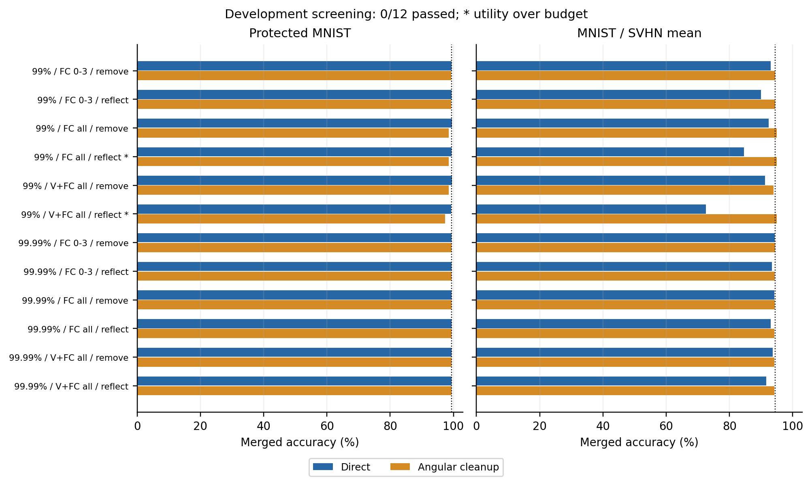
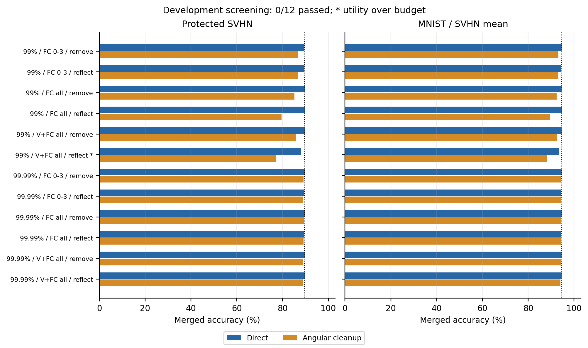
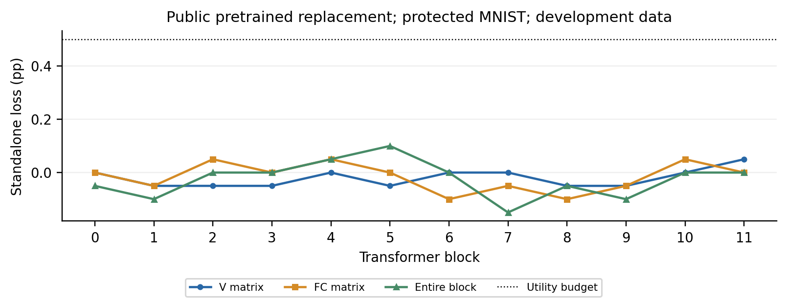
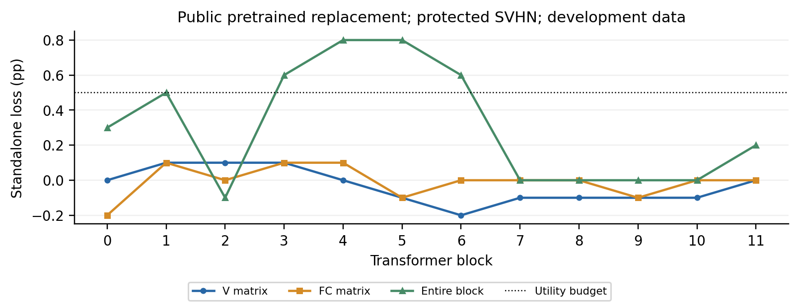

# 有界补空间对照

当前 24 个配置均未通过开发筛选。本轮检验局部信息删除与多层反射，没有提出新的安全机制；完整测试不因开发失败而继续扩大。

## 解析构造

令中心化输入 PCA 的主子空间投影为 P=UUᵀ，Q=I−P，校准均值为 μ。发布 W′=W−sWQ、b′=b+sWQμ，局部输出变化为 −sWQ(x−μ)。

- s=1：W′=WP，删除补空间信息，一般不可逆。
- s=2：W′=W(P−Q)。P−Q 是正交反射，精确算术下保持权重 Frobenius 范数及列空间；偏置补偿不保证偏置范数不变。浮点范数及主空间泄漏另记录。
- 每层基均来自原专家的冻结输入统计，没有跨层基变换补偿。多层编辑会改变后续输入；即使局部校准变化小，也不能保证全网络效用。

反射是已有的可逆线性构造，不能仅凭范数不变取得安全性。本次反射混合线性层的输入维度；原 AGA 的转置权重与逐 head 拟合视图不同，不能直接套用其列空间论证，宣称本对照必然被原 AGA 恢复。本轮未运行新的 AGA 测试。[AGA 原文](https://arxiv.org/abs/2606.30360v1)。

投影的不可逆性也不保证安全：若编辑 ΔWP=0，理想公开锚点补全 A(W′)=W′P+W₀Q 的参数误差为 −(W−W₀)Q，依赖被删 task-vector 成分，不依赖保护噪声有多大。该式要求知道准确 P；真实攻击重估子空间有额外误差，且局部误差不能单独推出全网络准确率。

## 协议与判定

每种保护对象固定两档保留能量、两种编辑和三个位置集合，共 12 个配置。复用父实验互斥校准、开发和攻击训练索引；不使用官方 test 选参数，也不更改原专家训练。开发图不是原专家训练时的 held-out validation。

效用预算为 0.5 pp；本轮继续实验门槛为直接融合和角度清理后，受保护任务与双任务均值相对匹配对照都下降至少 5 pp。5 pp 是开发筛选标准，不是普遍安全标准。通过者才进入完整测试、原 AGA 和独立校准补全；本轮通过数为零，未执行这一步。

角度清理只取得发布模型和公共 pretrained，按参数名规则扫描 49 个二维权重项，以固定 cosine<0.9 替换矩阵及偏置。未保护对照没有触发；范数>3 的另一扫描在所有发布配置上均未触发。角度清理并非总能改善性能，攻击者保留不清理的直接融合选项。

扫描范围审计发现，实际旧入口为 48 个视觉块矩阵及一个未参与图像推理的词嵌入，遗漏最终 visual.proj；原协议“全部线性矩阵”的覆盖描述不准确。当前代码通过模块类型枚举视觉矩阵，并显式包含最终投影、排除词嵌入。原始扫描与协议保留。

24 个候选重新构造后，修正范围的角度及范数替换决定均与旧记录相同；按旧记录构成的攻击模型与修正入口得到的模型，全部 state_dict 张量逐项相等。因此本轮准确率计数无需重测或改写。该审计没有增加准确率实验。[状态核对](scope_audit/results.json)、[来源](scope_audit/metadata.json)、[4 项核验](scope_audit/validation.json)。

## 原始记录

| 保护对象 | 校准 / 参数对照 | 开发结果 | 位置替换 | 攻击扫描 | 选择 / 核验 |
|---|---|---|---|---|---|
| MNIST | [子空间](bounded_complement/calibration_subspaces.json)、[配置检查](bounded_complement/development_screen.json) | [正确计数](bounded_complement/results.json) | [逐部件替换](bounded_complement/replacement_profile.json) | [全部矩阵](bounded_complement/angular_scans.json) | [选择](bounded_complement/selection.json)、[8 项核验](bounded_complement/validation.json) |
| SVHN | [子空间](bounded_svhn/calibration_subspaces.json)、[配置检查](bounded_svhn/development_screen.json) | [正确计数](bounded_svhn/results.json) | [逐部件替换](bounded_svhn/replacement_profile.json) | [全部矩阵](bounded_svhn/angular_scans.json) | [选择](bounded_svhn/selection.json)、[8 项核验](bounded_svhn/validation.json) |

MNIST 组新增 159 条评价、复用 3 条；SVHN 组新增 160 条、复用 2 条。两组运行源码分别保留于提交 `c2f80aa`、`f726c13`，源码 SHA256 在各目录 metadata.json 中；后续输入诊断源码保留于 `6ded1dc`。真实计数与失败配置没有覆盖。

输入诊断同时使用各自冻结均值和 PCA，比较原专家及同一未保护融合模型的本任务输入；只用原 256 张校准训练图。两角色 × 两能量 × 24 位置，共 96 条统计，不是 96 次准确率实验。[统计](distribution_shift/results.json)、[来源](distribution_shift/metadata.json)、[核验](distribution_shift/validation.json)。
