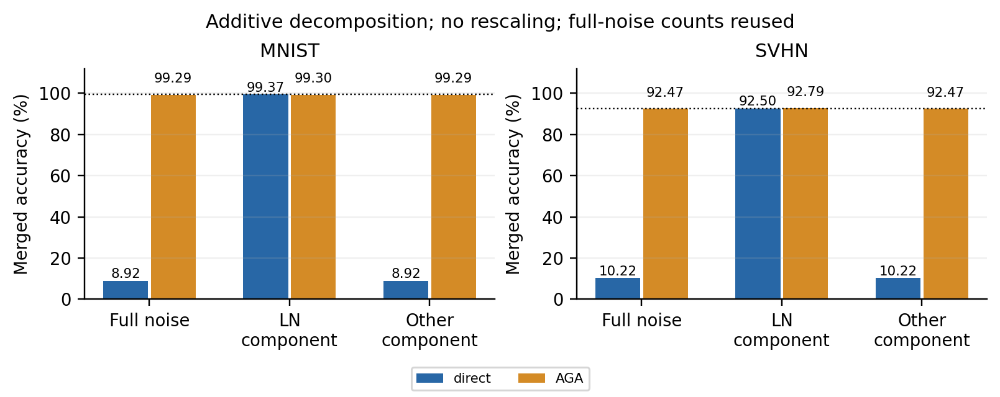
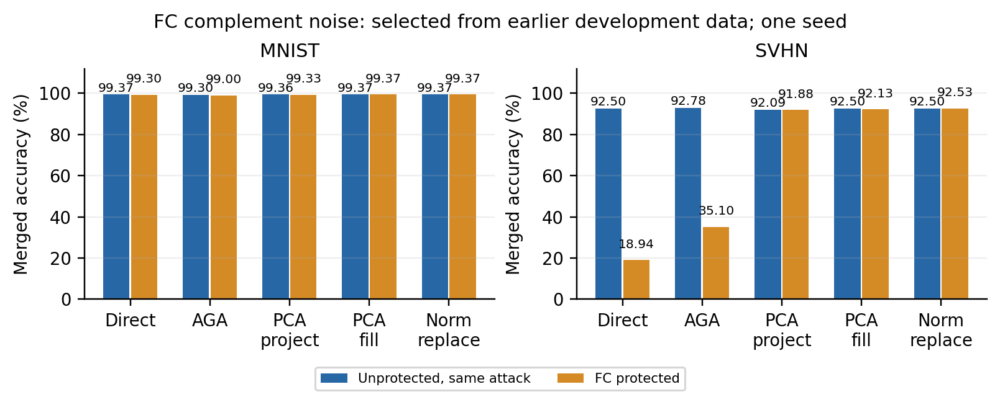

# 后续实测：补空间扰动仍可清理

本文保留随机扰动的完整测试与恢复诊断。当前总览及新增双角色开发筛选见[研究简报](report.md)。

**任务补空间扰动能保持独立性能并破坏直接融合，但当前 V 和 MLP 构造均不能抵抗自适应恢复。攻击者无需校准数据，只替换范数异常的公开矩阵就能恢复双任务性能。** 本轮保留这一失败结论，不把原版 AGA 的局部失效解释为防御成功。

## 三项结论

1. **当前效果不由 LayerNorm 公开空方向解释。** 将已发布 V 扰动分解为 LayerNorm 仿射空方向成分和剩余成分，不重新放大任一成分。空方向占参数编辑能量 0.1597%；去除它后，独立 MNIST 仍为 99.70%，直接融合 MNIST / SVHN 仍为 8.92% / 10.22%，与完整扰动的正确计数相同。只保留空方向成分时，直接融合为 99.37% / 92.50%。这支持当前扰动确实依赖任务输入统计，不能推广为所有补空间构造都有效。
2. **原 AGA 对不同模块的处理解释了恢复差异。** 完整 V 矩阵范数与原专家之比从 100.01 降至 0.28；MLP 第一线性矩阵之比保持 10.05。原 AGA 对 V 作线性拟合，对该 MLP 使用配对置换，后者保留 Frobenius 范数。局部参数和块输出诊断不能单独推出分类性能；下表提供完整测试证据。
3. **限制原 AGA 仍不足以保护模型。** MLP 扰动后独立 MNIST 为 9,967 / 10,000（99.67%），较原专家损失 0.02 pp；原 AGA 后融合 SVHN 只有 35.10%。然而独立校准清理已恢复到 91–92%，无数据异常矩阵替换进一步恢复到 92.53%。因此继续单纯放大噪声的科研价值有限。

## 完整测试与对照

保护 MNIST 专家，与原 SVHN 专家作系数 0.5 的 Task Arithmetic；仍使用作者 merger、dataset registry、head 和 AGA。MLP 配置为第 0 层、强度 10，来自上一轮开发集的效用合格 MLP 配置中最低平均融合准确率，未按本轮测试结果选择。原开发筛选及其局限见[首次实测](subspace_initial.md)。

下表为融合后的 MNIST / SVHN 准确率（%）；每行两侧使用相同攻击规则。

| 融合 / 恢复 | 未保护对照 | MLP 补空间扰动 |
|---|---|---|
| 直接融合 | 99.37 / 92.50 | 99.30 / 18.94 |
| 原 AGA | 99.30 / 92.78 | 99.00 / 35.10 |
| 独立校准补空间投影 | 99.36 / 92.09 | 99.33 / 91.88 |
| 独立校准 pretrained 补全 | 99.37 / 92.50 | 99.37 / 92.13 |
| 无数据异常矩阵替换 | 99.37 / 92.50 | **99.37 / 92.53** |

攻击者投影和补全使用另 256 张 MNIST 训练图片，从发布模型重新估计 PCA；不取得保护基或噪声种子。无数据替换按参数名规则扫描 49 个二维权重项，范数超过对应 pretrained 矩阵 3 倍时替换矩阵及偏置；阈值在参数诊断后、本次攻击评价前固定，未搜索测试阈值，也未提供扰动位置。未保护对照没有矩阵触发替换。后续发现该旧规则包含词嵌入、遗漏最终视觉投影；原扫描记录保留，范围审计见[补空间对照记录](bounded_notes.md)。

V 版本触发一个 QKV 矩阵替换，MLP 版本触发一个第一线性矩阵替换。替换后 V 独立 MNIST 为 99.70%，融合为 99.38% / 92.52%；MLP 独立 MNIST 为 99.66%，融合为 99.37% / 92.53%。这里替换的是公开预训练参数，攻击者没有原微调专家。

MLP 版本在直接融合及原 AGA 后的 MNIST 已保持约 99%。因此不能仅以另一任务 SVHN 下降就声称“受保护任务知识不可融合”；必须同时检查两项任务及攻击后的联合能力。

## 数学解释与下一步

补空间编辑为 ΔW = αR(I−UUᵀ)，偏置补偿 Δb = −ΔWμ，因此输入变化为 ΔW(x−μ)。它能压低校准主子空间上的变化，但对未见输入没有严格效用保证；该投影思路已有前作，不计作本项目创新。[前作核查](review.md#前作核查)。

令 LayerNorm 的仿射参数为 γ、β，取单位方向 n ∝ 1/γ。输入满足 nᵀ(z−β)=0，可将实际编辑 D 分解为 Dnnᵀ 和 D(I−nnᵀ)，并对前者补偿偏置 −Dn(nᵀβ)。本轮两成分重建相对误差为 3.59×10⁻⁸；对照保持实际幅度，避免重标定造成歧义。

当前缺口是：保护既要保持任务能力，也要使攻击者不能廉价定位并替换被编辑部件。下一步先建立公开 pretrained 局部替换的敏感性图，并在固定效用预算内验证编辑是否落在不可轻易替代的任务部件上。只有跨过无数据清理与独立校准清理，再扩大任务、种子和融合方法。这里是待检验假设，尚无新的有效防御。

## 记录与复现

本轮因果对照新增 30 条完整测试评价，另明确复用 12 条上一轮计数；无数据攻击新增 6 条，另复用 3 条未改变对照。两轮总耗时分别为 486.82 s、93.66 s，含加载、诊断及评价，不能解释为单独攻击耗时。仍为单种子、双任务；开发子集不是原专家训练时的 held-out validation。

- 因果对照：[协议](subspace_diagnostics/protocol.json)、[开发选择](subspace_diagnostics/fc_selection.json)、[正确计数](subspace_diagnostics/results.json)、[分解](subspace_diagnostics/decomposition.json)、[参数诊断](subspace_diagnostics/parameter_diagnostics.json)、[7 项核验](subspace_diagnostics/validation.json)。运行源码版本保留于提交 `fb79aac`；之后增加独立清理入口，没有改写已有结果。
- 无数据攻击：[协议](anchor_cleanup/protocol.json)、[全部扫描记录](anchor_cleanup/scans.json)、[正确计数](anchor_cleanup/results.json)、[来源和计时](anchor_cleanup/metadata.json)、[6 项核验](anchor_cleanup/validation.json)。
- 八任务复现：RESISC45 的 31,500 张图片与原 train/val/test 索引均已核验；作者入口 pretrained + 官方 head 在完整测试取得 3,794 / 6,300（60.22%），这是数据与推理检查，**不是八任务融合结果**。六个官方专家仍受 Drive 配额限制。[资源状态](../eight_task/status.md)。

数据、权重、PCA 基和完整日志仅保存在服务器；仓库保留代码、协议、真实计数与轻量图表。
