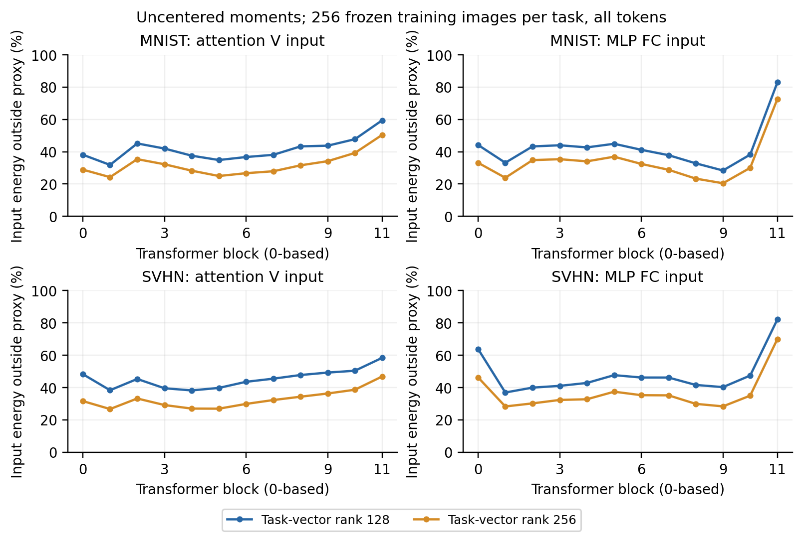
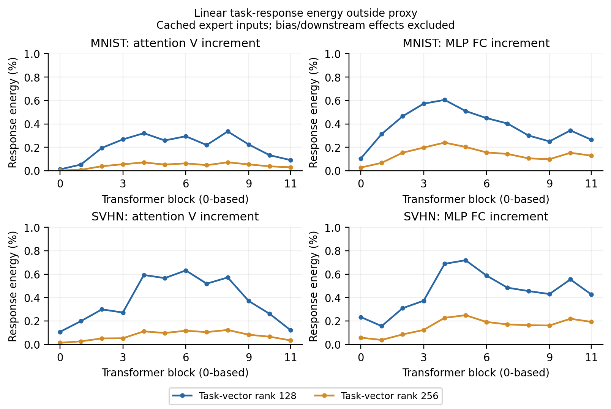

# NUFILT 与组会提示

## 是否就是老师提到的论文

**很可能是，但现有录音转写不能确定论文名。** 10 月 9 日转写开头提到“之前看过的那篇论文”和低维假设，随后讨论保持本任务子空间、操作其余方向。名字被转写成“人浪费”。这与 NUFILT 的主题吻合，属于依据语境的推断，不能当作逐字确认。

用户提供的 `view.pdf` 共 25 页，标题结尾为 *Preserving Transparency, Promoting Fidelity*。同一工作 [arXiv v2](https://arxiv.org/abs/2509.21413v2) 改为 *Preserving Stability, Promoting Plasticity*，2026-03-15 更新，标注 ICLR 2026 接收。核对了附件首页、方法与附录相关页，以及 v2 的 §3.4、§4、实验设置和附录 B.3–B.4；没有复现完整论文。

## 可借鉴的内容和限制

[NUFILT §3.4–4](https://arxiv.org/html/2509.21413v2) 用任务增量 `ΔW = Wft − W0` 的右奇异子空间近似任务表征子空间。论文的数据子空间对应未中心化二阶矩 `E[xxᵀ]`；之前的激活 PCA 使用中心化协方差，两者不同。

子空间相似度为 `A = ‖V̂ᵀ Vd‖²_F / rd`，要求 `rd ≤ rv`。其对齐论证依赖低秩信号、噪声界和谱间隔；不保证任意层有固定的 16 维任务空间，也不直接保证分类准确率。

过滤器 `P = I − VVᵀ` 作用于新任务增量，目的是减小持续融合干扰。完整方法还优化低秩适配器；[作者配置](https://github.com/zihuanqiu/NUFILT/blob/4cd298fb7ea22bd4bcd343748fb4b8e3f9815324/config/method/nufilt/nufilt.yaml) 使用 Adam、50 步、学习率 0.001，过滤 / LoRA / 新任务子空间秩为 128 / 64 / 8。**无需数据不等于无需优化；NUFILT 本身不是发布保护。**

## 对我们研究的影响

老师的提示应落到一个可检验问题：能否在独立任务少用、融合时会用的方向上编辑模型，同时使编辑难以被公开锚点替换或功能拟合清除？这是我们的问题，不是 NUFILT 已经解决的结论。

先检查实际激活和任务向量子空间的关系，再决定能否采用无数据近似。即使近似成立，攻击者也能访问相同的公开 pretrained 与发布权重；它可能同时帮助攻击者定位或清理编辑，不能把容易计算的投影当作秘密或安全保证。

此前的有界补空间编辑、随机噪声及低成本恢复失败结果继续有效。没有因引用 NUFILT 就出现新方法或新防御结果。

## 本次检查协议

新增 [几何检查配置](../../../configs/nufilt_alignment.json)：两个真实专家、每个专家 12 层 V / FC 输入，用父实验冻结的 256 张本任务训练校准图和全部 50 个 token。复用作者原 SVD 函数，固定 [源码版本](https://github.com/zihuanqiu/NUFILT/tree/4cd298fb7ea22bd4bcd343748fb4b8e3f9815324)，不安装 FusionBench，不更改当前环境。

同时统计中心化 / 未中心化矩，任务向量秩 128 / 256，数据子空间秩 16 / 128。16 只是检查老师举例的诊断参数，256 是本项目追加的覆盖率对照，均不是估计的内在维度。记录相似度、输入能量覆盖和 99% / 99.99% 所需维数。48 个专家-部件组合、192 条几何记录；不运行准确率、不修改模型、不使用官方 test。

首次启动因手工记录的源码 SHA256 多了一个字符而停止于来源检查；未加载模型或生成测量结果。保留服务器上的原协议及失败日志，修正为重新计算的 64 位指纹后重跑。

## 初步结果：这个补空间并不空

10 月 10 日完成，计算用时 27.64 s，192 条记录通过核验。[完整几何记录](../../2026-10-10/nufilt_alignment/results.json)；[来源与数值核验](../../2026-10-10/nufilt_alignment/validation.json)；[启动失败记录](../../2026-10-10/nufilt_alignment_startup_failure/failure.json)。

以下使用未中心化二阶矩，均为第一层 V 的输入。参数增量能量和输入能量是不同的量。

| 专家 | task-vector 前 128 维保留的增量能量 | 输入在其补空间中的能量 | 改为前 256 维后的补空间能量 | 实际输入保留 99.99% 能量所需维数 |
|---|---:|---:|---:|---:|
| MNIST | 98.76% | 38.12% | 28.88% | 115 |
| SVHN | 98.70% | 48.28% | 31.60% | 265 |

在各 24 个 V / FC 部件上，128 维代理的输入补空间能量范围为 MNIST 28.35–82.94%、SVHN 36.91–82.18%。这不是准确率损失。中心化第一层 V 的 99.99% 维数为 159 / 280，与先前实际激活检查一致；未中心化结果不同，不能混用。



令 `Q = I − V̂V̂ᵀ`、`M = E[xxᵀ]`，补空间输入能量比例为 `tr(QM) / tr(M)`。若施加固定编辑 `DQ`，该层输出变化满足 `E‖DQx‖² ≤ ‖D‖²₂ tr(QM)`。因此仅有高参数增量能量覆盖，不能推出输出扰动小；实际输出仍取决于编辑方向和尺度，分类效用还取决于后续网络。

本次数据不支持把这些代理补空间直接视为本任务未使用的空间，因而不追加一批缺少效用依据的随机噪声实验。它也没有否定 NUFILT 的条件性定理或完整方法：这里只查两个任务、两类部件、所有 token，未跑持续融合、LoRA 或论文 Figure 2。

下一步保留两条具体检查：任务响应的加权残差，而非只看输入能量；先前闭式重建在独立数据上无法补回的分类信息。仅当出现稳定缺口，再尝试新的免训练保护。当前仍无有效防御。

在服务器仓库根目录运行，输出目录须为新的目录：

```bash
python experiments/nufilt_alignment.py \
  --config configs/nufilt_alignment.json \
  --output outputs/2026-10-10/nufilt_alignment \
  --author-repo external/secure-merge-attack \
  --nufilt-repo external/NUFILT \
  --checkpoints checkpoints/ViT-B-32 --data data
python experiments/plot_results.py --nufilt-alignment \
  --output outputs/2026-10-10/nufilt_alignment
```

完整输入二阶矩与论文 PDF 仅在服务器保存；本地和 GitHub 保留代码、配置、轻量统计与图表。

## 补充：输入能量与任务响应的差别

后续复用同一批缓存二阶矩和相同 checkpoint，新增 192 条**线性任务增量响应**统计，没有再采图、改模型或测准确率。使用 `T = Wft − W0`，比较 `E‖TQx‖² / E‖Tx‖²`；不包含偏置变化、后续非线性或标签。[全部记录](../../2026-10-10/nufilt_response/results.json)、[缓存来源和直接矩阵核对](../../2026-10-10/nufilt_response/validation.json)。

| 第一层 V，128 维代理 | 补空间输入能量 | 补空间中的线性任务响应能量 |
|---|---:|---:|
| MNIST | 38.12% | 0.0111% |
| SVHN | 48.28% | 0.1064% |

24 个部件的响应能量占比分别为 MNIST 0.0111%–0.6051%、SVHN 0.1064%–0.7188%。这补足了上一轮的证据边界：较大的输入补空间能量并不代表较大的任务响应，不能仅凭输入统计否定任务向量代理。

若 `T = UΣVᵀ`，则完整响应能量为 `Σi σi² viᵀMvi`，删除前 r 个方向之外的任务增量时，其响应能量由 `i > r` 的项给出。对两种任务、两个秩的第一层 V，用直接矩阵乘法核对了谱表达式；比例误差小于 `1e-8`。这一计算可检查对任务增量本身的过滤，但不能把它当作任意随机编辑 `DQ` 的效用保证，因为 D 与 T 是不同映射。



当前可以确认：代理补空间仍有输入活动，而原任务增量在那里产生的线性响应很小。尚未确认：多层编辑后的完整任务效用、直接融合或自适应恢复。没有因此产生新防御，也没有复现完整 NUFILT。

```bash
python experiments/nufilt_alignment.py \
  --config configs/nufilt_alignment.json \
  --moments-from outputs/2026-10-10/nufilt_alignment \
  --output outputs/2026-10-10/nufilt_response \
  --author-repo external/secure-merge-attack --nufilt-repo external/NUFILT \
  --checkpoints checkpoints/ViT-B-32 --data data
python experiments/plot_results.py --nufilt-response \
  --output outputs/2026-10-10/nufilt_response
```
