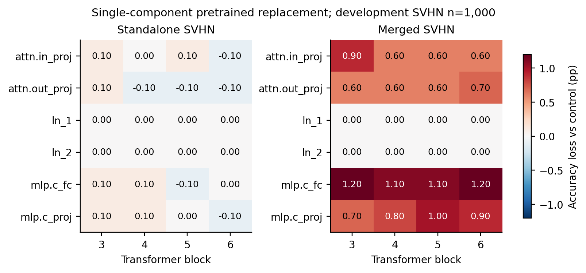
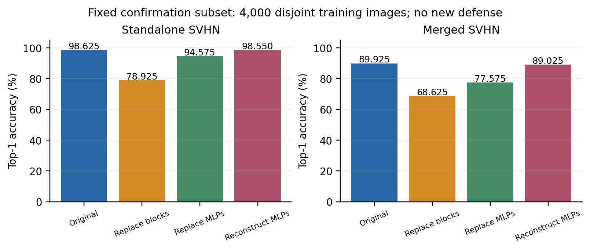
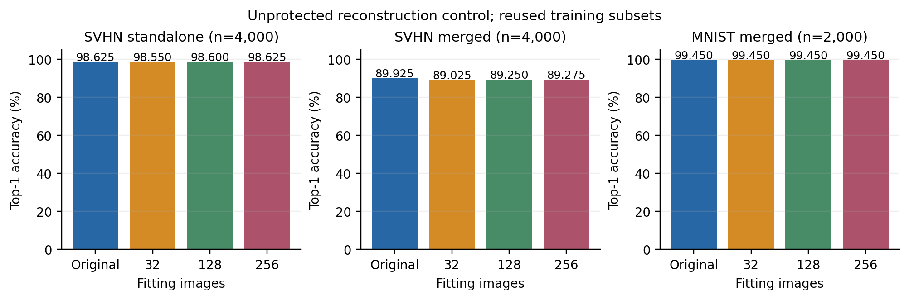
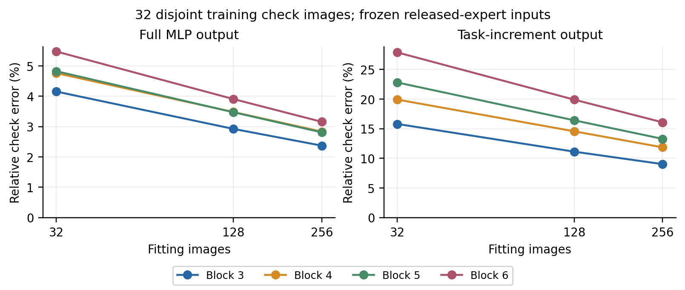

# 中层算子定位与功能重建

本轮不是新防御实验。它检验 SVHN 中层的联合依赖，以及公开 pretrained 隐藏特征能否低成本近似重建这些 MLP。没有发布新保护构造，没有运行官方 test。

## 协议

沿用官方 CLIP ViT-B/32 专家、classification head、作者 TaskVector 和 ImageClassifier/get_logits。定位对象为 SVHN，另一专家为 MNIST，融合系数固定 0.5；block 索引 3–6 从 0 编号。

每块分别替换 QKV、attention output、两处 LayerNorm、MLP FC 和 MLP output，共 24 个单部件对照。再对四块联合替换整块、attention、MLP、LayerNorm，共 4 个对照。替换均取得公开 pretrained 的对应权重及偏置。

主开发图仍为 MNIST 2,000 / SVHN 1,000 张训练图。运行前另固定 4,000 张 SVHN 复核训练图，与父实验全部校准、攻击和开发索引互斥；只评价原专家、联合整块替换、联合 MLP 替换、联合 MLP 重建四项。这些图仍属于原专家训练数据，不能称原训练时的 held-out validation。[配置](operator_diagnostics/protocol.json)、[索引](operator_diagnostics/training_indices.json)。

闭式重建直接复用 `polynomial_probe.reconstruct`，没有复制新的拟合算法。只用父实验 attack 子集前 32 张 SVHN 图，标签不进入拟合。每层 1,600 tokens，固定 pretrained 的第一层及 QuickGELU，拟合第二层和 bias。四层均在冻结的发布专家输入上独立拟合，再共同替换；不是逐层更新后的重拟合。独立局部检查使用互斥的 32 张 defender calibration 图。[拟合和检查](operator_diagnostics/fitting.json)。

拟合者取得未保护、可发布的专家控制模型和 pretrained，没有从另一个秘密原专家读取目标；其余模块保留发布控制模型。本次结果只说明该控制的 MLP 功能可重建，不能宣称重建了整个 block、任意结构保护或完整 MergeBarrier。

## 真实结果

| 四块处理 | SVHN 独立复核准确率 | 融合 SVHN 复核准确率 | 独立净损失 |
|---|---|---|---|
| 原专家 | 3,945 / 4,000 = 98.625% | 3,597 / 4,000 = 89.925% | — |
| 全部换回 pretrained | 3,157 / 4,000 = 78.925% | 2,745 / 4,000 = 68.625% | 19.700 pp |
| 仅 MLP 换回 pretrained | 3,783 / 4,000 = 94.575% | 3,103 / 4,000 = 77.575% | 4.050 pp |
| 用公开隐藏特征重建 MLP | 3,942 / 4,000 = 98.550% | 3,561 / 4,000 = 89.025% | 0.075 pp |

联合 MLP 替换让原本正确的 167 张变错、5 张变对；闭式重建为 5 张变错、2 张变对。融合时重建仍造成净损失 0.900 pp，不能称完全恢复。逐图配对计数、双任务开发结果和比较族 Holm 校正在[结果](operator_diagnostics/results.json)；复核只含 SVHN，没有另做 MNIST 复核。

24 个单部件替换在原 SVHN 开发图上最大独立损失仅 0.10 pp，融合 SVHN 最大损失为 1.20 pp。四块 joint attention 的开发独立损失为 0.70 pp，joint norms 为 0；这些数值不能替代复核或证明模块没有任务作用。





## 重建为何不需要识别原第一层

已有重建令 H=[QuickGELU(XW₁₀ᵀ+b₁₀),1]，A₀ 为 pretrained 输出权重和 bias，T 为发布 MLP 的输出。复用的 anchor-centered ridge 解为：

`A* = A₀ + Hᵀ(HHᵀ + λI)⁻¹(T − HA₀)`。

拟合残差为 `λ(HHᵀ+λI)⁻¹(T−HA₀)`。它没有识别发布专家原 W₁；训练样本上的小残差也不保证泛化，必须同时检查独立输入和任务准确率。这是已有线性代数与原重建代码的说明，不是新定理或攻击创新。

四层独立检查的完整输出相对误差为 4.15%–5.48%，相对于专家减 pretrained 的任务输出增量则为 15.79%–27.87%；不把小训练拟合误差当成精确功能等价。即便有这些残差，本子集上重建仍保留多数任务能力。四次拟合调用共 2.35 s，含激活采集、解方程与拷贝，不含后续独立检查及分类评价，也不是重复计时基准。

## 决策与边界

重要层存在联合依赖，原 W₁ 也并非本重建的识别目标；该控制结果尚不能为“仅换算子表示、隐藏原 W₁”提供安全证据。下一步检查独立数据上的任务增量残差与分类决策 margin 的关系，以及扩展公开特征后是否仍有不能低成本补回的部分；确认缺口后才值得构造保护，并须在真实发布构造上另测恢复。当前没有通过验证的新发布机制，不据此推断所有后处理都不可能。

新增 110 条准确率评价：102 条原开发图评价、8 条互斥 SVHN 复核，均为新测。整个作业 271.38 s，单种子。推理、拟合、原始预测和完整日志在服务器；本地与 GitHub 只保存轻量结果。源码固定于 `0725862`，主入口及复用模块 SHA256 在 [metadata](operator_diagnostics/metadata.json)。[7 项核验](operator_diagnostics/validation.json)包含服务器原始预测指纹与逐图计数审查。

## 扩大恢复预算

10 月 10 日固定 32 / 128 / 256 张无标签图，使用父实验 attack 图的嵌套前缀，四个 MLP 仍在冻结的原发布控制输入上各自拟合。继续固定 pretrained 第一层，未增加隐藏特征，也未选择预算或 ridge 系数。第二层及偏置的闭式参数拟合发生在攻击侧，专家没有梯度训练。

沿用已查看的 4,000 张 SVHN 训练复核图和 2,000 张 MNIST 开发图；它们与拟合图、32 张局部检查图互斥，但不构成新的独立 holdout。本轮全部 12 条评价新测，其中原控制和 32 张图重建共 6 条逐图预测与之前完全一致。[协议](../../../configs/reconstruction_budget.json)、[完整结果](../../2026-10-10/reconstruction_budget/results.json)、[核验](../../2026-10-10/reconstruction_budget/validation.json)。

| 拟合图数 | SVHN 独立正确数 / 4,000 | SVHN 融合正确数 / 4,000 | 融合净损失 | MNIST 融合正确数 / 2,000 |
|---|---:|---:|---:|---:|
| 原控制 | 3,945 | 3,597 | — | 1,989 |
| 32 | 3,942 | 3,561 | 0.900 pp | 1,989 |
| 128 | 3,944 | 3,570 | 0.675 pp | 1,989 |
| 256 | 3,945 | 3,571 | 0.650 pp | 1,989 |

256 张图重建的独立结果是 1 张变错、1 张变对，正确总数相同不等于逐图预测或函数相同。融合结果为 27 张变错、1 张变对；与原控制的配对差异仍可见，Holm 校正 p 为 `2.235e-7`。这是此前已查看的训练诊断数据上的描述，不能据此宣布安全或等价。



### 相同 ridge 目标，较小线性方程

令 `R = T − HA₀`。大预算使用原问题的 primal 解 `ΔA = (HᵀH+λI)⁻¹HᵀR`，与上面的 dual 解代数等价；`λ = 1e-4 × ‖H‖²_F / N` 沿用原公式。32 张图有 1,600 个 token，解 dual；128 / 256 张图有 6,400 / 12,800 个 token，解固定 3,073 维 primal，避免建立随 token 数平方增长的矩阵。所有拟合的正规方程相对残差小于 `1e-8`。

在同样互斥的 32 张局部检查图上，256 张图拟合的完整输出相对误差为 2.37%–3.16%，相对任务输出增量的误差为 9.01%–16.07%；尚未消除。小预算的训练拟合误差更小，但检查误差更大，不能靠训练拟合残差判断恢复程度。[逐层记录](../../2026-10-10/reconstruction_budget/fitting.json)。



新增固定 head 的原始 logits 和真实类别 margin 记录，标签仅用于评价。256 张图重建导致融合变错的图，在原控制上的 margin 中位数为 0.1481；独立变错的那张原 margin 为 0.1975。它们提示当前误差触及决策边界，但不是局部 MLP 残差到分类错误的因果证明。

256 张图的四次拟合调用共 9.46 s，含输入采集、求解、正规方程检查和模型拷贝，不含局部检查和分类评价；整个作业 77.64 s。单次计时，不能当作稳定性能基准。源码为 `82570bd`，来源、原预测、拟合权重与新预测 SHA256 在[元数据](../../2026-10-10/reconstruction_budget/metadata.json)，全部重文件仅在服务器。

预算提高后独立计数损失消失，融合仍有损失。它可能来自固定公开特征的表达限制或融合时的计算变化；本控制没有保护，也没有证据把该残差解释为攻击难度。下一步须定位这两种来源，再决定在哪类任务算子上设计后处理。

```bash
python experiments/operator_diagnostics.py --reconstruction-budget \
  --config configs/reconstruction_budget.json \
  --output outputs/2026-10-10/reconstruction_budget
python experiments/validate_results.py --reconstruction-budget \
  --output outputs/2026-10-10/reconstruction_budget
python experiments/plot_results.py --reconstruction-budget \
  --output outputs/2026-10-10/reconstruction_budget
```
