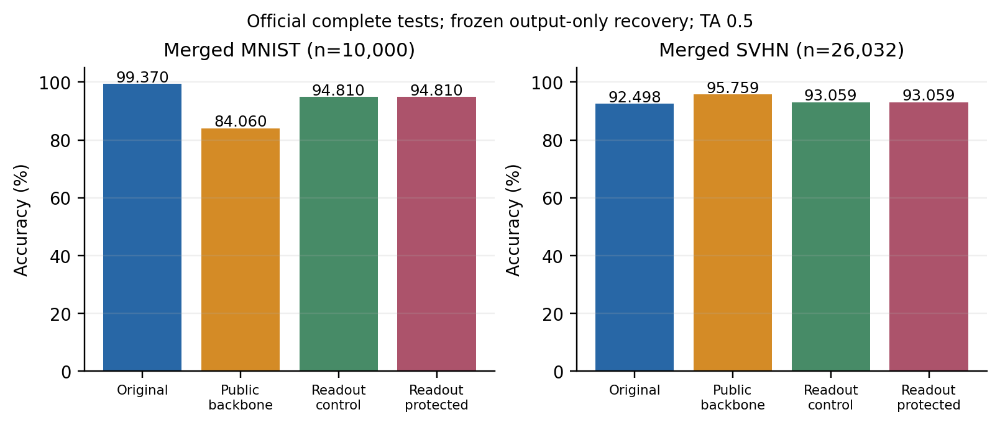

# 替换与分类输出恢复：当前边界

10 月 10 日。目的：判断哪些后处理值得继续，而非把新增攻击称为新防御。保护 MNIST、伙伴 SVHN，双任务 TA 系数 0.5；与八任务 Table 6 分开。

## 1. 完整编辑集合可被一次替换抹去

设后处理 $P_S$ 只改变参数集合 $S$，$R_S$ 把这组参数替换为公开 pretrained。直接有

$$R_S(P_S(\theta))=R_S(\theta).$$

该等式与编辑强度、可逆性、AGA 是否匹配成功无关。前提是攻击者知道或提出覆盖所有编辑的集合 $S$；集合越大，替换的功能代价可能越大。因此要测同种攻击的未保护对照，不能只测保护后结果。

对已冻结的四层 MLP 扰动与输出补偿，同时替换这四个**完整 MLP**，不查询校准图、不拟合参数：

| 官方完整测试 | 同处理未保护 | 同处理保护 |
|---|---:|---:|
| 独立 MNIST | 9,927 / 10,000 = 99.27% | 99.27% |
| 融合 MNIST | 9,807 / 10,000 = 98.07% | 98.07% |
| 融合 SVHN | 24,700 / 26,032 = 94.88% | 94.88% |

两组恢复参数逐元素完全相同，三项预测也逐图完全相同。原未攻击融合 MNIST 为 99.37%；替换有 1.30 pp 的代价，保护编辑没有额外阻碍。[结果](../../2026-10-10/subspace_compensation_mnist_reset/results.json)、[编辑集合审计](../../2026-10-10/subspace_compensation_mnist_reset/support_audit.json)、[原始预测核验](../../2026-10-10/subspace_compensation_mnist_reset/validation.json)。AGA 原文 §4.2 已讨论 pretrained MLP 绕过 MergeBarrier；替换攻击本身不作创新声明。[AGA](https://arxiv.org/html/2606.30360v1)。

## 2. 先测功能依赖，再设计联合保护

未保护专家的 4,000 张固定 MNIST 训练确认子集，与保护校准、攻击拟合及早期开发子集互斥。它不是官方测试，也不是专家训练未见数据。没有新保护、没有参数拟合。

| 替换范围 | 独立 MNIST | 融合 MNIST | 相对原融合下降 |
|---|---:|---:|---:|
| 不替换 | 99.875% | 99.550% | — |
| 全部 12 层 MLP | 98.025% | 95.825% | 3.725 pp |
| 全部 12 层 Attention | 99.825% | 98.750% | 0.800 pp |
| 全部 12 个 block，含 LayerNorm | 46.600% | 85.225% | 14.325 pp |

仅扩大 MLP 或仅保护 Attention 仍留下相当强的替换结果。完整 block 的替换代价较大，是进一步检查联合功能依赖的依据；其中含 LayerNorm，不能将结果归因于 MLP 与 Attention 的相互作用，更没有证明存在可保效用的联合防御。[MLP / Attention](../../2026-10-10/operator_support_mnist/validation.json)、[完整 block](../../2026-10-10/operator_support_mnist_block/validation.json)。

## 3. 只用分类输出，绕过内部表示

攻击者使用公开 pretrained $\theta_0$、已知 SVHN 专家 $\theta_v$，以及发布模型的分类查询。固定公共骨干 $\theta_0+\lambda(\theta_v-\theta_0)$，从每任务 256 张无标签训练图取得其 768 维 CLS 特征 $X$。目标 $Y$ 为两名专家给出的十类 one-hot 预测；攻击不读取保护模型的隐藏激活，不使用保护前 MNIST 参数。保护前模型仅用于同处理对照。

固定 $\rho>0$，求解

$$C=(X^\top X+\rho I)^{-1}X^\top Y.$$

当前两个分类 head 权重恰好完全相同，记为满行秩 $H\in\mathbb R^{10\times512}$，且 bias 为零。令 $R=(HH^\top)^{-1}H$，则 $HR^\top=I$。公共视觉投影 $P_{pub}\in\mathbb R^{768\times512}$ 可替换为

$$P_* =P_{pub}+(C-P_{pub}H^\top)R,\qquad P_*H^\top=C.$$

归一化只引入每图正数缩放，因此保持上述分类 argmax。再选择攻击专家投影

$$P_s=P_0+\frac{P_*-P_0-\lambda(P_v-P_0)}{\lambda},$$

使原作者 TA 在固定 $\lambda=0.5$ 下得到 $P_*$。模型仍为单个原架构 ViT，head 不变；没有 ensemble 或输入路由。攻击专家的独立能力可能差，攻击目标是最终融合模型。

**条件结论。** 若保护前后在这批查询上的分类结果相同，则 $Y'=Y$，拟合系数与攻击参数完全相同，无论保护如何改变内部表示。若有 $m$ 个预测不同，则 $\|Y'-Y\|_F=\sqrt{2m}$，且

$$\|C'-C\|_F\le\frac{\sqrt{2m}}{2\sqrt\rho}.$$

证明：$X$ 的每个奇异值 $\sigma$ 对应增益 $\sigma/(\sigma^2+\rho)\le1/(2\sqrt\rho)$。该界只约束固定公共特征的系数变化。对新输入，仍须结合公共特征与分类 margin；不能直接推出准确率或任意后处理不可能。

对同一数据分布，若原分类错误率为 $\epsilon_0$、保护后至多 $\epsilon_0+\delta$，则预测分歧概率至多 $2\epsilon_0+\delta$，因为两者均正确时预测必相同。它是分布条件下的上界，不是有限校准集的确定分歧数量，也不适用于任意 OOD 查询。

当前固定候选在完整 MNIST 测试上，10,000 张仅有 16 张分类预测改变；原模型和保护模型分别正确 9,969、9,965 张。这里统计了类别是否改变，不能将净少正确 4 张误当成只改变 4 个预测。对应错误率并集上界为 66 张。该统计是冻结结果的事后审计，不用于重新设计保护。[原始预测指纹与计数](../../2026-10-10/subspace_compensation_mnist_test/utility_prediction_audit.json)。

### 固定查询的真实结果

保护前后 512 个教师预测全部相同。4,000 张确认子集上：

| 方法 | 融合 MNIST |
|---|---:|
| 原未保护融合 | 3,982 / 4,000 = 99.550% |
| 公共骨干，无分类拟合 | 3,387 / 4,000 = 84.675% |
| 从未保护输出拟合 | 3,785 / 4,000 = 94.625% |
| 从保护输出拟合 | 3,785 / 4,000 = 94.625% |

后两组逐图预测完全一致。开发 SVHN 为 921 / 1,000 = 92.10%，原融合为 89.50%；尚无新攻击的 SVHN 确认子集结论。该攻击还未恢复原融合 MNIST 的 99.55%，缺口 4.925 pp，不能称完全恢复。攻击专家独立 MNIST 仅 0.75%，不能将它报告为保效用的专家重建。[固定协议](../../2026-10-10/readout_recovery_mnist/protocol.json)、[计数](../../2026-10-10/readout_recovery_mnist/results.json)、[逐图核验](../../2026-10-10/readout_recovery_mnist/validation.json)。

冻结这两组已保存的投影，**不重新拟合、不按测试调参**，完整官方测试得到：

| 完整测试 | 原未保护融合 | 仅公共骨干 | 分类输出恢复，未保护与保护相同 |
|---|---:|---:|---:|
| MNIST，10,000 张 | 99.37% | 84.06% | 9,481 / 10,000 = 94.81% |
| SVHN，26,032 张 | 92.50% | 95.76% | 24,225 / 26,032 = 93.06% |

两组恢复的全部三项逐图预测相同。攻击专家独立 MNIST 为 95 / 10,000 = 0.95%；最终融合 MNIST 距原融合仍低 4.56 pp。这一缺口反映当前公共骨干与小样本拟合的能力，不能归为保护导致的额外下降。[完整计数](../../2026-10-10/readout_recovery_mnist_test/results.json)、[冻结参数与原始预测核验](../../2026-10-10/readout_recovery_mnist_test/validation.json)。

分类蒸馏、公开表示上的线性拟合及最小二乘已有基础。该构造用于区分参数恢复与功能回收，不作原创算法声明。[知识蒸馏](https://arxiv.org/abs/1503.02531)、[CLIP 表示](https://arxiv.org/abs/2103.00020)、[PLeaS](https://arxiv.org/html/2407.02447v2)。它不是原 AGA，也不是完整 SLOA 或 ProDistill 复现；只覆盖已知伙伴、相同 head、当前数据预算和公共骨干容量。

## 4. 下一步只保留可检验的问题

NUFILT 的条件性子空间理论支持研究“本任务小响应、融合大响应”，但没有保证防御不被整体替换或功能回收。当前四层机制停止扩大网格；仅增大扰动、继续改补偿或隐藏对应关系均未解决上述反例。

待研究的是：在已有专家中，能否通过免梯度、明确标注校准的**联合不可逆重表示**，使分类能力依赖于不宜整体删除的非线性计算，并保住独立效用；其恢复成本必须用公开特征、功能拟合和原 AGA 实测。这是待证假设，尚无新机制或成功结果。完整 block 替换的功能代价提供了一个必要条件，但不足以证明防御可行。任何保持查询分类结果的候选都应先接受同一分类输出恢复基线，不能用内部表示改变解释安全性。

[Trap²](https://proceedings.mlr.press/v306/jang26e.html)已研究通过训练塑造缩放敏感性，并评估数据驱动恢复；我们的约束是既有专家无需额外微调，不能直接采用它，也不能把“融合触发干扰”本身当作未被研究的新想法。[阅读边界](reading_update.md)。
