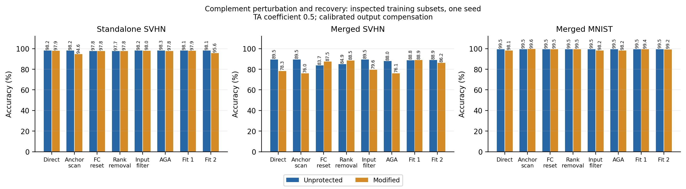

# 当前研究简报

**10 月 10 日：子空间外扰动加闭式响应补偿首次通过独立效用和直接融合门槛，但被一轮闭式功能重建攻破，目前仍无有效保护。**

目标：对已微调专家做发布前后处理，保原任务能力，抵抗未经授权的融合及自适应恢复。4090 上完成了本轮真实实验；原环境与已有成果保留，重文件只放服务器。

## 本轮具体机制与结果

依据 NUFILT 的任务增量 SVD，在 SVHN 中层四个 MLP 的任务代理补空间加入 rank-16 扰动，用原专家与已知 MNIST 融合输入的响应差选方向。小扰动最多使融合 SVHN 下降 1.6 pp；强扰动虽干扰融合，却损失独立能力 12.8 pp。随后只固定一个强度，用闭式岭回归补偿输出层，没有额外专家微调，但使用 256 张无标签图进行参数拟合。

CLIP ViT-B/32，TA 系数 0.5。固定 SVHN 1,000 / MNIST 2,000 张已查看过的训练开发图片；单种子，不能作为官方测试或泛化安全结论。

| 处理 | 独立 SVHN | 融合 SVHN | 融合 MNIST |
|---|---:|---:|---:|
| 未保护 | 98.2% | 89.5% | 99.45% |
| 扰动加响应补偿 | 97.9% | 78.3% | 98.10% |
| 补偿模型，经原 AGA | 97.8% | 76.1% | 98.20% |
| 补偿模型，第一投影换回 pretrained | 97.8% | 87.5% | 99.45% |
| 补偿模型，删除更新前 16 个谱成分 | 97.8% | 88.5% | 99.50% |
| 补偿模型，一轮公开特征功能重建 | 97.9% | 88.9% | 99.40% |

独立损失 0.3 pp、直接融合下降 11.2 pp；但功能重建已恢复至 88.9%，与相同攻击未保护模型的 88.8% 相近。原 AGA 失败不构成保护成立。恢复侧仅使用公开 pretrained、发布模型与独立校准图，未使用保护前专家或保护方向。[机制、条件证明、全部匹配对照及失败记录](subspace_interference_notes.md)。

## 为什么失败，接下来研究什么

“处于任务子空间外”不等于“不可恢复”。已知真实任务投影时，外扰动可被直接投影掉；输出空间耦合也可能被连同少量任务谱成分一起删除。未经响应补偿的强扰动中，谱清理后的逐图预测与同种攻击未保护模型一致。补偿保持了可预测功能，使攻击者仍能在公开特征中重新拟合，而不必恢复原参数。

因此停止增加同一扰动强度的网格。下一步的机制须同时说明保效用依据，以及攻击者做投影、替换和功能重建后，干扰为何仍留在融合路径。当前尚无通过检验的替代构造。[此前功能重建对照](reconstruction_notes.md)与[首次完整测试的失败保护](followup.md)保留。

## 文献与复现

NUFILT 给出任务增量与表示子空间的条件性联系，完整方法含 LoRA 优化；本轮只复用作者 SVD，没有把补空间处理当创新。[理论与代理核查](nufilt_notes.md)。新读 SLOA 的顺序算子匹配、MergeGuard 的两阶段保护及 HDRQ 的融合友好量化：分别提示功能恢复、更窄的训练约束和不可逆编辑仍可融合的风险。原论文、PaRaMS、MergeLock、MergeBarrier 与 AGA 继续作为主线。[原文与适用边界](reading_update.md)。

八任务复现继续：八个 Task Arithmetic 官方专家及全部 head 共 17 个文件已核验，Cars 数据也已补齐。八专家按作者代码系数 0.2 融合，在六个就绪完整测试集上完成评估；逐图计数已验证，但结果与 Table 6 尚有差异。作者原始入口复算 DTD / RESISC45 得到完全相同计数，当前不能归因于评估封装。SUN397 第 1 划分已核验，图片流式准备已启动；仍缺完整图片核验与 EuroSAT 原随机索引，不能填八任务均值或声称原表复现完成。[具体计数、论文差异与来源](../eight_task/status.md)。

本轮结果、源码版本、逐图计数、拟合残差与图表均可追溯。新增官方测试仅用于未保护资源和融合检查；保护候选仍停留在开发集，不声称创新性或有效防御。
