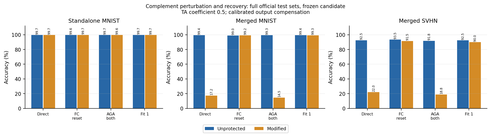

# 当前研究简报

**10 月 10 日：MNIST 后处理保住了独立能力，能干扰直接融合和原 AGA，但完整模块替换及功能恢复仍能绕过。目前没有抗强恢复的新防御。SUN397 数据已核验就绪，八任务复现继续。**

目标：对已微调专家做发布前后处理，保原任务能力，抵抗未经授权的融合及自适应恢复。当前重点是导师提出的任务子空间思路，八任务复现同步继续。

## 最新真实结果

保护 MNIST，伙伴为 SVHN；CLIP ViT-B/32，双任务 TA 系数 0.5。MNIST 官方测试 10,000 张、SVHN 官方测试 26,032 张。候选在开发阶段固定，测试时直接加载保存的保护参数，没有重做保护或按测试结果调参。

独立 MNIST：**99.69% → 99.65%，损失 0.04 个百分点**。以下每项恢复均有同处理的未保护对照；原 AGA 使用作者函数，对两名专家均执行。

| 处理 | 同处理未保护：融合 MNIST | 保护后：融合 MNIST | 保护后：融合 SVHN |
|---|---:|---:|---:|
| 直接融合 | 99.37% | 17.24% | 22.02% |
| 原 AGA，处理两名专家 | 99.32% | 14.47% | 18.83% |
| 四层第一投影换回 pretrained | 99.04% | 99.25% | 91.54% |
| 一轮公开特征功能重建 | 99.38% | 99.29% | 89.98% |
| 四层完整 MLP 换回 pretrained | 98.07% | 98.07% | 94.88% |
| 仅用分类输出恢复，额外攻击 | 94.81% | 94.81% | 93.06% |

直接融合 MNIST 下降 82.13 个百分点；AGA 后仍下降 84.85 个百分点。但第一投影替换和一轮重建已恢复 MNIST 的可融合能力，不能称稳健防御。完整 MLP 替换后，两组恢复参数与逐图预测完全相同；这一点与扰动强度无关。

[原 AGA 与功能重建](../../2026-10-10/subspace_compensation_mnist_test/validation.json)、[完整 MLP 替换](../../2026-10-10/subspace_compensation_mnist_reset/validation.json)、[分类输出恢复完整测试](../../2026-10-10/readout_recovery_mnist_test/validation.json)。所有预测计数已在服务器核验；原始预测和保护参数仅保存在服务器。

## 机制与导师思路的对应

用任务增量 SVD 建立 rank-128 的任务代理，在其补空间添加 rank-16 扰动；再用 256 张无标签 MNIST 训练图，闭式拟合四层输出投影以补偿独立响应。没有梯度微调，**有校准数据和输出层参数拟合**。第一投影满足代理空间内的线性映射约束，输出补偿会改变参数；不声称所有任务空间内参数完全不变，效用以实际测试为准。

NUFILT 提供条件性子空间联系，导师举的“16 维”是直观例子；本实验没有假定所有层都存在精确的 16 维任务空间。小独立响应与大融合响应的差别在 MNIST 上比先前 SVHN 方向明显，结果支持继续研究这种分离。SVD、补空间编辑和岭回归已有前作，当前不作原创机制声明。[数学、两个任务方向和失败边界](subspace_interference_notes.md)、[NUFILT 原文核对](nufilt_notes.md)。

## 本轮收紧的问题

分类输出恢复只查询每任务 256 张无标签训练图，不读取保护模型隐藏激活，闭式拟合公开骨干的最终投影。固定恢复参数在完整测试上得到 MNIST 94.81%、SVHN 93.06%；保护与同处理未保护预测逐图一致。它距离原融合 MNIST 99.37% 仍低 4.56 pp，是部分恢复。攻击专家自身独立 MNIST 仅 0.95%，因此不能称保效用的专家重建；最终融合仍为单个原架构 ViT，原分类 head 不变。

固定 4,000 张训练确认图上，单独替换全部 MLP 或 Attention 后，融合 MNIST 仍为 95.83%、98.75%；同时替换 Attention＋MLP、保留 LayerNorm 时降至 85.20%。新增 LayerNorm 单独替换对照仍为 99.55%，说明前述下降主要涉及两类模块共同被删除。这是联合依赖的依据，尚无新防御；这些已查看训练子集结果不混入完整测试表。

已检验一个有明确等式的构造：删除可替代的 Attention 任务更新，再加载原冻结保护参数。完整 MLP 替换后融合降至 85.20%，但独立 MNIST 损失 0.75 pp，四层 FC 替换仍恢复到 98.40%。候选已按预定门槛淘汰，未追加 AGA、重建或调参，不能把其中较好的单项攻击结果称为突破。[构造、全部对照与失败原因](recovery_boundary_notes.md)。

下一步是检查已有专家中不宜整体删除的非线性功能，能否通过免梯度的联合不可逆重表示保护，同时接受分类输出恢复。保持查询分类结果时，上述固定公共特征攻击完全不依赖保护内部参数；只改参数对应关系不足以解决它。当前四层方案停止增加强度或扩大网格。[条件性数学论证、协议与失败边界](recovery_boundary_notes.md)。

极小性能损失的方向也没有直接成立：固定线性恢复中，单个查询分类改变的最坏确认准确率为 93.00%，比原恢复下降 1.625 pp。这个诊断使用已知查询和确认真值，尚未构成满足独立效用要求的发布后处理；不能以理论界无法证明稳定为由宣称防御成功。

## 文献与八任务复现

PaRaMS、MergeBarrier、MergeLock 与 AGA 是保护和恢复的主线；NUFILT 提供有条件的任务子空间依据。PLeaS、SLOA、知识蒸馏用于核查功能恢复已有方法。新增核查 ICML 2026 的 Trap²：它通过梯度训练塑造缩放敏感性，并测试数据驱动恢复，不直接满足已有专家无需额外微调的约束。当前没有机制原创性结论。[原文阅读及适用边界](reading_update.md)。

八任务复现：17 个官方 checkpoint 已核验，七个完整测试集的未保护基线已完成；SUN397 完整归档哈希与第 1 划分 39,700 张图片覆盖核验通过，专家准确率 75.28%、八专家融合准确率 63.76%。EuroSAT 原随机划分仍未取得，现有基线与原表也有差异，不能报告八任务均值或原表复现成功。双任务系数 0.5 的结果不能填进八任务系数 0.2 的 Table 6。[复现状态与真实计数](../eight_task/status.md)。
