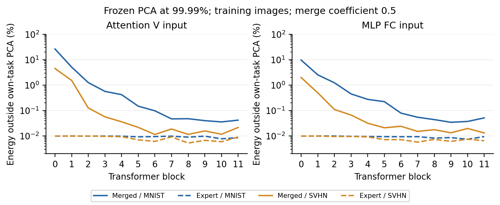

# 当前研究简报

**目前仍未得到有效的免微调保护。新增多层补空间删除与反射，在 MNIST、SVHN 两种保护对象上均未通过筛选；停止继续扩大这批配置。**

目标保持不变：保护已微调专家的独立任务能力，并抵抗直接融合和自适应恢复。以下严格区分完整测试结果与开发筛选。

## 先前完整测试

保护 MNIST，CLIP ViT-B/32，与 SVHN 作系数 0.5 的 Task Arithmetic；MNIST / SVHN 均评价官方完整 test。原 MNIST 独立性能为 99.69%。

| 配置 | 保护后独立 MNIST | 直接融合 MNIST / SVHN | 无数据公开锚点替换后融合 |
|---|---|---|---|
| 第一层 V，随机补空间扰动 | 99.70 | 8.92 / 10.22 | 99.38 / 92.52 |
| 第一层 FC，随机补空间扰动 | 99.67 | 99.30 / 18.94 | 99.37 / 92.53 |

V 版本也被原 AGA 恢复至 99.29 / 92.47；FC 版本限制原 AGA，但独立校准或无数据矩阵替换仍可恢复。因此当前构造未形成有效防御。[首次实测](subspace_initial.md)；[成分分解与恢复对照](followup.md)。

## 本轮开发筛选

将随机大噪声改为补空间删除或范数保持的反射；分别编辑前四层 FC、全部 FC、全部 V+FC，保留 99% 或 99.99% 激活方差。每个保护对象 12 个配置；256 张本任务训练图作无标签校准，使用与校准互斥的 MNIST 2,000 / SVHN 1,000 张训练图作开发评价。

| 保护对象 | 独立效用损失 ≤0.5 pp | 效用合格时，直接融合目标任务最大下降 | 通过恢复筛选 |
|---|---|---|---|
| MNIST | 10 / 12 | 0.10 pp | 0 / 12 |
| SVHN | 11 / 12 | 0.00 pp | 0 / 12 |

以 MNIST 的四层 FC、99% 反射为例：独立性能 99.85%，融合 MNIST 99.45% 与未保护相同，SVHN 从 89.50% 降至 80.50%；角度清理后融合为 99.30% / 89.70%。平均性能下降不能单独证明受保护任务知识不可融合。

角度清理在与 pretrained 的 cosine 小于预先固定的 0.9 时替换矩阵和偏置，不使用数据、扰动位置或保护基。原记录扫描 49 个参数名匹配项；下述审计修正为 49 个实际使用的视觉矩阵，并核对攻击结果。范数扫描在全部 24 个配置上均无触发，但方向差异仍可暴露编辑。保护 SVHN 时，角度清理有时反而伤害 SVHN；攻击者可选择直接融合，当前这些配置已经不能抑制它。

本轮开发门槛同时要求直接融合和清理后，受保护任务及双任务均值各下降至少 5 pp；这是继续实验的筛选标准，不是安全定理。没有配置通过，因此未运行本轮官方最终测试，也未追加 AGA / 校准补全的最终测试。[数学、协议与全部记录](bounded_notes.md)。

扫描审计修正了旧入口的范围描述：排除未使用的词嵌入、补入最终视觉投影。24 个候选的替换决定与攻击模型完整状态均保持相同，本轮计数及结论不变。[核对记录](scope_audit/validation.json)。

## 失败原因查得更清楚了

逐个将 V / FC 矩阵换回 pretrained，两种专家的开发效用损失均不超过 0.10 pp；逐个替换整块，MNIST 最大损失 0.10 pp，SVHN 为 0.80 pp。这是单部件替换，不能推广为同时替换全部部件无损。同一开发子集上，pretrained 的 MNIST / SVHN 为 48.65% / 30.00%，专家为 99.75% / 98.20%。

冻结本任务 PCA 后，第一层 V 输入的融合补空间能量为 MNIST 26.27%、SVHN 4.50%；保留 99.99% 方差分别需要 159、280 维。这支持两个保护对象的分布变化与可编辑自由度不同，但不能由输入能量直接推出分类结果。[96 条诊断与核验](distribution_shift/validation.json)。

## 文献、下一步与复现

本轮补查 PACT v3 的 pretrained 重要成分、任务更新过滤及因果消融；Spectral Rewiring v1 的 pretrained 谱投影与适用限制。它们改善融合，提醒我们“不可逆编辑”也可能保留可融合能力。本轮没有复现两篇完整方法，也未验证它们能攻击本项目。[阅读范围与原文链接](reading_update.md)。

下一步优先检查 SVHN 第 3–6 块：本轮逐块替换的开发损失为 0.60 / 0.80 / 0.80 / 0.60 pp，较其他位置敏感。进一步定位块内功能依赖，再检验免微调的局部算子重表示及恢复成本。必须同时测效用、部署代价、局部替换和闭式功能拟合；已有 Taylor / 多项式失败记录继续保留。该定位仍限于单个开发子集，现阶段尚无通过验证的新构造，不将研究问题当作创新成果。

八任务复现继续：RESISC45 数据与完整测试入口已补齐；21:46 重试后，六个官方专家仍受 Drive 下载限制，未用不同微调配置的权重替代。[资源状态](../eight_task/status.md)。

本轮新增 319 条开发准确率评价，另明确复用 5 条先前计数；96 条输入统计不是准确率或独立重复。两组筛选耗时 422.84 s、364.84 s，含加载、诊断及评价；仍为单种子。开发图未从原专家训练中留出，这限制了效用估计。代码与轻量结果同步 GitHub；数据、模型、PCA 基和完整日志只保存在服务器。
