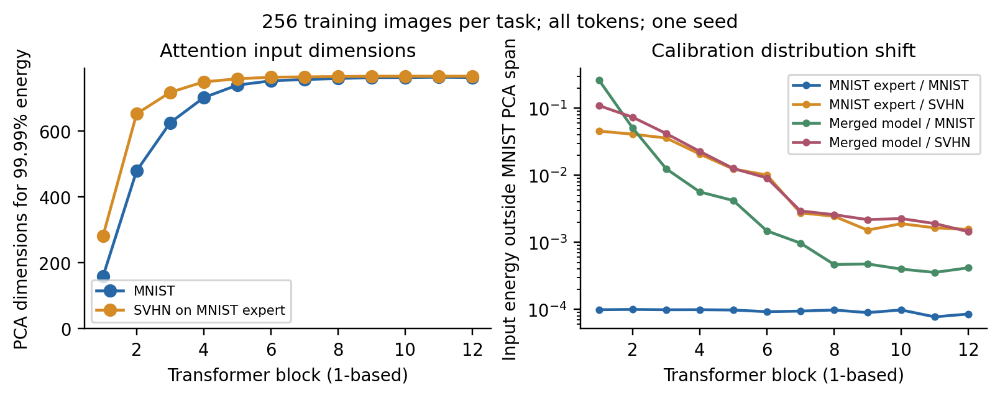
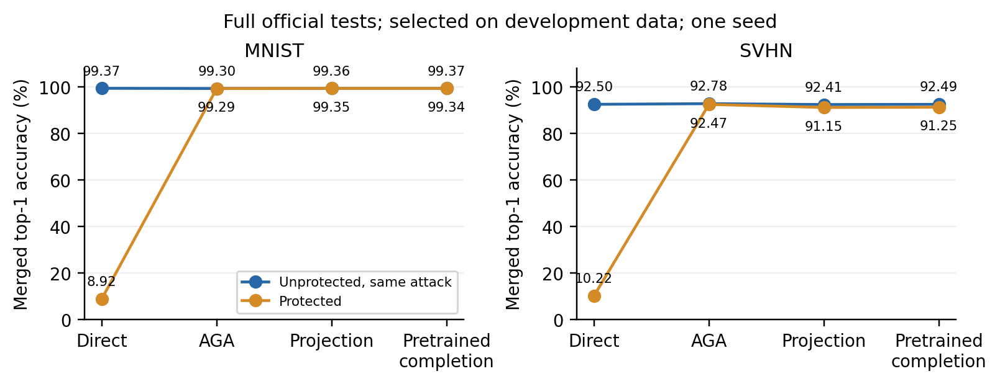

# 组会后实验：任务补空间扰动

**在当前配置下，保住 MNIST 单独性能并破坏直接融合可以做到；但原 AGA 仍可恢复，尚未得到有效的抗恢复防御。** 这次独立验证了导师提出的机制，不能把组会前的压缩失败当作该机制失败。

## 做了什么

官方 CLIP ViT-B/32，保护 MNIST 专家，与原 SVHN 专家作系数 0.5 的 Task Arithmetic。原专家没有额外微调。使用 256 张真实 MNIST 训练图片，采集全部 token 的线性输入、中心化 PCA，仅在主子空间补空间中加随机参数扰动，并补偿偏置。不叠加旋转、置换或压缩。

预先固定第一 / 最后一层的 Attention V、MLP 第一线性层，以及四档强度，共 16 个配置。保护校准、开发选择、攻击校准的训练图片互斥；不使用官方测试集选参数。开发子集并非原专家训练时的 held-out validation，这是一项限制。[完整协议与数学条件](review.md)。

## 低维假设的实测

第一层 Attention 输入维数为 768。MNIST 前 16 个主方向覆盖 93.97% 方差；保留 99.99% 需要 159 维，相应补空间为 609 维。SVHN 在同一 MNIST 专家上的激活需要 282 维；到最后一层，MNIST 已需要 762 维。这里测量的是特定层、特定 token 统计下的有效维数，不是图像任务的内在维数，也不能说“MNIST 就是 16 维”。

以同一 MNIST 校准均值和 PCA 基为参照，第一层原 MNIST 专家处理 MNIST 的补空间能量占比为 0.0099%；未保护融合模型处理 MNIST 时为 26.27%，处理 SVHN 时为 10.95%。这支持融合会改变输入分布、激活原先低活跃方向的解释；尚未完成因果分解。

## 完整测试

开发集选出第一层 V、扰动范数为原 V 参数范数 100 倍的配置；开发 MNIST 独立性能未下降。大参数范数不是安全保证，也不代表可直接推广到其他模型。

官方完整 MNIST 测试：原专家 **9,969 / 10,000（99.69%）**，保护后 **9,970 / 10,000（99.70%）**。一个样本的差别不解释为显著改善。

下表均为融合后的准确率（%）。右侧攻击与左侧未保护对照使用相同规则；第二专家保持原始 SVHN。

| 融合 / 恢复 | 未保护 MNIST / SVHN | 保护 MNIST / SVHN |
|---|---|---|
| 直接融合 | 99.37 / 92.50 | **8.92 / 10.22** |
| 原 AGA | 99.30 / 92.78 | **99.29 / 92.47** |
| 独立校准补空间投影 | 99.36 / 92.41 | 99.35 / 91.15 |
| 独立校准 pretrained 补全 | 99.37 / 92.49 | 99.34 / 91.25 |

AGA 不使用数据；两项投影攻击使用另外 256 张真实 MNIST 训练图片，从发布模型重估 PCA，不取得保护基、随机矩阵或原专家。攻击后的保护模型独立 MNIST 均为 99.67%。投影后的 SVHN 还有约 1.2 pp 损失，但 AGA 已恢复到接近基线，因此当前配置不能计作抗恢复成功。

## 为什么随机加噪声仍可能被 AGA 绕过

AGA 不必找回保护随机矩阵。对其线性拟合目标 X T≈Y，理想最小二乘输出为 XX⁺Y，即把 pretrained 参数投影到发布参数的列空间；该投影的 Frobenius 范数不超过 ‖Y‖F。所以把参数范数放大 100 倍，并不意味着恢复后的参数仍保持同样扰动规模。这个局部解释不能单独推出分类准确率，本次完整测试实际确认了恢复有效。

独立数据估计主子空间后，攻击者还可将发布参数的补空间部分删除或换为 pretrained，并补偿均值。这两项更直接的清理同样恢复了大部分融合能力。

## 保留记录与下一步

- 本次单种子、双任务，耗时 538.14 s，包含模型加载、诊断、开发筛选和完整测试，不能当作保护或攻击单独耗时。51 条开发评价、24 条完整测试评价，7 项结果核验通过。
- [所有 16 个配置，包括 3 个效用超预算配置](subspace_probe/development_screen.json)、[原始正确计数](subspace_probe/results.json)、[子空间诊断](subspace_probe/subspaces.json)、[选择记录](subspace_probe/selection.json)、[核验](subspace_probe/validation.json)。权重、PCA 基、数据与完整日志仅在服务器。
- 下一步先量化 AGA 前后参数与块输出的变化，并区分真实任务补空间和 LayerNorm 公开空方向的作用；再提出对恢复目标有针对性的构造，不继续单纯放大随机噪声。零空间投影已有前作，当前不宣称创新或强防御。
- 八任务原论文复现继续独立推进。六个官方专家仍缺失；DTD、GTSRB 推理入口及 RESISC45 官方索引已核验。[资源状态](../eight_task/status.md)。

前作依据和本文差异：[AlphaEdit / X-Edit 原文核查](review.md#前作核查)。
