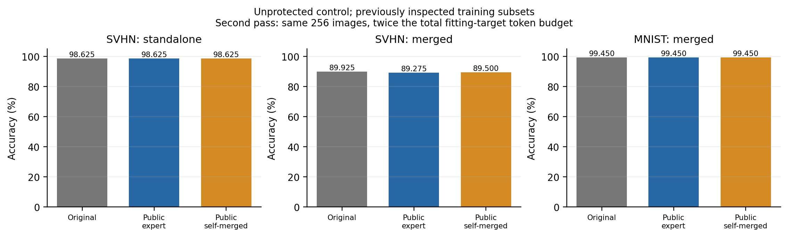

# 当前研究简报

**目前仍未得到有效的免微调保护。新完成的恢复对照进一步缩小了融合残差，没有形成防御成果。**

目标：对已微调专家施加发布前后处理，保持独立任务能力，抵抗直接融合及自适应恢复。模型、数据和原始记录只放服务器，本地保存轻量结果。

## 当前最有用的发现

CLIP ViT-B/32，保护研究对象为 SVHN，与 MNIST 作系数 0.5 的 Task Arithmetic。下面评价固定、已经查看过的 SVHN 4,000 / MNIST 2,000 张训练子集；不是新验证集或官方 test。

| 四层 MLP 的处理 | 独立 SVHN | 融合 SVHN | 融合 MNIST |
|---|---|---|---|
| 原专家 | 98.625% | 89.925% | 99.450% |
| 公开特征，32 张无标签图重建 | 98.550% | 89.025% | 99.450% |
| 公开特征，256 张图重建 | 98.625% | 89.275% | 99.450% |
| 公开特征，改在原融合输入上拟合 | 98.625% | 89.500% | 99.450% |
| 发布控制模型特征，原专家或融合输入 | 98.625% | 89.925% | 99.450% |
| 公开特征，第二轮使用自己融合后的输入 | 98.625% | 89.500% | 99.450% |

第二轮无需原融合模型输入；仍使用那 256 张图，但累计拟合目标 token 调用预算翻倍。相对第一轮，融合 SVHN 有 10 张变对、1 张变错，净增 9 张；相对原模型仍净损失 0.425 pp。独立正确总数相同，但相对原专家有 1 张变错、1 张变对。

本轮实际做了两组对照，新增 4 个重建配置。每个配置测独立 SVHN、融合 SVHN、融合 MNIST 三项准确率，因此有 12 项新增配置结果；另有 12 次旧基线重测，用于核对逐图预测。这里的“准确率测量”就是让模型预测固定图片、对照真实标签计算正确比例，测量次数不代表方法数或独立实验数。**这些都在未保护发布模型上进行，不能称新防御被攻破或任务信息不可恢复。**使用发布特征的结果是诊断正对照；真正改变表示的保护未必向攻击者提供这些特征。[数学、成本与全部记录](reconstruction_notes.md)；[此前预算和算子定位](operator_notes.md)。

## 已淘汰的保护

首次真实完整测试：保护 MNIST，官方 MNIST / SVHN test，原 MNIST 独立准确率 99.69%。

| 后处理 | 独立 MNIST | 直接融合 MNIST / SVHN | 公开锚点替换后融合 |
|---|---|---|---|
| 第一层 V 随机补空间扰动 | 99.70% | 8.92% / 10.22% | 99.38% / 92.52% |
| 第一层 FC 随机补空间扰动 | 99.67% | 99.30% / 18.94% | 99.37% / 92.53% |

V 版本也被原 AGA 恢复至 99.29% / 92.47%；FC 版本限制了原 AGA，但未挡住廉价替换或独立校准。当前构造未形成有效防御。[首次实测](subspace_initial.md)；[恢复与成分对照](followup.md)。

随后筛选补空间删除、范数保持反射：两种保护对象各 12 个配置。MNIST 有 10 个、SVHN 有 11 个满足独立损失 ≤0.5 pp，但效用合格配置对受保护任务的直接融合最大下降分别只有 0.10 pp、0.00 pp；没有配置通过直接融合与恢复门槛。24 个配置已淘汰，没有新增官方最终测试。[全部失败记录和数学](bounded_notes.md)；[视觉矩阵扫描审计](scope_audit/validation.json)。

SVHN 中层 block 3–6 存在联合依赖：整块换回 pretrained，独立 / 融合 SVHN 为 78.925% / 68.625%；只替换 MLP 为 94.575% / 77.575%。不过上表显示其 MLP 功能可低成本近似重建，联合替换的损失本身不是安全依据。

## 论文依据

原论文、PaRaMS、MergeLock、MergeBarrier 和 AGA 的方法与恢复边界继续作为主线。补读内容与实际采用部分分别记录，不把论文结果计作我们的实验。

NUFILT 与老师的低维提示高度吻合，转写仍不能确认论文名。其完整方法优化 LoRA，不是完整免训练方法；我们只复用任务向量 SVD 作诊断。第一层 V 的 128 维代理外，虽有 MNIST 38.12%、SVHN 48.28% 的输入能量，线性任务增量响应能量仅为 0.0111%、0.1064%。输入能量不能代替任务响应，两者也都不是准确率。[原文、理论与两轮统计](nufilt_notes.md)。

PACT、Spectral Rewiring 提醒我们：不可逆编辑也可能保留可融合能力。Gradient Immunity 依赖保护组件不可廉价移除，不能直接迁移到允许结构修改的白盒攻击。PLeaS 已有层级最小二乘拟合；本轮功能重建用于加严对照，不作为原创保护。[阅读范围与原文](reading_update.md)。

## 下一步与八任务复现

新构造的判断标准更明确了：既要保独立能力，也要面对攻击者在其自行构建的融合输入上重建发布功能。只改变参数对应关系、结构格式或留下小幅重建残差，证据不足。当前没有通过检验的新构造，失败方向和真实记录继续保留。

八任务复现继续。RESISC45 图片、原索引与完整测试入口已核验；DTD、GTSRB 入口也已检查。10 月 10 日 01:01 重试后，六个官方专家仍受 Drive 配额限制，已有 11 个文件通过指纹检查，未用不同微调配置的权重填补。EuroSAT 原划分等数据缺项仍待解决。[资源状态和运行入口](../eight_task/status.md)。

本轮代码、图表、元数据与逐图计数核验同步 GitHub；拟合权重、冻结输入、原始 logits/预测和完整日志留在服务器。全部新增结果来自单种子训练子集诊断，尚无新的官方测试结论。
