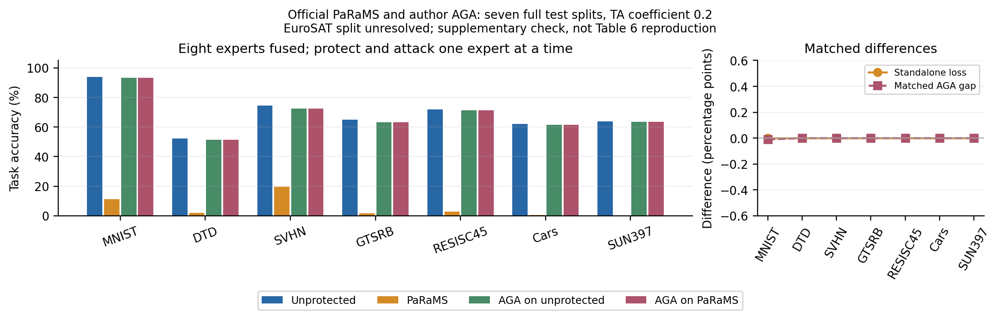

# PaRaMS 与原作者 AGA：七任务完整测试

每次只保护并恢复一个专家，融合始终包含八专家，TA 系数固定 0.2。所有数值为该受保护任务准确率（%），不计算缺 EuroSAT 的八任务均值。

| 任务 | 测试图数 | 未保护融合 | PaRaMS 融合 | AGA 未保护对照 | AGA 后 PaRaMS |
|---|---|---|---|---|---|
| MNIST | 10000 | 94.00 | 11.35 | 93.23 | 93.24 |
| DTD | 1880 | 52.18 | 2.07 | 51.38 | 51.38 |
| SVHN | 26032 | 74.42 | 19.59 | 72.53 | 72.53 |
| GTSRB | 12630 | 65.08 | 1.82 | 63.29 | 63.29 |
| RESISC45 | 6300 | 72.00 | 2.92 | 71.46 | 71.46 |
| Cars | 8041 | 62.06 | 0.57 | 61.61 | 61.61 |
| SUN397 | 19850 | 63.76 | 0.34 | 63.56 | 63.56 |

七任务保护前后的独立分类预测逐图相同。AGA 后融合预测差异：MNIST 1 张，其余 6 任务逐图相同。七任务恢复后准确率均不低于匹配未保护对照；本配置未抵抗 AGA。

PaRaMS 使用官方实现、一轮独立置换组 assignment 和既定 Attention 缩放。AGA 调用作者完整 Attention 入口后调用 MLP 入口；未保护组接受同样恢复。无校准或测试调参，原始预测与保护权重仅保存在服务器。

这是补充复现对照。PaRaMS 不是 AGA Table 6 中的防御方法；EuroSAT 原划分、论文精确权重及 Table 6 防御配置仍未对齐。

[逐图核验](validation.json)、[全部计数](results.csv)、[冻结协议](protocol.json)、[源码与输入指纹](metadata.json)。

