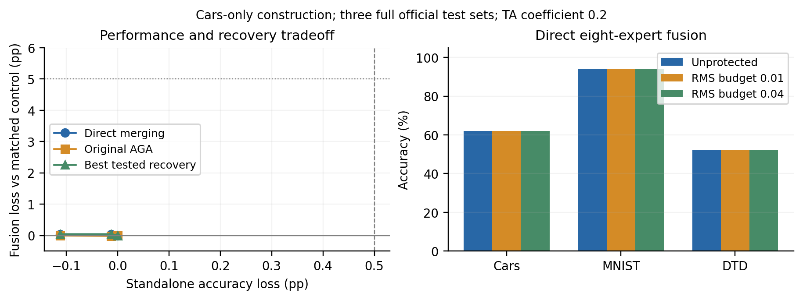

# Cars 跨模块功能敏感性检验

**结论：两个固定幅度保留了独立性能，却没有产生融合防御。停止当前 24 方向构造，不再调整其幅度。**两个点都满足性能目标，淘汰依据是无融合干扰。

构造只用 Cars 目标专家、公开预训练模型及 128 张未标注训练图片，排除之前定位和响应迁移使用过的图片。无梯度微调、无响应拟合。Attention／MLP 共 24 个模块任务向量，闭式求功能敏感性对比最大的联合方向；两个特征 RMS 预算事先固定为 0.01、0.04。公式、文献边界及冻结协议见[实验协议](../functional_contrast_protocol.md)。模块任务向量缩放和广义特征值分析不是本项目的新发明。

## 完整测试结果

独立性能在 Cars 8041 张官方测试图片上评价。八专家 TA 系数固定为 0.2，伙伴仅在发布权重冻结后加载；AGA 只攻击所发布的 Cars 专家。表内均为 Cars 准确率，单位 %。

| 构造 | 独立 | 直接融合 | 原版 AGA 后融合 | Attention 替换 | MLP 替换 | 联合替换 |
|---|---:|---:|---:|---:|---:|---:|
| 未保护 | 77.6645 | 62.0570 | 61.6093 | 59.2588 | 58.5126 | 55.5279 |
| 预算 0.01 | 77.7764 | 62.0196 | 61.6093 | 59.2712 | 58.5251 | 55.5279 |
| 预算 0.04 | 77.6769 | 62.0196 | 61.6217 | 59.2712 | 58.6121 | 55.5279 |

两点直接融合都是 4987/8041，未保护为 4990/8041，仅净少 3 张，下降 **0.0373 pp**。AGA 后分别为 4954、4955 张，未保护同条件为 4954 张；没有额外防御收益。独立损失分别为 −0.1119、−0.0124 pp，这些小幅计数变化不能解释为确定的性能改进。最有利的已测攻击都是不攻击，仍达到 62.0196%。

跨任务也未出现干扰：直接融合的 MNIST 为 94.00% → 94.01%／94.02%，DTD 为 52.1809% → 52.1809%／52.2340%。对应完整测试集 10000／1880 张。这是三个测试集上的八专家融合，不是八任务均值或 Table 6 完整复现。全部准确率及配对正确数见 [results.json](results.json)：60 条测量来自 3 种权重（含未保护）×5 组攻击×4 项性能（Cars 独立及三个任务融合）。

## 机制性结论

在这 128 张校准图片与声明的 24 方向内，目标特征敏感性二次型正定，最小特征值 0.001080。独立白化核验得到未正则化最大比值 1.195351，因此对所有该族系数向量 v，数值二次型满足 G₀ ≼ 1.195351 Gθ；**校准一阶特征 RMS 对比最多约 1.0933 倍**。这族方向没有产生强敏感性分离。该范围只涉及中心差分特征代理，不能扩展为有限扰动保证、未知融合保证或所有任务补空间都无效的结论。

全 Attention＋MLP 替换覆盖实际编辑的 96 个字段，保留 LayerNorm、其他权重和分类头。其结果在三个发布模型间逐张完全相同：Cars 融合 4465/8041 = 55.5279%。对架构和支持相同的构造，R(θ′)=R(θ)，所以相对未保护直接融合的攻击后下降最多为 **6.5290 pp**；其他攻击还可能恢复得更好。这个条件下限没有证明存在可行防御，本轮实际最好恢复结果远高于该下限。

下一步必须检验模块内部的任务表示与低敏感方向，先确认功能对比和公开恢复代价，再决定是否构造；不继续在这 24 个重加权系数上搜索，也不把 NUFILT 的低秩假设当作防御保证。

## 核验与资源

[核验记录](validation.json)检查了原始预测、官方标签、12 个 checkpoint 指纹、广义特征方程、96 个编辑字段及支持外完全一致性；未保护对照逐张复现旧结果，另对保存的发布模型做了 128 张前向重放。[冻结源码核验](source_validation.json)指向构造提交 `45044f2`、核验提交 `c294fed`。

首次未缓存运行在 357.26 秒时停止，保留 13 条未保护控制计数，但没有逐项保存原始预测，不能单独作为已核验科学结果。完整缓存运行 325.80 秒，60 条预测均逐项落盘。[运行修正核验](restart_audit.json)确认两次校准张量、方向、系数、发布权重完全相同，13 条控制计数也一致；未修改科学配置。完整日志、权重、差分张量及预测保留在服务器，本地该结果目录约 250 KB。

图左使用同攻击未保护对照，避免把 AGA 自身的基线变化算作防御收益；最佳恢复包含不攻击。虚线为 0.5 pp 性能参考，点线为 5 pp 干扰参考。
