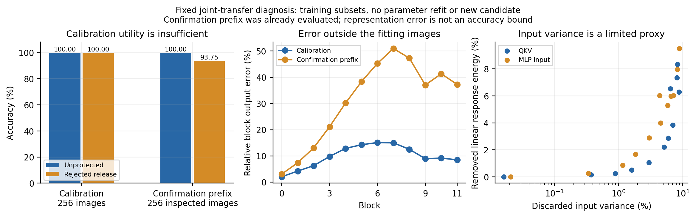

# 联合响应转移：本轮可证伪构造

10 月 10 日。此方向受已有模块依赖结果和同学建议启发，不能写成导师指定的新机制。先冻结单个构造，检验可行性，不继续调整旧四层扰动强度。

## 机制

对已有专家的 pre-LN block，记

\[
 u=x+A(L_1x),\qquad y=u+W_2\phi(W_1L_2u+b_1)+b_2.
\]

在每层当前校准输入上，用中心化协方差前 128 个特征向量构造 $\Pi=BB^\top$。对 Attention 的合并 QKV 输入矩阵，以及 MLP 第一投影，分别做

\[
 W'=W\Pi,\qquad b'=b+W(I-\Pi)\mu.
\]

因此 $W'z+b'=W[\mu+\Pi(z-\mu)]+b$，保留代理子空间内映射，删除其补空间依赖。丢弃的线性响应平方期望为 $\operatorname{tr}[W(I-\Pi)C(I-\Pi)W^\top]$；它不是分类损失界。前 128 维仅是固定研究选择，不是推断出的精确任务维数。输入 QKV 投影也会改变 softmax，不能套用这个线性式保证 Attention 保真。

随后令 Attention 的输出投影与偏置乘 $-1$，把分支变成 $\widetilde A=-A_{\Pi}$。这个符号变换可逆，也不构成安全性依据。它用于要求 MLP 承接被移走的 Attention 响应，而非只补偿一个微小的独立噪声。

在新 Attention 和新第一投影固定后，令 $\widetilde u=x+\widetilde A(L_1x)$，组成包含常数列的设计矩阵 $H=[\phi(W'_1L_2\widetilde u+b'_1),1]$。原专家同一校准图的 block 输出为 $Y$，拟合目标为 $T=Y-\widetilde U$。保留原输出投影作为中心 $D_0$，解

\[
 D^*=D_0+(H^\top H+\rho I)^{-1}H^\top(T-HD_0),
 \qquad \rho=10^{-4}\|H\|_F^2/N.
\]

按层顺序拟合，原专家 teacher 的输出始终固定，当前候选输入包含此前编辑造成的变化。使用 256 张无标签 MNIST 训练图，十二次闭式参数拟合，没有梯度或优化器。保留原架构、分类 head 与融合实现。

## 可行性条件与反例

该构造要成立，Attention 中被转移的非局部响应必须能由当前 MLP 的非线性特征近似。即使不用岭正则，训练误差也至少包含 $\|(I-P_H)T\|_F$，其中 $P_H$ 是设计矩阵列空间的正交投影。更一般地，任意仅依赖当前 token 特征 $h$ 的重建器，其均方误差下界为 $\mathbb E[\operatorname{Var}(T\mid h)]$。Attention 访问其他 token，MLP 不直接访问；小任务空间不能消除这一可表示性限制。校准误差小也不能保证新图分类不变。

单个 $W\mapsto W\Pi$ 在固定 $\Pi,\mu$ 下非单射，但输出补偿可能重新编码被删除的功能。因此不声称完整发布参数不可逆，也不从投影推出抗 AGA 或抗功能重建。符号可由公开 pretrained 的输出权重相关性识别；明确加入“恢复分支符号＋全部 MLP 替换”攻击。

所有十二层 Attention 与 MLP 的输入、输出矩阵都被编辑；只用“完整 block 替换损失大”解释安全性仍不够。攻击还包括全部 FC、全部 MLP、全部 Attention、两类输出投影，以及 Attention＋MLP 联合替换。按同处理未保护对照比较，并报告攻击者能选到的最高准确率。

固定门槛：独立 MNIST 损失 ≤0.5 pp；保护和未保护各取已测攻击的最佳融合准确率，差至少 5 pp。同时报告每个攻击的匹配差。完整编辑支持被替换后，两组参数严格相同，匹配差必为零；需要考察替换本身是否已损害融合，不能要求这种攻击也具有非零匹配差。门槛不满足就停止，不改 rank、gain 或岭系数，也不追加昂贵 AGA。通过后再使用作者原 AGA 和现有功能重建。此门槛用于淘汰候选，不代表通过即安全。

## 前作与边界

[NUFILT §3.4](https://arxiv.org/html/2509.21413v2) 提供带分解和谱隙条件的任务增量／表示子空间近似联系；本轮直接使用无标签表示协方差，既不是数据无关保护，也不是完整 NUFILT 复现。NUFILT 的 LoRA 梯度适应未用于本构造。

[GRAIL §3.1](https://arxiv.org/html/2602.23795v2) 已用隐藏表示的 Gram 矩阵和岭回归，在压缩后补偿下游投影。本轮复用仓库现有岭回归求解器；跨 Attention／MLP 的响应转移尚须实验，不能把闭式补偿本身当作创新。

[AGA §4.2](https://arxiv.org/html/2606.30360v1) 已讨论用 pretrained MLP 绕过保护；[Transformer rotation](https://proceedings.mlr.press/v267/zhang25dk.html) 表明线性坐标变换也已有恢复方法。本轮没有由文献检索确立机制原创性，仅检验一个明确假设。

## 真实结果：淘汰

实验协议先以 commit `7c91962` 提交，随后在 4090 上运行。新的 4,000 张 MNIST 确认图与所有旧开发／校准／攻击／确认图互斥，但不是专家训练之外的样本；下表不与官方 test 混用。

| 处理 | 未保护 MNIST | 联合构造 MNIST |
|---|---:|---:|
| 独立任务 | 3,995 / 4,000 = 99.875% | 3,803 / 4,000 = 95.075% |
| 直接融合 | 3,983 / 4,000 = 99.575% | 414 / 4,000 = 10.350% |
| 全部 FC 替换后融合 | 3,944 / 4,000 = 98.600% | 371 / 4,000 = 9.275% |
| 全部 MLP 替换后融合 | 3,835 / 4,000 = 95.875% | 273 / 4,000 = 6.825% |
| 全部 Attention 替换后融合 | 3,944 / 4,000 = 98.600% | 418 / 4,000 = 10.450% |
| 两类输出投影替换后融合 | 3,923 / 4,000 = 98.075% | 3,787 / 4,000 = 94.675% |
| Attention＋MLP 替换后融合 | 3,357 / 4,000 = 83.925% | 3,357 / 4,000 = 83.925% |
| 公开符号恢复＋MLP 替换后融合 | 3,835 / 4,000 = 95.875% | 3,869 / 4,000 = 96.725% |

效用损失 **4.8 pp >0.5 pp**；两组各取最佳已测攻击，差 **2.85 pp <5 pp**。原 AGA 和功能重建因此未追加，不能把“未测”写成“抵抗”。完整支持替换后的参数和预测严格相同；单独 Attention 或 MLP 替换失效，说明这个构造产生了联合依赖，但联合依赖不等于稳健保护。

前两层投影删除的线性响应能量很小，但后层 QKV 达 8.33%、MLP 达 9.50%；固定 rank-128 不是无损任务空间。全校准集合最后一层相对输出误差为 8.486%。这些现象与效用损失相容，尚未分离压缩、响应转移、校准泛化的各自贡献，不作单一因果归因。

岭求解器提取前后的原始 MLP 重建在 primal / dual 两条路径都逐参数完全相同，投影的均值响应误差约 $1.06\times10^{-7}$。这些检查排除了对应实现环节的错误，并不证明构造本身正确。全部逐图计数、配对表、冻结门槛、子集互斥、参数及源码指纹已核验。[结果与判定](joint_transfer_mnist/decision.json)、[逐图核验](joint_transfer_mnist/validation.json)、[代码回归核验](joint_transfer_mnist/runtime_check.json)。原始参数和预测只放服务器。

## 固定参数诊断：校准保真未泛化

没有重拟合或调整候选。重放全部 256 张校准图及已评 4,000 张确认图的前 256 张：校准两组均 256 / 256；确认未保护 256 / 256、候选 240 / 256。确认子集此前已被查看，不能称为新的验证集。校准最后一层相对输出误差为 8.486%，确认前缀为 37.255%；十二层记录的校准拟合目标误差都被重放复核。

这说明当前补偿没有在新图保持原任务分类能力。尚未计算最优列空间误差下界，不能单独归因于非局部响应，也不据此否定所有联合重表示。[逐图与拟合重放核验](joint_transfer_diagnostics/validation.json)、[真实层误差](joint_transfer_diagnostics/layer_errors.json)。



```bash
python experiments/joint_diagnostics.py --parent outputs/2026-10-10/joint_transfer_mnist --output outputs/joint_diagnosis
python experiments/validate_results.py --joint-diagnostics --output outputs/joint_diagnosis
python experiments/plot_results.py --joint-diagnostics --output outputs/joint_diagnosis
```


停止这个冻结构造。下一机制必须解释如何保住分类相关响应，并使攻击者无法用公开参数识别可逆部分后删去补偿；不能仅以更大的编辑集合或单种恢复准确率低来论证安全性。
