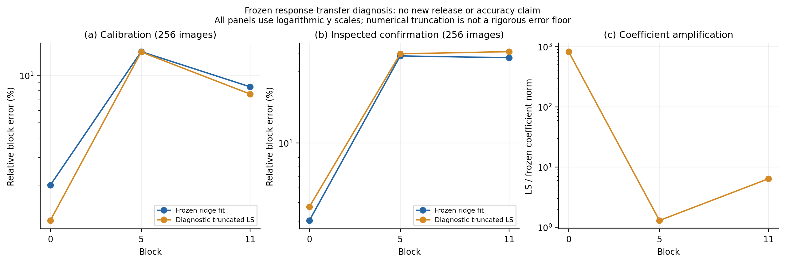

# 固定响应转移的可表示性诊断

诊断已淘汰的十二层联合构造，不发布新模型，不评价新准确率。取层 0、5、11；沿用 256 张校准图，以及已经查看过的确认集前 256 张。每组 12,800 个 token，三次诊断拟合，没有梯度优化。

## 线性拟合能否补足响应

冻结当前 MLP 特征 $H$ 和目标 $T$，比较已发布的岭回归系数与数值最小二乘系数。SVD 截断固定为 $\sqrt{\epsilon_{64}}$，没有按准确率选阈值；诊断系数没有安装回模型。

| 层 | 校准：冻结拟合 | 校准：数值 LS | 确认：冻结拟合 | 确认：数值 LS |
|---|---:|---:|---:|---:|
| 0 | 2.003% | 1.192% | 3.030% | 3.745% |
| 5 | 14.236% | 14.160% | 38.319% | 39.578% |
| 11 | 8.486% | 7.630% | 37.255% | 40.936% |

这些是残差范数除以原专家 block 输出范数，**不是准确率**。层 5、11 保留全部 3,073 个奇异方向，层 0 保留 3,071 个。层 5 的冻结拟合已接近该固定设计的最小二乘校准误差；三层的 LS 确认误差都更高。层 0 的系数范数扩大约 830 倍，提示病态方向；不推出所有正则或所有机制均无效。

截断 LS 不是无约束实数问题的严格误差下界，也不是分类损失界。本诊断未分离压缩、分支转移、先前层累积误差和数据覆盖的原因。结论仅是：**没有证据支持靠去掉岭正则修复这个冻结构造。**

## 公开符号恢复的代数依据

原 Attention 输出矩阵为 $O_0+\Delta O$，发布矩阵为 $O_r=-(O_0+\Delta O)$。若

\[
\|\Delta O\|_F<\|O_0\|_F,
\]

则由 Cauchy–Schwarz，$\langle O_0+\Delta O,O_0\rangle>0$，故公开相关性 $\langle O_r,O_0\rangle$ 为负。攻击者只需发布权重与公开 anchor 就能判定符号。

实际十二层的任务增量／anchor 范数比为 0.0163–0.0212；十二层输出矩阵与偏置都可逐元素精确恢复。它没有还原被压缩的 QKV 或 MLP，也不等于完整模型恢复；既有“符号恢复＋MLP 替换”融合结果仍见[联合构造记录](../joint_transfer_notes.md)。

## 核验与复核

运行前冻结源码 `2b181e3`。计算段 23.26 秒，原始矩、分解、截断及公开符号恢复均由服务器核验。约 900 MB 原始文件只存服务器；本地保存[六行结果](results.json)、[谱统计](spectra.json)、[核验](validation.json)及[源码对照](source_validation.json)。初次运行的残差符号断言错误及修正另存[失败记录](../response_transfer_startup_failure/failure.json)，不计作科学结果。



```bash
python experiments/response_transfer_probe.py --config configs/response_transfer_probe.json --output outputs/response_probe
python experiments/response_transfer_probe.py --audit-output outputs/response_probe
python experiments/plot_results.py --response-transfer --output outputs/response_probe
```
