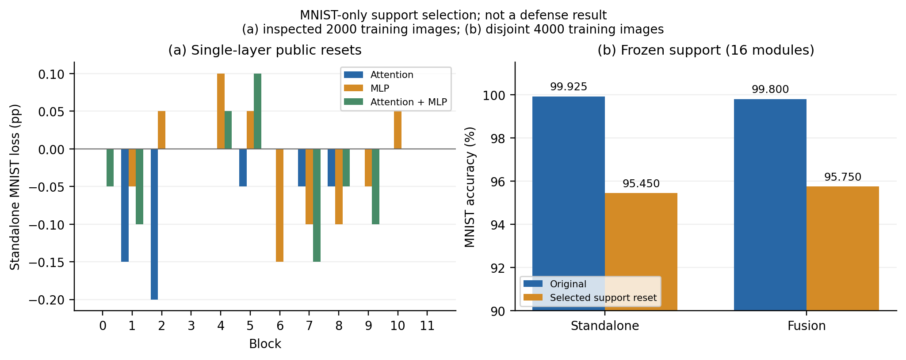

# MNIST 任务贡献与替换代价

本轮只做有界模块定位，不构造新保护。选择阶段仅加载 MNIST 专家、MNIST head 和公开 anchor；SVHN 在组合及其 SHA256 保存后才加载，用于固定融合评价。

## 定位规则

在此前已查看的 2,000 张 MNIST 训练开发图上，测 24 个单独 Attention／MLP 替换和 12 个同层联合替换。使用标签计算删除后的任务准确率；这不是无标签模块选择，也没有参数拟合。

从全部 24 个模块替换开始，按单模块任务损失从小到大删减，平局依次按层号和部件名。保持独立任务损失至少 5 pp，重复到不可继续逐个删除；最多 80 个不同组合。本次实际用了 64 个组合。这是提前固定的依赖诊断，不是保护方法或强度网格。

单模块及同层联合替换的**最大独立损失均仅 0.10 pp**。低准确率损失不代表算子没有任务作用，也不代表函数或逐图预测完全相同。

## 被保留下来的组合

| 部件 | 从 0 编号的层 |
|---|---|
| Attention | 0、3、4、5、6、7、9、10、11 |
| MLP | 0、2、3、4、5、10、11 |

共 16 个模块、跨 10 层。替换该组合在定位集产生 5.10 pp 独立损失；再移除其中任何单模块，剩余组合的损失均低于 5 pp。服务器核验全部删除证书；它**不是全局最小组合**，也不应据此扩成十六模块保护重构。

运行前另固定 4,000 张 MNIST 训练确认图，与全部列出的旧子集及本次定位图互斥，但仍属于原专家训练数据。

| 确认评价 | 原专家 | 公开组合替换 |
|---|---:|---:|
| 独立 MNIST | 3,997 / 4,000 = 99.925% | 3,818 / 4,000 = 95.450% |
| 融合 MNIST，系数 0.5 | 3,992 / 4,000 = 99.800% | 3,830 / 4,000 = 95.750% |

独立损失 4.475 pp，未保持定位集的 5 pp 门槛；融合恢复下限为 95.750%，相对原直接融合只降 4.050 pp，未过本轮预先固定的 5 pp 筛选门槛。5 pp 是研究筛选阈值，不是统计显著性的统一定义。

**按独立任务重要性选模块，不能替代对融合恢复代价的检查。**这次有界定位没有找到经过确认合格的局部组合；它没有证明不存在其他局部组合，也不否定所有后处理。



左图为单层删除净损失，负数表示正确总数增加；右图纵轴从 90% 开始。两图都使用训练诊断数据，不与官方 test 数字混表。

## 复核

源码在 `5f20c07` 冻结，作业 212.15 秒；没有梯度、优化器或参数拟合。68 行评价包含 64 个定位组合与 4 行固定确认，行数不是独立重复次数。[协议](protocol.json)、[选择及删除证书](selection.json)、[删除过程](pruning_trace.json)、[原始预测核验](validation.json)、[源码及权重来源](source_validation.json)。原始预测只在服务器。

```bash
python experiments/operator_diagnostics.py --task-support --config configs/task_support_mnist.json --output outputs/task_support
python experiments/validate_results.py --task-support --output outputs/task_support
python experiments/plot_results.py --task-support --output outputs/task_support
```
