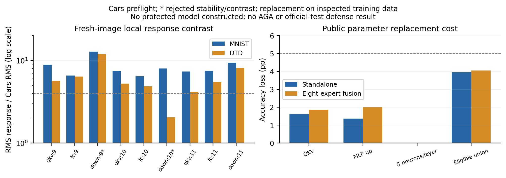

# Cars 细粒度预检

**找到稳定响应分离，但没有构造保护模型。**九个固定方向中七个通过新图片确认；实际编辑支持的公开替换下限未达到冻结的 5 pp 筛选要求。这个负结果不等于所有免训练保护不可能。

Cars 第 9–11 层；每个公开分布 128 张估计、128 张确认，两者互斥，排除已用索引。只用目标专家和预训练权重定方向，已知 MNIST／DTD 输入分布提供先验；伙伴权重在方向冻结后加载。

| 方向 | 确认 MNIST/Cars RMS | 确认 DTD/Cars RMS | Cars 确认/估计能量 | 通过 |
|---|---:|---:|---:|:---:|
| qkv:9 | 8.903 | 5.662 | 1.351 | 是 |
| fc:9 | 6.555 | 6.365 | 1.168 | 是 |
| down:9 | 12.795 | 11.936 | 17.412 | 否 |
| qkv:10 | 7.472 | 5.245 | 1.290 | 是 |
| fc:10 | 6.444 | 4.864 | 1.181 | 是 |
| down:10 | 8.020 | 2.049 | 2.317 | 否 |
| qkv:11 | 7.335 | 4.168 | 1.304 | 是 |
| fc:11 | 7.511 | 5.485 | 1.531 | 是 |
| down:11 | 9.368 | 8.080 | 0.811 | 是 |

QKV／上投影方向取任务向量 99% 奇异能量补空间，排除 LayerNorm 精确零方向；八神经元下投影为单独的稀疏族。下投影第 9 层估计对比很高，但确认能量漂移 17.41 倍，未通过；不能只报告最漂亮的校准数字。

| 公开替换支持 | 独立正确数/2048 | 独立损失 pp | 融合正确数/2048 | 融合损失 pp |
|---|---:|---:|---:|---:|
| 未替换 | 1911 | 0.0000 | 1346 | 0.0000 |
| QKV 三层 | 1878 | 1.6113 | 1308 | 1.8555 |
| MLP 上投影三层 | 1883 | 1.3672 | 1305 | 2.0020 |
| 每层八个下投影神经元 | 1911 | 0.0000 | 1346 | 0.0000 |
| 七个通过方向的编辑支持并集 | 1830 | 3.9551 | 1263 | 4.0527 |

原融合为 65.7227%，并集替换为 61.6699%。保持区外权重、架构和分类头不变时，任何只编辑这一支持的保护均可被完整支持替换消去；在本固定伙伴池与数据上的最佳恢复准确率至少为该下限，因此相对原融合最多下降 4.0527 pp。不是未知伙伴或所有防御的界，也不证明下限之外一定存在有效候选。

替换数值来自此前观察过的 Cars 2048 张训练确认图片，八专家 TA 系数 0.2；不是官方测试。下投影替换前后正确集合不变。没有保护准确率、原版 AGA 或抗恢复成功结果；构造条件未通过，没有调低门槛追求成功。

核验通过：54 组原始激活、27 个协方差、全部方向确认、源码／权重／数据指纹、训练标签和十条计数；16 张校准图片激活精确重放，原控制逐图重放，替换模型 128 张前向重放。源码 `42f3379`，原始核验源码 `b3b6fda`。模型、激活、预测只留服务器。

[协议](../fine_subspace_protocol.md) · [计数](results.json) · [核验](validation.json) · [沿方向删除更新的进一步诊断](../subspace_recovery_cars/summary.md)

