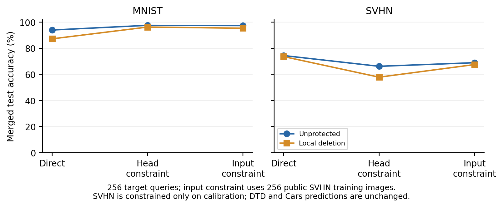

# 共享数字 head：校准保持不等于测试保持

**没有得到新防御。**本轮补查上一轮未测的 SVHN：MNIST 和 SVHN 的官方分类 head 权重、bias 及归一化设置相同。原来的输出零空间只保持 DTD、Cars，不能同时保证数字伙伴。新攻击在此基础上用 256 张公开 SVHN 训练图约束输入子空间，防御与发布点均未改动。

## 四套完整官方测试

| 发布模型 | 攻击 | MNIST | SVHN | DTD | Cars |
|---|---|---:|---:|---:|---:|
| 未保护 | 直接融合 | 94.00 | 74.42 | 52.18 | 62.06 |
| 未保护 | 上轮输出约束恢复 | 97.57 | 66.19 | 52.18 | 62.06 |
| 未保护 | 新增输入约束恢复 | 97.38 | 68.96 | 52.18 | 62.06 |
| 局部删除 | 直接融合 | 87.23 | 73.67 | 52.61 | 62.01 |
| 局部删除 | 上轮输出约束恢复 | 96.27 | 57.87 | 52.61 | 62.01 |
| 局部删除 | 新增输入约束恢复 | 95.37 | 67.51 | 52.61 | 62.01 |

准确率为 %。测试数量分别为 MNIST 10000、SVHN 26032、DTD 1880、Cars 8041；全部八个专家参与 TA 0.2。没有八任务平均，也没有重新运行或改写原版 AGA。父实验原版 AGA 仍见[局部删除结果](../local_erasure/summary.md)。

受保护组的上轮恢复把 MNIST 提至 96.27%，但 SVHN 比自身直接融合损失 15.80 pp。加入输入约束后，MNIST 为 95.37%，SVHN 损失缩至 6.15 pp，仍未保住数字伙伴。未保护同攻击为 MNIST 97.38%、SVHN 68.96%，必须保留这个同条件对照。

DTD、Cars 在新攻击的原始／删除两组中，共四套完整预测数组与各自直接融合完全一致。剩余四项伙伴没有测试。伙伴损伤不等于防御成功，也不能据此推出恢复不可能。AGA 论文的目标任务指标与本项额外多任务权衡分开报告。

## 机制与失败原因

相同 head 下，若要求所有输入的 SVHN 原生分数保持，就会同时禁止 MNIST 原生分数更新。因此本轮仅约束 SVHN **校准输入**。从 256×768 的当前融合 CLS 矩阵取完整非零行空间，其补空间维数为 512；在其中作一次固定岭拟合。数学与边界见[运行前协议](../input_score_recovery_protocol.md)。

两组校准均保持全部 256 张 SVHN 预测，MNIST 教师预测拟合也为 256/256；这是 FP64 拟合层面的校准检查。实际发布投影编译到 FP32，参数误差另行核验，不将理想代数当作部署保证。完整 SVHN 测试仍分别改变 5254／5646 张预测，证明有限样本上的零响应不能保证同任务校准外的保持。

约束后的 MNIST 输入能量保留 9.18%／10.64%，仍足以恢复大量任务能力。归一化前类别分数来自白盒发布专家；不使用教师中间表征或校准真标签，额外 SVHN 图只查询当前公共融合模型。这里的简单投影与岭拟合不作创新声明，也不是完整 NUFILT 或 SLOA。

结论限于两个冻结发布点、一个固定输入预算与一次闭式拟合。旧删除没有变成有效防御；新增攻击也未实现三个已测伙伴全部保持。不再调整本点的岭系数、秩或扰动幅度。接下来须检验关键非线性计算能否免微调地改变并保持任务能力，先排除公开可还原的结构。[本轮激活分拆反例与输入约束](../mechanism_boundary.md)已经保存。

## 复核与计算

运行前源码冻结于 `8485683`，成功退出，无超时；进程墙时 242.5 秒，含资源核对、预处理和全部新增测试，不是单次攻击时间。24 行计数包括 12 次新增完整评价与 12 行父实验复用，不是 24 个方案、种子或独立实验。

唯一设置：原先 256 张 MNIST 校准、固定种子 256 张 SVHN 训练图、一次岭拟合、比例 10⁻⁴、SVD 数值秩阈值 10⁻⁹；无梯度优化和搜索。官方测试以前已观察，不能称新 holdout。首次启动因默认 shell 缺少 python3 未创建实验结果，随后用现有环境绝对路径运行；首次启动日志保留于服务器。

[核验记录](validation.json)检查官方标签、原始预测计数与配对变化、父预测复用、两次拟合完整回放、独立约束岭方程、输入／输出零空间、仅投影编辑、FP32 编译误差，以及 24 组各 128 张预测前缀。原始张量、权重、预测和日志只存服务器，本地／Git 保留轻量结果。

[精确计数](results.json) · [拟合与子空间](fitting.json) · [源码冻结核验](source_validation.json)
