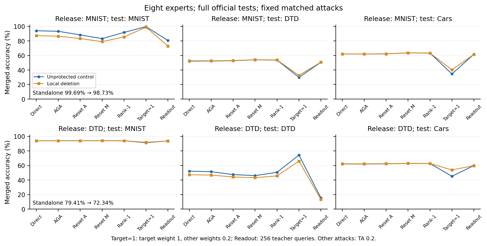

# 局部任务更新删除：恢复与性能权衡

这是两个固定删除点的机制诊断。任务向量删减是已有工具；本轮没有得到可声称创新或安全成立的新防御方法。所有固定攻击均运行，没有按准确率门槛提前停止。

CLIP ViT-B/32，八专家始终参与融合，作者 TA 系数 0.2。目标专家不依赖未来融合伙伴：MNIST 固定 6–8 层、DTD 固定 9–11 层，每层将 V／Attention 输出／MLP 的任务增量及相应偏置置零；Q/K、LayerNorm、头和其他参数保留。支持来自此前仅本任务训练标签的选择，两份发布模型在加载伙伴前冻结。

## 原任务能力

| 目标 | 原专家 | 删除后 | 独立损失 |
|---|---:|---:|---:|
| MNIST | 9969/10000 (99.69%) | 9873/10000 (98.73%) | 0.96 pp |
| DTD | 1493/1880 (79.41%) | 1360/1880 (72.34%) | 7.07 pp |

均为官方 test。此前 MNIST 的训练确认独立损失为 0.44 pp，本轮真实测试损失更大；训练点不能替代校准外能力检查。DTD 的训练定位结果也不替代官方测试。

## 固定攻击下的目标融合

每格为同攻击未保护对照 → 删除后，准确率（%）。所有攻击只处理目标，其他专家保持原样。最强已测恢复是运行后从固定攻击取最大值，属于已测攻击包络；不等于未测攻击上限。

| 攻击 | MNIST | DTD |
|---|---:|---:|
| 直接融合 | 94.00 → 87.23 | 52.18 → 47.23 |
| 作者原版 AGA | 93.23 → 86.45 | 51.38 → 46.81 |
| 全网 Attention 公开替换 | 88.28 → 83.26 | 47.45 → 44.15 |
| 全网 MLP 公开替换 | 83.16 → 79.03 | 46.06 → 43.24 |
| 公开任务更新 rank-1 清理 | 91.75 → 85.48 | 50.59 → 45.64 |
| 目标权重 1，伙伴 0.2 | 99.67 → 98.90 | 74.36 → 66.06 |
| 256 硬标签查询／投影重建 | 80.57 → 72.95 | 15.43 → 13.30 |

重缩放与输出重建是额外自适应攻击，单列于原版 AGA。rank-1 清理使用攻击者实际可见的发布参数与公开 anchor，不获得防御方秘密方向。输出重建只作一次固定岭拟合，不使用训练真标签或 teacher 隐藏激活，也不是完整 SLOA。

四组硬标签拟合都在 256 张校准图上全命中，但未保护测试也很差（MNIST 80.57%、DTD 15.43%）。这是校准外泛化失败，不能用作抗功能重建证据；另补[原生分数及伙伴响应保持攻击](../score_recovery_protocol.md)，结果见[分数恢复](../score_recovery/summary.md)：无需重构删除参数，在保持两个已测伙伴预测时仍显著取回目标能力。

## 最强已测恢复及伙伴代价

| 发布目标／模型 | 固定恢复 | MNIST | DTD | Cars |
|---|---|---:|---:|---:|
| MNIST／未保护直接 | 直接融合 | 94.00% | 52.18% | 62.06% |
| MNIST／同攻击对照 | 目标权重 1，伙伴 0.2 | 99.67% | 29.84% | 34.52% |
| MNIST／删除后恢复 | 目标权重 1，伙伴 0.2 | 98.90% | 32.61% | 40.29% |
| DTD／未保护直接 | 直接融合 | 94.00% | 52.18% | 62.06% |
| DTD／同攻击对照 | 目标权重 1，伙伴 0.2 | 91.32% | 74.36% | 45.16% |
| DTD／删除后恢复 | 目标权重 1，伙伴 0.2 | 91.87% | 66.06% | 53.82% |

高目标恢复若损失伙伴能力，不能直接算成完整多任务攻击成功。这里只检查三个测试任务，其余五个任务和完整 SLOA 尚未覆盖；不能声称广泛攻击安全，也不计算八任务平均。逐攻击伙伴效果见原始计数和下图。

## 机制结论

删除构造 $\theta_R=\theta_0+M_{S^c}\Delta$ 非单射，故删除坐标中的原始更新不唯一可识别。这不阻止从保留更新、公开先验或模型输出恢复任务功能。再次替换同一支持是恒等操作，也不排除其他恢复。

攻击者设 $\widetilde\Delta_R=\Delta_R/\alpha$ 后，TA 的结果为 $\theta_R+\alpha\sum_{j\ne R}\Delta_j$；本轮固定 $\alpha=0.2$，无需原目标权重、校准或优化。它解释为何目标能力可能恢复，伙伴代价则由真实测试确定。这个恒等式不保证任意任务或任意伙伴下恢复成功。

- MNIST：最强已测目标恢复为 目标权重 1，伙伴 0.2，删除后 98.90%；同攻击保护差距 0.77 pp，独立损失 0.96 pp。伙伴代价按上表保留，不把此差距解释为纯防御增益。
- DTD：最强已测目标恢复为 目标权重 1，伙伴 0.2，删除后 66.06%；同攻击保护差距 8.30 pp，独立损失 7.07 pp。伙伴代价按上表保留，不把此差距解释为纯防御增益。

本轮停止扩展这两个固定删除点；不据此否定所有免微调保护。下一步机制必须解释保留任务能力为何不会被系数重调或功能对齐便宜取回，并先给出同预算、多任务恢复对照；不再仅凭谱能量、固定 TA 或训练确认点选方向。

## 核验与复核

源码运行前冻结于 `87c3456`；执行成功，墙时 602.3 秒，无超时。构造无梯度、响应拟合或未来伙伴访问；区域选择曾使用本任务训练标签。攻击校准复用既有 selection 前 256 张，全部官方测试以前已观察，不能声称新 holdout 或无适应性选择。

逐图预测、官方标签、配对计数、编辑坐标、源码与权重指纹，以及每条攻击的 128 张前缀回放，见 [validation.json](validation.json)。四组输出拟合还核对伪标签、岭方程与固定 TA 的投影映射。

`results.json` 有 104 行计数；实际全测试集前向评价 101 次，第二目标未保护直接融合的三行复用同一预测。这不是 104 个候选、种子或独立实验。原始权重修改、预测、拟合张量及日志只在服务器；Git／本地仅保留轻量证据。

[运行前数学协议](../local_erasure_protocol.md) · [完整计数](results.json) · [机器决策记录](decision.json)

记录说明：机器文件 `selected_after_results=false` 指发布点已预选；最强攻击名称仍是在固定攻击集合中运行后取最大，未声称攻击预选。
