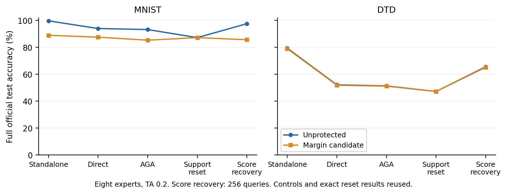

# 分类间隔编辑：本轮仍未达到保护目标

**没有有效突破。** MNIST 的融合下降伴随独立能力损失 10.73 pp；DTD 独立只损失 0.43 pp，但原版 AGA 后仅下降 0.21 pp。两份权重均已生成并完成真实测试，不继续调整这两个方向的强度。

## 完整测试

同条件未保护 → 候选，准确率（%）。八专家作者 TA 系数均为 0.2；完整 MNIST 10,000、DTD 1,880、Cars 8,041 张。下表只列保护目标，伙伴结果保留于[完整计数](results.json)。

| 测量／恢复 | MNIST | DTD |
|---|---:|---:|
| 独立任务 | 99.69 → 88.96 | 79.41 → 78.99 |
| 直接融合 | 94.00 → 87.59 | 52.18 → 51.86 |
| 作者原版 AGA | 93.23 → 85.33 | 51.38 → 51.17 |
| 256 图原生分数恢复 | 97.57 → 85.67 | 65.53 → 65.16 |
| 三层完整编辑支持替换 | 87.23 → 87.23 | 47.23 → 47.23 |

DTD 的 AGA 对照损失 13 张正确、获得 9 张，配对检验 p=0.523；直接融合净损失 6 张，p=0.210。不能把这类微小差异当稳定防御。MNIST 原任务已明显损坏，恢复输出低不能单独证明抗恢复有效；本轮也没有加入与其 88.96% 独立能力严格匹配的损坏模型控制。

固定已测路径中，候选最高目标融合准确率为 MNIST 87.59%（直接融合）、DTD 65.16%（原生分数恢复）。并非攻击搜索上限。完整支持替换后，候选与原模型的全部参数逐项相同，因此明确复用旧逐图结果；没有新增替换成本。

## 机制检查

新构造复用父实验的 48 维有限差分，不搜索新层或秩。以目标专家预测为伪标签，约束原分类间隔的线性变化，并一次解析选择降低 β=0.2/0.5 代理分类间隔的符号。只用目标专家、公开预训练、公开目标 head 和 64 张训练校准图；无梯度、反传或迭代权重训练，依赖校准预测。数学见[冻结协议](../path_margin_protocol.md)。

符号问题得到单独检验，但**一阶分类低敏感不能保证大幅编辑后功能保持**。MNIST 校准间隔变化预测上限为 12.82%，实际最大为 129.75%；预测 0 张分类改变，实际 5/64。归一化特征变化向量的相对预测误差为 96.0%。DTD 该误差为 31.1%，实际校准分类不变，却没有产生强融合干扰。见[线性化复算](linearity.json)。

β=0.2 代理完整准确率：MNIST 91.55 → 71.10、DTD 56.86 → 56.33。真实融合分别下降 6.41、0.32 pp。两个点既不足以建立代理预测规律，也不能把缩放代理当新思想；它与已有缩放路径研究的区别和使用边界已写入协议。

另一条已推导的条件反例是公开回填：若 Wp=We P+N(I−P)，攻击者取得任务输入投影 P 后，可用 Wr=WpP+W0(I−P) 清掉补空间项并保持该子空间上的任务计算。多处独立投影可以逐层清理。**这是条件性代数分析，尚未实现新的全模型攻击，也没有融合准确率保证。**后续构造须解释为什么不能被这条路径重建可融合表示，详见[机制边界第 4 节](../mechanism_boundary.md)。

## 核验与资源

候选源冻结于 `797ae9c`，完整运行 218.6 秒，无超时。68 行结果中，**26 行为本轮完整前向评价，42 行为明确标记的父对照或状态恒等复用**；候选只有两份。没有符号、强度或秩扫描。校准、MNIST 128／DTD 24 确认及 256 攻击查询索引沿用父实验，均不声称新留出集；旧层选择用过目标训练标签。八专家参与、三任务实测，不报告八任务均值或 AGA Table 6 已对齐。

初版核验错误地要求恢复后的伙伴预测绝对不变。实际 MNIST 候选在 DTD 改变 1/1880 张预测，其余三个已测伙伴数组无变化；原批次重放确认该图两类间隔由 +1.91×10⁻⁶ 变为 −1.91×10⁻⁶。浮点编译不能继承理想零空间的精确预测保证。失败日志与[修订说明](validation_revision.json)保留，候选、配置和结果未更改。

最终核验通过：全部原始计数与正式标签、两次解析求解与编辑重建、两次功能恢复全部张量逐字节重放、26 个新评价各 128 图前缀、42 行复用、完整支持替换恒等，以及上述近边界预测重放。核验墙时 127.8 秒；[验证结果](validation.json)、[源码证明](source_validation.json)、[编译误差](compilation.json)可复核。

所有权重、原始预测与完整日志只在服务器；本地和 Git 只保留轻量结果与代码。下一步先检查具体构造对整体替换与公开回填的抵抗依据，避免在已知可清理的噪声上继续耗 GPU。

