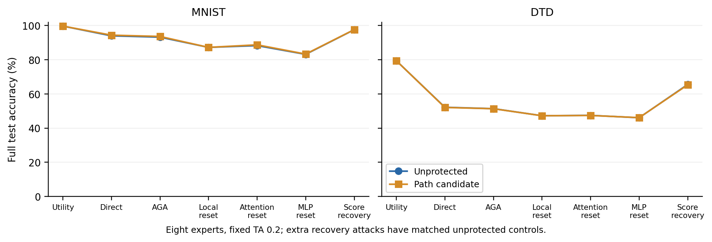
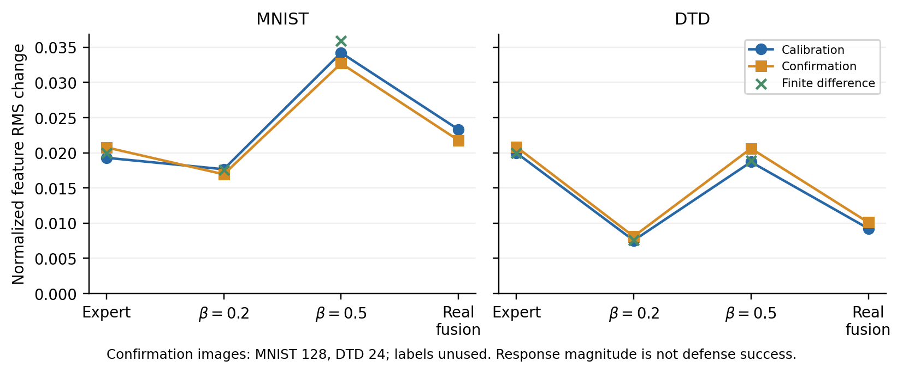

# 融合路径敏感性：两份真实候选的结果

**结论：没有得到有效防御。** 两个目标的独立准确率均保持，但 MNIST 融合反而提高，DTD 的直接融合只下降 2 张图，原版 AGA 后只下降 1 张图。两份发布权重已实际生成，全部固定恢复路径已测试；停止对这组方向调整幅度。

构造仅用目标专家、公开预训练与各 64 张无标签训练校准图。三层区域沿用此前目标训练标签的定位；每个矩阵取 4 个任务奇异方向，共 48 维，联合求一次广义特征向量。β=0.2/0.5 的有限差分计入 β 缩放，固定一个响应预算，不用未来伙伴选方向、符号或幅度。方向、均值与已修改权重见服务器原始张量，数学和调用边界见[运行协议](../path_subspace_protocol.md)。

## 原任务与真实融合

数值为同条件未保护 → 候选，准确率（%）。八专家均参与作者 TA 0.2；正式 MNIST 10,000、DTD 1,880、Cars 8,041 张。原版 AGA 只处理目标。

| 测量／攻击 | MNIST | DTD |
|---|---:|---:|
| 独立任务 | 99.69 → 99.69 | 79.41 → 79.41 |
| 直接融合 | 94.00 → 94.38 | 52.18 → 52.07 |
| 作者原版 AGA | 93.23 → 93.63 | 51.38 → 51.33 |
| 三层实际支持替换 | 87.23 → 87.23 | 47.23 → 47.23 |
| 全十二层 Attention 替换 | 88.28 → 88.72 | 47.45 → 47.39 |
| 全十二层 MLP 替换 | 83.16 → 83.31 | 46.06 → 46.12 |
| 256 图原生分数恢复 | 97.57 → 97.63 | 65.53 → 65.32 |

独立计数分别为 MNIST 9969/10000 → 9969/10000、DTD 1493/1880 → 1493/1880，准确率相同但预测并非逐图恒等。MNIST 直接融合净增 38 张正确（损失 1、获得 39）；DTD 净损失 2 张，配对检验 p=0.5。不能把 DTD 的微小下降当稳定防御。

固定攻击集合中的最高目标恢复来自原生分数读出：MNIST 97.63%，DTD 65.32%；相对同攻击未保护对照分别提高 0.06 pp、下降 0.21 pp。该攻击只是一次闭式拟合，不是完整 SLOA，也不需要找回原始保护参数。另两套已测伙伴的完整预测与各自直接融合保持，详见核验文件；没有覆盖其他五个伙伴或全部攻击。

## 代理到底预测了什么

下表为互不重叠训练确认图上的实际归一化输出 RMS，图标签未用于构造。MNIST 128 张，DTD 仅 24 张。

| 目标 | 原专家 | β=0.2 | β=0.5 | 真实八专家融合 |
|---|---:|---:|---:|---:|
| MNIST | 0.02076 | 0.01694 | 0.03271 | 0.02178 |
| DTD | 0.02084 | 0.00810 | 0.02061 | 0.01009 |

有限差分对自身路径的校准变化向量相对误差为 2.4%–9.4%；数值线性化有一定精度。MNIST 在 β=0.5 上确认响应为专家的约 1.58 倍，但 β=0.2 代理准确率由 91.55% 提高到 92.26%，真实融合也提高。DTD 两条路径响应未超过原专家。**本轮不支持用 RMS 分离预测融合破坏；只有两份候选，亦未建立跨候选的统计预测关系。**

一个明确缺口是符号：二次能量目标 Q(c)=Q(−c)，而非零的一阶分类 margin 改变在翻转方向后会变号。能量目标不能区分提升正确类别与破坏正确类别。真实融合还带有未知伙伴更新，其 Jacobian 不等于缩放代理；NUFILT 子空间亲和度理论没有提供此处分类损害的保证。

另复算整个固定 48 维家族的无正则 Rayleigh 商上界：计入 β 后，β=0.2 的校准一阶 RMS 比值最多为 MNIST **0.9202**、DTD **0.3820**；β=0.5 上界分别为 1.8019、0.9426。这个固定家族、校准集与一阶特征能量度量内，β=0.2 没有比专家更大的诱导 RMS；结论覆盖全部方向。此界不是非线性准确率界，也不是其他参数空间的不可能性证明。见[谱界复算](sensitivity_limits.json)。

全部局部编辑可被公开支持替换清掉：R_S(θe+δ_S)=R_S(θe)。本轮两者替换后的完整逐图预测完全一致，没有增加这一攻击的删除成本。它说明本构造未解决功能耦合漏洞，不是对所有免微调保护的不可能性证明。

缩放任务更新作为融合代理已有先例，[Trap² 的 Eq. (5) 与 Algorithm 1](https://arxiv.org/html/2601.21898v2#S5)采用同类路径并通过训练优化；不能把引入 β 本身当创新。本轮只做该文新意筛查，尚未核实正文中的作者研究代码链接，不将其列为新的精读完成项。NUFILT SVD、广义特征值筛选均为复用工具，本项目没有方法创新成功声明。

## 核验、失败记录与后续

首轮在 DTD 取样前因只余 88 张可用训练图停止，全部部分文件和日志保留。MNIST 的已冻结系数与权重逐项复用，DTD 改为 64 张校准＋24 张确认；未根据正式准确率改配置。修订源提交 e38bc26，成功运行 504.7 秒、无超时。

本轮 100 行计数对应 100 次完整前向评价，含独立、代理、融合与同攻击对照；候选只有两份，不是 100 个方法、种子或独立实验。旧测试集合此前已观察，不宣称全新 holdout。八专家参与、三任务实测，不报告八任务均值；EuroSAT 原划分及 AGA Table 6 精确身份仍未解决。

复核包括真实权重重建、Gram/特征问题复算、24 列有限差分抽查、完整逐图计数与官方标签、100 行各 128 图前缀重放、四次恢复拟合和伙伴预测核对。核验全部通过，墙时 287.0 秒。验证器修订只补核验与谱界分析，构造与运行函数的 AST 与冻结源一致。结果与源码指纹见[核验](validation.json)、[源码证明](source_validation.json)、[完整计数](results.json)。

后续应先检查带符号的任务分数或分类边界代理是否对应真实融合损害，并同时检查公开替换的恢复代价；另行固定协议后才能生成下一份候选。本轮不翻转方向、不加大幅度、不扩大层数。

