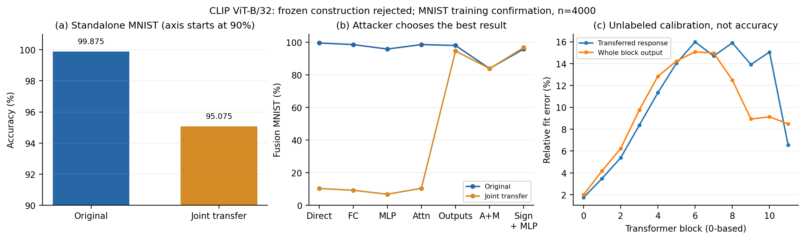

# 10 月 11 日科研汇报

**目前还没有满足效用与抗恢复要求的新防御。**旧后处理能干扰直接融合和 AGA，但便宜替换能绕过；新增十二层联合构造使单独模块替换失效，仍因效用损失和组合恢复被淘汰。

目标：对已微调专家施加发布前后处理，不做额外梯度微调；独立准确率下降 ≤0.5 pp，并抵抗原 AGA、参数替换及明确标注预算的功能恢复。导师的任务子空间思路是机制依据，不假定每层都存在精确的 16 维空间。以下保护 MNIST、伙伴 SVHN，CLIP ViT-B/32。

## 1. 已确认的结果与问题

旧四层候选在完整 MNIST test 上独立准确率 **99.69% →99.65%**，损失 0.04 pp。双任务 TA 系数 0.5，恢复结果如下；每项均有同处理未保护对照。

| 恢复方式 | 未保护融合 MNIST | 保护后融合 MNIST |
|---|---:|---:|
| 直接融合 | 99.37% | 17.24% |
| 原 AGA，两名专家均处理 | 99.32% | 14.47% |
| 四层 FC 换回 pretrained | 99.04% | 99.25% |
| 一轮公开特征功能重建 | 99.38% | 99.29% |
| 四层完整 MLP 换回 pretrained | 98.07% | 98.07% |

**不再调整这四层的扰动强度。**只要替换覆盖全部编辑参数，两组恢复参数严格相同；单看 AGA 失败会误判防御有效。[完整测试核验](../2026-10-10/subspace_compensation_mnist_test/validation.json)、[完整模块替换证明](../2026-10-09/post_meeting/recovery_boundary_notes.md)。

额外的分类输出恢复只用每任务 256 次无标签图查询，完整测试得到 MNIST **94.81%**、SVHN **93.06%**。它是部分恢复，距离原融合 MNIST 仍低 4.56 pp；没有隐藏激活或保护前参数权限，也不是论文原 AGA。不能将这条匹配攻击两组相同，误写成所有攻击均无保护效果。

## 2. 本轮联合构造及淘汰依据

用任务校准表示的 rank-128 子空间，压缩十二层 QKV 与 MLP 输入映射；反转 Attention 输出响应，再闭式拟合 MLP 输出以补回原 block 响应。使用 256 张无标签训练图、十二次岭回归参数拟合，没有梯度优化。投影单独非单射，不代表整体发布参数或任务功能不可恢复。

在**新抽取且与旧子集互斥的 4,000 张 MNIST 训练图**上：

| 处理 | 未保护 | 联合构造 |
|---|---:|---:|
| 独立任务 | 99.875% | 95.075% |
| 直接融合 | 99.575% | 10.350% |
| 全部 MLP 替换后融合 | 95.875% | 6.825% |
| 全部 Attention 替换后融合 | 98.600% | 10.450% |
| 两类输出投影替换后融合 | 98.075% | 94.675% |
| 公开符号恢复＋MLP 替换后融合 | 95.875% | 96.725% |

该构造出现了联合依赖，但独立损失 **4.8 pp**，最佳已测恢复与未保护最佳融合只差 **2.85 pp**。按运行前冻结的门槛淘汰，未追加 AGA、功能重建或强度网格。这是开发实验，不能与上面的官方 test 数字拼成同一对照。[推导、全部攻击和失败原因](../2026-10-10/joint_transfer_notes.md)、[逐图核验](../2026-10-10/joint_transfer_mnist/validation.json)。

## 3. 文献与复现

| 工作 | 本研究采用的依据及限制 |
|---|---|
| [NUFILT](https://arxiv.org/html/2509.21413v2) | 任务增量与表示子空间的条件性近似联系；不是安全性定理，也不保证固定 rank 无损。其梯度 LoRA 适应未采用。 |
| [PaRaMS](https://arxiv.org/html/2503.07661v2)、[MergeLock](https://arxiv.org/html/2509.01548v1) | 函数保持的参数变换及恢复基线；不将已有置换、缩放、旋转当作创新。 |
| [MergeBarrier](https://arxiv.org/html/2511.10712v2)、[AGA](https://arxiv.org/html/2606.30360v1) | 参数恢复困难须与公开模块替换、功能回收分开。AGA 已讨论 pretrained MLP 绕过。 |
| [GRAIL](https://arxiv.org/html/2602.23795v2) | 压缩后的无标签闭式响应补偿已有前作；本轮没有原创算法结论。 |
| [ReACT](https://arxiv.org/html/2511.10943v1) | 通过最终表示的闭式线性修正促进融合；进一步说明参数对应关系之外也有恢复入口。尚未作为本项目攻击复现，不能给它填写攻击结果。 |
| [MergeGuard](https://arxiv.org/html/2511.11851v1) | 第一阶段依赖 L2 正则微调来分散任务信息；不能直接用于既有专家的免微调发布。本轮响应转移试验尚未实现这种功能分散下的效用保持。 |
| [Trap²](https://proceedings.mlr.press/v306/jang26e.html) | 通过额外训练塑造缩放敏感性，直接套用不满足当前免微调约束。 |

AGA 新核验：作者完整入口与旧逐层调用，在原 MNIST 专家和冻结保护专家上恢复的 158 项参数逐项相同。[入口核验](../2026-10-10/aga_entry_audit/validation.json)。

八任务复现已有 17 个官方权重、七个完整测试集的未保护基线。正在补 PaRaMS 官方保护与作者完整 AGA 入口：融合始终包含八个专家、系数固定 0.2，每次只保护和攻击一个专家。EuroSAT 原随机划分仍缺，checkpoint 与论文具体文件尚未独立对齐，因此不能报 Table 6 成功或八任务均值。[资源和基线状态](../2026-10-09/eight_task/status.md)。

新增交叉核对：我们的七项未保护融合准确率，与 [TADrop Table 1 的 ViT-B/32 Task Arithmetic](https://arxiv.org/html/2508.06163v1) 均在一位小数上相同。这增加了计算链路的可信度，仍不是 AGA 原表对齐。

## 4. 下一步要回答的问题

新机制要同时满足两点：保住分类相关响应；使可融合任务功能不能通过低成本恢复重新放回公开表示。联合编辑确实能改变便宜替换的效果，但扩大编辑范围并不自动满足这两点。

具体技术缺口是：能否通过免梯度微调的后处理，使任务功能依赖不可廉价替代的联合计算，同时保持分类边界。NUFILT 的子空间联系及已有闭式补偿都不能直接保证这一点，当前不声称这是首次提出的问题。[三条可在实验前检查的必要条件](../2026-10-10/search_constraints.md)。

先检查新构造的效用、完整编辑支持及公开规范化恢复，再给通过者运行原 AGA 和功能重建。保留全部失败及查询预算，继续补复现；不将反复试强度或通用补偿包装为创新。
