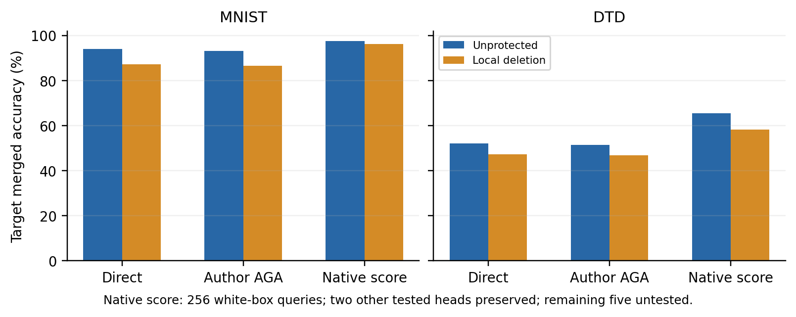

# 功能恢复：无需还原删除参数，也能保住两项伙伴预测

**发现了现有删除构造的恢复路径，没有得到有效新防御。**用原先 256 张训练图查询可访问专家的原生类别分数，再作一次既有闭式岭拟合；只修改共享投影，约束另两个已测公共 head 的类别响应。发布模型、支持、校准索引和岭比例均未调整。

## 完整官方测试

| 目标 | 直接融合：对照 → 删除 | 原版 AGA：对照 → 删除 | 分数恢复：对照 → 删除 | 独立损失 |
|---|---:|---:|---:|---:|
| MNIST | 94.00 → 87.23 | 93.23 → 86.45 | 97.57 → 96.27 | 0.96 pp |
| DTD | 52.18 → 47.23 | 51.38 → 46.81 | 65.53 → 58.24 | 7.07 pp |

准确率为 %。独立能力来自冻结父实验：MNIST 99.69% → 98.73%，DTD 79.41% → 72.34%。八专家均参与，TA 系数 0.2；没有八任务平均。分数恢复是适应性额外攻击，不混作原版 AGA。

| 发布目标／教师 | 恢复后目标正确数 | 伙伴任务 | 伙伴正确数 | 相对自身直接融合的逐图预测变化 |
|---|---:|---|---:|---:|
| MNIST／原始 | 9757/10000 | DTD | 981/1880 | 0 |
| MNIST／原始 | 9757/10000 | Cars | 4990/8041 | 0 |
| MNIST／删除 | 9627/10000 | DTD | 989/1880 | 0 |
| MNIST／删除 | 9627/10000 | Cars | 4986/8041 | 0 |
| DTD／原始 | 1232/1880 | MNIST | 9400/10000 | 0 |
| DTD／原始 | 1232/1880 | Cars | 4990/8041 | 0 |
| DTD／删除 | 1095/1880 | MNIST | 9396/10000 | 0 |
| DTD／删除 | 1095/1880 | Cars | 5010/8041 | 0 |

八组伙伴完整逐图预测全部保持，比较的是各组自身攻击前直接融合；不是宣称保护与未保护的伙伴预测彼此相同。未测其余五个伙伴，不能推出完整八任务攻击成功。

## 为什么这比仅提高目标权重更严格

提高目标权重能把删除后的 MNIST 恢复到 98.90%，却损失 DTD／Cars；本轮分数恢复把目标从 87.23% 提高到 96.27%，保留这两个伙伴全部预测。DTD 从 47.23% 提高到 58.24%，同样保留 MNIST／Cars 预测。

目标 head 为 $C$，另两个 head 拼接为 $B$。其右零空间中，目标映射仍满行秩；因此可实现任意目标线性分数更新，同时令伙伴原生分数更新为零。两个约束预检都通过：MNIST 的可用零空间维数为 269，DTD 为 306。具体公式与假设见[运行前协议](../score_recovery_protocol.md)。该结论不依赖重建已删除的参数。

输出范数非零、零偏置与共享特征归一化下，共同正缩放不改变伙伴类别排序；理想实数证明与实际 FP32 全测试预测分别核验。有限校准只证明本次恢复，不保证任意目标、伙伴或未来攻击均成功。

同攻击保护差距：MNIST 1.30 pp，DTD 7.29 pp；各自独立损失为 0.96、7.07 pp。相比单看固定 TA／AGA 的下降，新增防御价值已很有限。这是性能权衡，不能把两者相减直接当成因果防御效应。

本轮不继续扩大两个现有删除点。接下来构造须明确攻击者为何不能从保留表征和少量响应低成本取得任务能力；参数更新不可逆或谱能量高本身不够。完整 SLOA、其余五个伙伴以及多种校准预算仍待覆盖。

## 数据、计算与核验

源码运行前冻结于 `ca2606a`，执行成功，无超时，进程墙时 139.0 秒；此时间包含预处理和十二次完整测试，不是单次攻击耗时。每组教师 256 张原索引、一次岭拟合、固定比例 10⁻⁴，没有梯度优化、真标签、系数搜索或重新构造保护。

原生归一化前类别分数需要白盒模型访问；普通黑盒归一化 logits 接口不直接提供该量。拟合不使用或保存教师中间表征。四组校准预测均命中 256/256，这不替代校准外测试。

协议在观察父实验后确定，benchmark 测试以前已看过；这是补充恢复攻击，不能称新 holdout、完整 SLOA 或创新防御。上一轮硬标签恢复在未保护对照上也很差，已明确不作为抗功能恢复证据。

[验证记录](validation.json)核对全部十二行原始预测、官方标签、冻结权重与源码指纹、四组原生分数拟合回放、岭方程、目标与伙伴映射、仅投影编辑，以及十二组 128 张预测前缀。重文件和日志只保存在服务器，Git／本地保留轻量结果。

[完整计数](results.json) · [几何证据](geometry.json) · [父实验与全部旧恢复路径](../local_erasure/summary.md)

后续已补查共享数字 head：上表 MNIST 96.27% 的恢复伴随 SVHN 73.67% → 57.87%；加入固定输入约束后，MNIST 为 95.37%、SVHN 为 67.51%。原来的“两项伙伴保持”结论不扩大到 SVHN，完整同条件对照见[补充检查](../input_score_recovery/summary.md)。
