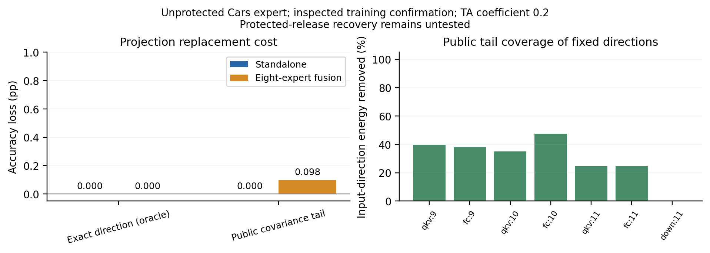

# 沿输入子空间删除更新的代价

**这七个方向没有体现难以删去的任务更新。**获得精确方向后，只沿方向替换任务更新并补偿均值，独立和融合的正确集合都不变。精确方向属于额外信息；这是条件诊断，不能宣称攻击者已恢复一个受保护模型。

| 未保护专家的处理 | 独立正确数/2048 | 独立损失 pp | 融合正确数/2048 | 融合损失 pp |
|---|---:|---:|---:|---:|
| 原专家 | 1911 | 0.0000 | 1346 | 0.0000 |
| 精确方向投影，oracle | 1911 | 0.0000 | 1346 | 0.0000 |
| 公开激活协方差尾部 | 1911 | 0.0000 | 1344 | 0.0977 |

投影规则 W_R=W−DP、b_R=b+DPμ，D=W−W₀。对 NP=N 的均值补偿噪声 N，处理发布参数后噪声消去，剩余代价只有 DP；推导及访问条件见[冻结协议](../subspace_recovery_protocol.md)。浮点实现有舍入误差。

| 方向 | 精确方向包含的任务更新能量 % | 公开协方差投影覆盖方向能量 % |
|---|---:|---:|
| qkv:9 | 0.00464 | 39.61 |
| fc:9 | 0.00824 | 38.25 |
| qkv:10 | 0.00386 | 34.92 |
| fc:10 | 0.00550 | 47.55 |
| qkv:11 | 0.00370 | 24.75 |
| fc:11 | 0.00248 | 24.68 |
| down:11 | 0.02238 | 0.00 |

公开协方差规则保留目标输入 99% 能量；定投影时不使用防御方向向量，但知道公开的编辑坐标。它只覆盖约四分之一至一半的六个稠密方向能量，未覆盖八坐标下投影方向，不能据此声称完全消去扰动。保护后的激活协方差与方向估计仍未验证。

只复用公开无标签 Cars 校准激活与此前观察过的 2048 张训练确认图片，系数 0.2。没有新图片、官方测试、AGA、保护候选、梯度或响应拟合。权重能量小不直接证明功能不重要；表中前向结果才是该数据上的功能检验。

核验通过：重新计算七组公开投影、秩和覆盖率；检查实际矩阵上的条件消噪恒等式、源码／权重／父实验指纹、真实标签及六条计数；四组 128 张前向精确重放。源码 `d6b036e`，核验 `7c6d5cc`。一次作业 36.59 秒。

文献边界：[NUFILT](https://arxiv.org/html/2509.21413v2)给出任务向量与表示子空间的条件近似联系，不能把其补空间直接当作免训练保护保证。[PACT](https://arxiv.org/html/2606.18627v1)研究预训练核心中、任务更新之外的功能依赖；因此任务更新能量小不等于原矩阵功能不重要。[MergeGuard](https://arxiv.org/html/2511.11851v2)的任务信息分散阶段需要微调，随后才做免训练权重处理，不能直接充当本项目的完整免微调方案。本轮投影与均值补偿只是诊断工具，不声明创新。

结论限定于当前方向和局部线性编辑族。下一种构造必须说明删去干扰为何会同时损失任务计算；继续给这些方向增大噪声不解决这个问题。

[计数](results.json) · [几何](geometry.json) · [核验](validation.json) · [细粒度预检](../fine_subspace_cars/summary.md)

