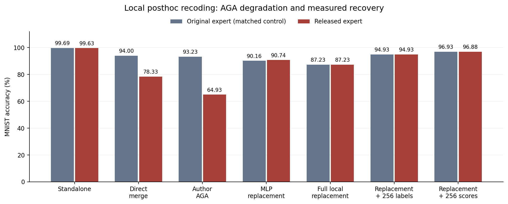

# MNIST 专家后处理实验

2026 年 10 月 12 日

## 1. 要解决什么问题

对已经微调好的专家模型，只在发布前修改参数，尽量保持它单独完成原任务的能力，同时让别人拿它做参数融合时性能下降。构造时不使用未来融合伙伴，也不做额外梯度微调。

本次只讲一个结果：**MNIST 独立准确率下降 0.06 个百分点；原版 AGA 后的融合准确率下降 28.30 个百分点。但公开参数替换和少量查询仍能恢复，防御还没有做成。**

## 2. 具体怎么做

模型是 CLIP ViT-B/32。只改第 7—9 个 Transformer block 的 Attention 和 MLP，使用 256 张 MNIST 训练图像做校准，不读取其真值标签。层的位置来自此前使用过训练标签的目标任务分析。

整个处理分三步。

**第一步：压缩 Attention 的 Value 表示。**

先记录 MNIST 图像在每个 head 中的 Value 响应，用主成分分解（不减均值）找到响应能量最大的 32 个方向，将原来的 64 维表示投影到这些方向。设 $V$ 是 Value 输入矩阵，$O$ 是输出矩阵，$b$ 是偏置，$P$ 是选出的子空间投影：

$$
V'=PV,\qquad b'=Pb,\qquad O'=OP.
$$

这一步删去选定子空间之外的响应。Q、K 不变。这里选的是“校准响应的主要方向”，还不能证明它们就是分类必需的任务子空间，是否保持任务能力要实际测。

**第二步：压缩 MLP 的内部表示。**

原 MLP 可以写成：

$$
z=Ax+b,\qquad f(x)=B\,g(z)+d.
$$

$x$ 是进入 MLP 的特征；$A$ 将它映射到 3072 个神经元，$g$ 是 QuickGELU 激活函数，$B$ 将神经元输出映射回模型特征；$b$、$d$ 是两次映射的偏置。

从校准隐藏响应 $g(z)$ 中提取 768 个主要方向，组成矩阵 $E$，将新的预激活改成 $E^\top z$。标准模型仍保留 3072 个神经元的位置，但只使用前 768 个，其余置零。

这会改变非线性计算，因为一般有 $g(E^\top z)\ne E^\top g(z)$，不能直接当成无损换基。因此还需要第三步补偿。

**第三步：重新计算 MLP 输出权重，补偿原任务计算。**

依次处理这三个 block，记录压缩后的隐藏响应。让它们的输出尽量接近“原专家的 block 输出减去当前模型 Attention 后的残差”，求：

$$
D^*=\arg\min_D
\|\Phi D-Y\|_F^2+\lambda\|D-D_0\|_F^2.
$$

$\Phi$ 是新的隐藏响应，加一列常数用于拟合偏置；$Y$ 是需要补偿的目标响应；$D$ 是待求的输出权重与偏置；$D_0$ 是原输出权重在新基中的表示。第二项约束更新不要过大，$\lambda=10^{-4}\|\Phi\|_F^2/N$，$N$ 是响应行数。

每个 block 用闭式线性求解做一次，共三次，再把结果写回参数。**没有梯度微调，但使用了校准图像和原专家的中间响应拟合。**

为什么可能影响融合？单独运行时，压缩后的输入表示与补偿后的输出权重配套工作。参数融合会分别混合这些权重，也改变进入各层的特征，原先的补偿关系未必继续成立。下面用真实融合检验这一点；上述构造本身不能保证融合一定受损。

## 3. 效果如何

八个专家使用 Task Arithmetic 融合，系数为 0.2。只处理 MNIST 专家，其他七个专家相同。每行对原始和处理后的专家施加同一种攻击。下表均为完整 MNIST 测试集 10,000 张的准确率。

| 条件 | 原始专家 | 处理后的专家 |
|---|---:|---:|
| 独立运行 | 99.69% | 99.63% |
| 直接融合 | 94.00% | 78.33% |
| 作者原版 AGA 后融合 | 93.23% | **64.93%** |
| 将三个 MLP 换成公开预训练参数后融合 | 90.16% | 90.74% |
| 替换全部修改部位后融合 | 87.23% | 87.23% |
| 全部替换＋查询 256 张图像的类别标签 | 94.93% | **94.93%** |
| 全部替换＋查询 256 张图像的连续类别分数 | 96.93% | 96.88% |

AGA 使用原作者代码。参数替换、标签查询和分数查询是分别测试的恢复方法，没有串联在 AGA 后面。

**有效的部分：** 独立准确率从 99.69% 到 99.63%，正确数减少 6 张；直接融合下降 15.67 个百分点，原版 AGA 后下降 28.30 个百分点。说明这个后处理确实能在基本保持原任务准确率的同时，干扰参数融合。

**失败的部分：** 仅替换三个 MLP 就恢复到 90.74%，此时独立准确率仍为 99.51%。攻击者再查询 256 个类别标签，把替换后融合模型的特征按标签分组，计算每类中心并修改输出投影，便恢复到 94.93%。它仍使用目标专家其他部位的参数。

恢复也有伙伴任务代价。类别标签恢复后，SVHN 为 72.46%，比未保护直接融合的 74.42% 低 1.96 个百分点。连续分数恢复能把 MNIST 提高到 96.88%，但 SVHN 降到 56.55%，代价更大。

## 4. 得到了什么结论

**本方案能制造融合干扰，但这种干扰仍能被公开替换和查询恢复消除。** 当前证据没有建立“去掉干扰就必须损失原任务能力”的关系。接下来需要解决的是任务计算与改写部位的关系，而不是继续调整同一方案的秩或强度。

这与老师的任务子空间思路还有距离：目前只是按校准响应压缩表示并补偿输出，尚未严格做到保留任务空间中的原计算、只在补空间制造干扰。PCA 和闭式拟合也是已有工具，当前不能据此声称形成了新防御。

## 5. 参考与实验范围

- [AGA 论文](https://arxiv.org/html/2606.30360v1)及[作者代码](https://github.com/krumpguo/secure-merge-attack)：用于恢复攻击与评测。
- [NUFILT 论文](https://arxiv.org/html/2509.21413v2)及[作者代码](https://github.com/zihuanqiu/NUFILT)：参考任务子空间分析；本实验未复现完整 NUFILT。

这是固定候选的历史结果，测试集此前已经观察过，尚未验证跨目标任务泛化。虽然融合包含八个专家，当前只评估 MNIST、SVHN、Cars、DTD，不是八任务均值或 Table 6 完整复现。EuroSAT 原划分及 checkpoint 与论文作者文件的一致性仍待核实。

结果已与服务器保存的原始预测重新核对：[复核记录](../../results/report_validation.json)、[融合与攻击结果](../../results/mnist/evaluation/results.json)、[标签查询恢复结果](../../results/mnist/hard_label_recovery/results.json)。
