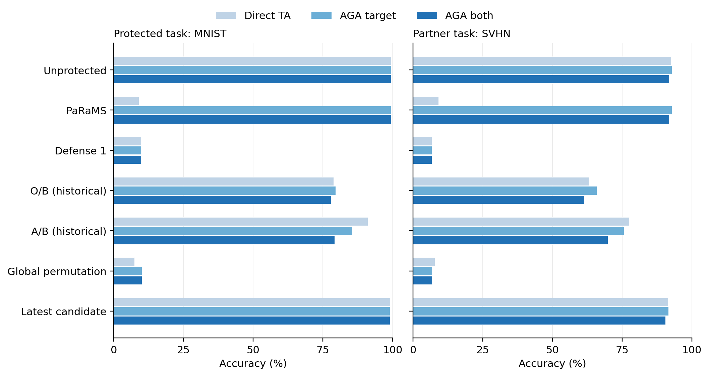

# 论文实验表汇总

主实验采用TA融合与原版AGA。以下均为本项目实际结果，不是原论文的数值。**对比尚未全部完成，缺项见最后一表。**

表格形式参考AGA原文v1第9页Table1：明确保护方法与攻击状态、数据集列、独立未保护控制；使用booktabs横线与简短表注。此处内容、评价范围与原论文不同。

[AGA原文](https://arxiv.org/pdf/2606.30360v1)。MergeLock仓库于2026-10-21核对仍仅README；未把其论文结果填入我们的表。

TeX正文为英文，Markdown解释使用中文。SA为单独使用准确率；M/D/S分别为MNIST/DTD/SVHN；T/P为该行目标/伙伴。所有准确率单位为百分比。

## 1. 主实验：双专家TA融合与原版AGA

| Protection | Standalone M | No recovery M / S | AGA target M / S | AGA both M / S |
|---|---|---|---|---|
| 无保护 | 99.69 | 99.37 / 92.50 | 99.30 / 92.78 | 99.32 / 91.77 |
| PaRaMS (full) | 99.69 | 8.92 / 9.15 | 99.30 / 92.79 | 99.32 / 91.77 |
| 防御一 | 99.69 | 9.80 / 6.70 | 9.80 / 6.70 | 9.80 / 6.70 |
| O/B [H] | 99.71 | 78.77 / 62.94 | 79.53 / 65.82 | 77.85 / 61.42 |
| A/B [H] | 99.65 | 91.07 / 77.46 | 85.42 / 75.50 | 79.20 / 69.84 |
| 全网置换 [K] | 99.69 | 7.39 / 7.74 | 10.09 / 6.78 | 10.09 / 6.78 |
| 最新防御二候选 [F] | 99.69 | 99.13 / 91.41 | 99.01 / 91.59 | 99.04 / 90.51 |

每格为受保护MNIST / 伙伴SVHN。H表示旧O/B、A/B不符合原任务间隔限制；K为已知全网置换对照；F为最新失败候选。完整PaRaMS作为完整基线保留，不因参数改动较大而排除。

## 2. Defense 1：三个保护任务

| Target / partner | Protection | Standalone | No recovery T / P | AGA target T / P | AGA both T / P |
|---|---|---|---|---|---|
| MNIST / SVHN | 无保护 | 99.69 | 99.37 / 92.50 | 99.30 / 92.78 | 99.32 / 91.77 |
| MNIST / SVHN | 防御一 | 99.69 | 9.80 / 6.70 | 9.80 / 6.70 | 9.80 / 6.70 |
| MNIST / DTD | 无保护 | 99.69 | 99.45 / 69.31 | 99.43 / 69.41 | 99.42 / 68.78 |
| MNIST / DTD | 防御一 | 99.69 | 9.80 / 2.13 | 9.80 / 2.13 | 9.80 / 2.13 |
| DTD / MNIST | 无保护 | 79.41 | 69.31 / 99.45 | 68.40 / 99.45 | 68.78 / 99.42 |
| DTD / MNIST | 防御一 | 79.41 | 2.13 / 21.09 | 2.13 / 21.09 | 2.13 / 21.05 |
| SVHN / MNIST | 无保护 | 97.46 | 92.50 / 99.37 | 91.56 / 99.39 | 91.77 / 99.32 |
| SVHN / MNIST | 防御一 | 97.46 | 6.70 / 9.80 | 6.70 / 9.80 | 6.70 / 9.80 |

每格为该行目标 / 伙伴，均为TA0.5。原版AGA不修改最终LayerNorm偏置；这些低分不等于能抵抗所有恢复。

## 3. 恢复权限对比

| Recovery pipeline | Additional access | Matched control M / S | Defense 1 M / S |
|---|---|---|---|
| No recovery | Published expert and partner | 99.37 / 92.50 | 9.80 / 6.70 |
| AGA target | Public base; defense-agnostic | 99.30 / 92.78 | 9.80 / 6.70 |
| AGA both | Public base; defense-agnostic | 99.32 / 91.77 | 9.80 / 6.70 |
| Diagonal adaptation | Specified diagonal family; no images | 99.37 / 92.50 | 9.80 / 6.70 |
| LN-bias cleanup | Known location; published projection | 99.37 / 92.50 | 99.37 / 92.50 |
| Student + TA | 2048 target-domain queries; student training | 95.53 / 95.95 | 95.53 / 95.95 |
| Student + AGA target | 2048 target-domain queries; student training | 95.35 / 95.94 | 95.35 / 95.94 |
| Student + AGA both | 2048 target-domain queries; student training | 95.25 / 95.29 | 95.25 / 95.29 |

不同恢复拥有的信息与数据不同，不能混称原版AGA。蒸馏使用2048张同分布训练图片和学生训练；两个教师的查询标签相同，因此只训练了一个问题。偏置清理知道修改位置；原生FP32前后分数差超限的旧记录保留。

## 4. 补充：更换融合方法

| Merger | Unprotected M / S | Defense 1 M / S | O/B [H] M / S | A/B [H] M / S |
|---|---|---|---|---|
| TA | 99.30 / 92.78 | 9.80 / 6.70 | 79.53 / 65.82 | 85.42 / 75.50 |
| TIES | 99.32 / 94.81 | 9.82 / 9.69 | 57.13 / 50.75 | 65.76 / 66.21 |
| DARE+TA | 99.30 / 92.81 | 24.20 / 25.50 | 79.52 / 66.01 | 86.11 / 75.87 |
| NUFILT M→S | 99.39 / 94.68 | 99.39 / 94.68 | 99.24 / 93.80 | 99.14 / 94.61 |
| NUFILT S→M | 99.07 / 95.35 | 99.07 / 95.35 | 98.97 / 95.07 | 98.86 / 95.38 |
| ProDistill | 99.42 / 96.83 | 9.80 / 6.70 | 99.42 / 96.16 | 99.42 / 96.46 |

均先执行原版AGA仅处理保护专家，每格MNIST / SVHN，各融合器各用自己的无保护控制。DARE为三个掩码种子的均值；NUFILT两种顺序分开；ProDistill另需每任务64张无标签训练校准图片和攻击方融合系数训练。融合方法不算新增恢复攻击。

## 5. DARE：三个固定掩码的波动

| Protection | MNIST mean +/- SD | SVHN mean +/- SD |
|---|---|---|
| 无保护 | 99.30 +/- 0.00 | 92.81 +/- 0.04 |
| 防御一 | 24.20 +/- 5.60 | 25.50 +/- 10.30 |
| O/B [H] | 79.52 +/- 0.57 | 66.01 +/- 0.71 |
| A/B [H] | 86.11 +/- 0.95 | 75.87 +/- 0.56 |

均值及样本标准差来自42、43、44三个掩码，不能称三个独立专家训练或三次防御训练。

## 6. 补充：DTD、SVHN保护专家的融合比较

| Target / partner | Merger / order | AGA scope | Control T / P | Defense 1 T / P |
|---|---|---|---|---|
| DTD / MNIST | NUFILT DTD / MNIST | None | 72.18 / 99.45 | 72.18 / 99.45 |
| DTD / MNIST | NUFILT DTD / MNIST | Target | 70.59 / 99.45 | 70.59 / 99.45 |
| DTD / MNIST | NUFILT DTD / MNIST | Both | 70.90 / 99.42 | 70.90 / 99.42 |
| DTD / MNIST | NUFILT MNIST / DTD | None | 72.71 / 99.51 | 72.71 / 99.51 |
| DTD / MNIST | NUFILT MNIST / DTD | Target | 70.96 / 99.51 | 70.96 / 99.51 |
| DTD / MNIST | NUFILT MNIST / DTD | Both | 71.44 / 99.48 | 71.44 / 99.48 |
| DTD / MNIST | ProDistill | None | 73.14 / 99.51 | 2.13 / 98.06 |
| DTD / MNIST | ProDistill | Target | 73.09 / 99.52 | 2.13 / 98.07 |
| DTD / MNIST | ProDistill | Both | 73.40 / 99.47 | 2.13 / 97.71 |
| SVHN / MNIST | NUFILT SVHN / MNIST | None | 95.11 / 99.19 | 95.11 / 99.19 |
| SVHN / MNIST | NUFILT SVHN / MNIST | Target | 94.40 / 99.25 | 94.40 / 99.25 |
| SVHN / MNIST | NUFILT SVHN / MNIST | Both | 94.51 / 99.14 | 94.51 / 99.14 |
| SVHN / MNIST | NUFILT MNIST / SVHN | None | 94.45 / 99.43 | 94.45 / 99.43 |
| SVHN / MNIST | NUFILT MNIST / SVHN | Target | 93.47 / 99.44 | 93.47 / 99.44 |
| SVHN / MNIST | NUFILT MNIST / SVHN | Both | 93.75 / 99.39 | 93.75 / 99.39 |
| SVHN / MNIST | ProDistill | None | 96.73 / 99.45 | 6.70 / 9.80 |
| SVHN / MNIST | ProDistill | Target | 96.45 / 99.45 | 6.70 / 9.80 |
| SVHN / MNIST | ProDistill | Both | 96.56 / 99.44 | 6.70 / 9.80 |

每格为该行目标 / MNIST伙伴。NUFILT保留两种顺序；SVHN无恢复、双方AGA的单元复用此前相同融合模型并交换任务列，不重复训练。ProDistill需要每任务64张无标签校准图和融合系数训练，不能算新增无数据恢复攻击。

## 7. 八专家参与、三个数据集评价

| Protected task | Protection | No recovery M / D / S | AGA target M / D / S |
|---|---|---|---|
| MNIST | 无保护 | 94.00 / 52.18 / 74.42 | 93.23 / 52.34 / 73.90 |
| MNIST | 防御一 | 9.80 / 5.85 / 6.70 | 9.80 / 5.90 / 6.70 |
| MNIST | O/B [H] | 51.73 / 50.64 / 40.57 | 54.22 / 50.80 / 44.63 |
| MNIST | A/B [H] | 61.94 / 50.21 / 53.09 | 59.16 / 50.59 / 51.97 |
| MNIST | PaRaMS (full) | 9.82 / 2.13 / 9.65 | 93.23 / 52.34 / 73.90 |
| MNIST | PaRaMS attention ablation | 94.00 / 52.13 / 74.45 | 93.23 / 52.34 / 73.90 |
| DTD | 无保护 | 94.00 / 52.18 / 74.42 | 94.06 / 51.38 / 74.46 |
| DTD | 防御一 | 72.22 / 2.13 / 52.48 | 72.30 / 2.13 / 52.47 |
| SVHN | 无保护 | 94.00 / 52.18 / 74.42 | 93.78 / 52.18 / 72.53 |
| SVHN | 防御一 | 9.80 / 27.07 / 6.70 | 9.80 / 27.07 / 6.70 |

TA0.2，每格固定MNIST / DTD / SVHN顺序。其余五个数据集未评价，不能写完整八任务表或八任务均值；与双专家TA0.5分开。

## 8. Unmask：独立的八专家恢复设置

| Protected task | Protection | No recovery M / D / S | Unmask0.3 M / D / S |
|---|---|---|---|
| MNIST | 无保护 | 94.00 / 52.18 / 74.42 | 7.52 / 1.97 / 9.55 |
| MNIST | 防御一 | 9.80 / 5.85 / 6.70 | 10.28 / 2.07 / 7.76 |
| MNIST | O/B [H] | 51.73 / 50.64 / 40.57 | 11.35 / 1.97 / 17.59 |
| MNIST | A/B [H] | 61.94 / 50.21 / 53.09 | 10.89 / 2.13 / 12.85 |
| MNIST | PaRaMS (full) | 9.82 / 2.13 / 9.65 | 9.58 / 1.70 / 14.45 |
| MNIST | PaRaMS attention ablation | 94.00 / 52.13 / 74.45 | 7.51 / 1.97 / 9.55 |
| DTD | 无保护 | 94.00 / 52.18 / 74.42 | 10.00 / 2.55 / 9.56 |
| DTD | 防御一 | 72.22 / 2.13 / 52.48 | 10.28 / 2.13 / 7.76 |
| SVHN | 无保护 | 94.00 / 52.18 / 74.42 | 7.91 / 2.13 / 9.15 |
| SVHN | 防御一 | 9.80 / 27.07 / 6.70 | 11.35 / 2.23 / 19.59 |

按论文公式，从融合参数减去0.3倍整份发布专家；未保护控制也执行同样操作，不与AGA组合。这里是公式适配而非官方完整复现。未保护模型也会崩溃，不能只凭绝对低分宣布防御成功或知识恢复。

## 9. 针对偏置的恢复：数值协议分列

| Target / partner | Numerics | Scope | Control T / P | Defense 1 T / P |
|---|---|---|---|---|
| MNIST / SVHN | Native FP32 | Target | 99.37 / 92.50 | 99.37 / 92.50 |
| MNIST / SVHN | Native FP32 | Both | 99.37 / 92.50 | 99.37 / 92.50 |
| MNIST / DTD | Native FP32 | Target | 99.45 / 69.26 | 99.45 / 69.26 |
| MNIST / DTD | Native FP32 | Both | 99.45 / 69.26 | 99.45 / 69.26 |
| DTD / MNIST | FP32 prefix; FP64 readout | Target | 69.26 / 99.45 | 69.26 / 99.45 |
| DTD / MNIST | FP32 prefix; FP64 readout | Both | 69.26 / 99.45 | 69.26 / 99.45 |
| SVHN / MNIST | FP32 prefix; FP64 readout | Target | 92.50 / 99.37 | 92.50 / 99.37 |
| SVHN / MNIST | FP32 prefix; FP64 readout | Both | 92.50 / 99.37 | 92.50 / 99.37 |

每格目标 / 伙伴。MNIST采用原生FP32；DTD、SVHN采用预先固定的FP32前缀、FP64最终读出。两类不可混表。原生DTD数值控制失败与MNIST分数差超限都保留，不声称完整FP32函数严格相同。

## 10. 任务方向内外变化与真实融合效果

| Fixed model | Task-inside distance | Task-outside distance | Standalone M | TA M | AGA both M |
|---|---|---|---|---|---|
| 全网置换 [K] | 2.69895 | 11.86048 | 99.69 | 7.39 | 10.09 |
| Latest compensation [F] | 0.49964 | 11.85437 | 99.69 | 99.13 | 99.04 |

相同74个矩阵、原专家减基座的32个任务右奇异方向；矩阵距离不含偏置、LayerNorm与embedding。任务外距离相近，但融合效果差别很大，不能把距离本身当作保护效果。

## 11. 最新Defense 2候选：任务内外与联合补偿消融

| Counterfactual | Correct | Prediction changes | Max. relative gap change |
|---|---|---|---|
| Task-inside matrices only | 511/512 | 1 | 1.05992 |
| Task-outside matrices only | 503/512 | 9 | 1.82071 |
| All changed matrices | 505/512 | 7 | 1.87001 |
| Other parameters only | 505/512 | 7 | 1.85216 |
| Complete joint change | 512/512 | 0 | 3.02985e-06 |

固定512张构造训练图，不是测试结果。仅矩阵任务内、仅任务外、全部矩阵、其他参数与完整联合共五项。完整联合保持原能力，但真实AGA后融合仍接近99%；没有根据消融改参数。

## 12. 已完成与尚缺的实验

| Item | Status |
|---|---|
| TA + original AGA | Completed: two-expert pairs; target/both recovery scopes; protected and partner accuracy. |
| 防御一 | MNIST, DTD, SVHN completed; targeted cleanup and fixed-budget hard-label recovery completed with separate permissions/numerics. |
| New Defense 2 | Not achieved: latest complete evaluation still gives about99 percent after fusion/recovery. Historical O/B and A/B task-bound failures retained. |
| PaRaMS | Full-default protection and Attention ablation completed for MNIST. Corresponding DTD/SVHN full-defense baselines are missing. Diagonal recovery is a native adaptation. |
| MergeLock | Not run: official repository currently contains only README/Coming Soon. No invented implementation or paper scores. |
| MergeGuard / ARF | Full defenses not run; training-stage conditions differ. Unmask formula was tested separately; GradErase not reproduced. |
| MergeBarrier | Full defense not run; architecture adaptation and verified implementation missing. |
| Eight-task benchmark | Eight experts participated; protected/evaluated targets cover MNIST/DTD/SVHN. Complete protected cases and evaluation for SUN397/Cars/RESISC45/EuroSAT/GTSRB are missing. |
| Other mergers | TIES, three DARE masks, NUFILT and ProDistill completed in documented scopes. Full TSV-Merge, CAT and LOT not run. |
| Reliability | Per-class/pair counts and source audits retained. Only DARE has the stated three-mask comparison; do not present deterministic rows as multi-seed results. |

这是一份完成情况清单，不能说所有对比已做完；缺项不填零分，也不拿别人的论文成绩冒充我们的实测。

## 图1. 同一组模型的直接融合与AGA后融合

目标任务和伙伴任务分别显示；每个柱来自固定配置，未添加不存在的随机重复误差条。详细数值见表1。

