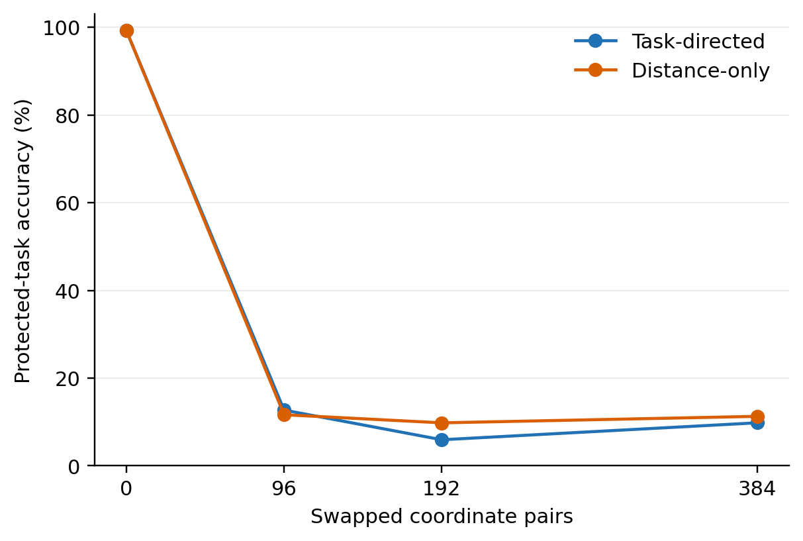

# 论文实验表汇总

主实验采用TA融合与原版AGA。以下均为本项目实际结果，不是原论文的数值。**对比尚未全部完成，缺项见最后一表。**

表格形式参考AGA原文v1第9页Table1：明确保护方法与攻击状态、数据集列、独立未保护控制；使用booktabs横线与简短表注。此处内容、评价范围与原论文不同。

[AGA原文](https://arxiv.org/pdf/2606.30360v1)。MergeLock仓库于2026-10-23核对仍仅README；未把其论文结果填入我们的表。

TeX正文为英文，Markdown解释使用中文。SA为单独使用准确率；M/D/S分别为MNIST/DTD/SVHN；T/P为该行目标/伙伴。所有准确率单位为百分比。

## 1. 主实验：双专家TA融合与原版AGA

| Protection | Standalone M | No recovery M / S | AGA target M / S | AGA both M / S |
|---|---|---|---|---|
| 无保护 | 99.69 | 99.37 / 92.50 | 99.30 / 92.78 | 99.32 / 91.77 |
| PaRaMS (full) | 99.69 | 8.92 / 9.15 | 99.30 / 92.79 | 99.32 / 91.77 |
| 防御一 | 99.69 | 9.80 / 6.70 | 9.80 / 6.70 | 9.80 / 6.70 |
| O/B [H] | 99.71 | 78.77 / 62.94 | 79.53 / 65.82 | 77.85 / 61.42 |
| A/B [H] | 99.65 | 91.07 / 77.46 | 85.42 / 75.50 | 79.20 / 69.84 |
| 防御二（固定结构）[K] | 99.69 | 7.39 / 7.74 | 10.09 / 6.78 | 10.09 / 6.78 |
| 先前失败候选 [F] | 99.69 | 99.13 / 91.41 | 99.01 / 91.59 | 99.04 / 90.51 |
| 防御二（任务方向构造） | 99.69 | 10.98 / 14.32 | 9.80 / 9.81 | 9.80 / 9.83 |
| Defense 2 (numerical) | 99.50 | 24.46 / 19.83 | 13.02 / 19.80 | 13.09 / 19.68 |
| Defense 2 (public backbone) | 99.47 | 15.65 / 19.56 | 11.57 / 19.61 | 11.52 / 19.56 |

每格为受保护MNIST / 伙伴SVHN。H表示旧O/B、A/B不符合原任务间隔限制；K为已知全网置换对照；F为先前失败候选。完整PaRaMS保留。新增数值版使用1024目标训练图校准、12次线性求解、不微调原专家；独立准确率下降0.19个百分点，原严格间隔检查未通过，不能称函数完全相同。

## 2. 主对比：三个保护任务、相同TA与原版AGA

| Target / partner | Protection | Standalone | No recovery T / P | AGA target T / P | AGA both T / P |
|---|---|---|---|---|---|
| MNIST / SVHN | 无保护 | 99.69 | 99.37 / 92.50 | 99.30 / 92.78 | 99.32 / 91.77 |
| MNIST / SVHN | 防御一 | 99.69 | 9.80 / 6.70 | 9.80 / 6.70 | 9.80 / 6.70 |
| MNIST / SVHN | PaRaMS (full) | 99.69 | 8.92 / 9.15 | 99.30 / 92.79 | 99.32 / 91.77 |
| MNIST / SVHN | Defense 2 (structure) | 99.69 | 7.39 / 7.74 | 10.09 / 6.78 | 10.09 / 6.78 |
| MNIST / SVHN | 防御二（任务方向构造） | 99.69 | 10.98 / 14.32 | 9.80 / 9.81 | 9.80 / 9.83 |
| DTD / MNIST | 无保护 | 79.41 | 69.31 / 99.45 | 68.40 / 99.45 | 68.78 / 99.42 |
| DTD / MNIST | 防御一 | 79.41 | 2.13 / 21.09 | 2.13 / 21.09 | 2.13 / 21.05 |
| DTD / MNIST | PaRaMS (full) | 79.41 | 2.07 / 8.92 | 68.35 / 99.45 | 68.78 / 99.42 |
| DTD / MNIST | Defense 2 (structure) | 79.41 | 2.23 / 8.68 | 2.18 / 9.89 | 2.13 / 9.85 |
| DTD / MNIST | 防御二（任务方向构造） | 79.41 | 2.39 / 10.29 | 2.39 / 10.09 | 2.39 / 10.09 |
| SVHN / MNIST | 无保护 | 97.46 | 92.50 / 99.37 | 91.56 / 99.39 | 91.77 / 99.32 |
| SVHN / MNIST | 防御一 | 97.46 | 6.70 / 9.80 | 6.70 / 9.80 | 6.70 / 9.80 |
| SVHN / MNIST | PaRaMS (full) | 97.46 | 9.09 / 8.95 | 91.56 / 99.39 | 91.77 / 99.32 |
| SVHN / MNIST | Defense 2 (structure) | 97.46 | 7.74 / 7.39 | 9.74 / 10.28 | 9.63 / 10.28 |
| SVHN / MNIST | 防御二（任务方向构造） | 97.46 | 7.30 / 9.45 | 6.45 / 12.19 | 6.45 / 12.22 |
| MNIST / SVHN | Defense 2 (numerical) | 99.50 | 24.46 / 19.83 | 13.02 / 19.80 | 13.09 / 19.68 |
| DTD / MNIST | Defense 2 (numerical) | 43.46 | 2.87 / 10.09 | 7.29 / 10.09 | 7.39 / 10.09 |
| SVHN / MNIST | Defense 2 (numerical) | 96.25 | 19.63 / 11.35 | 16.98 / 10.85 | 16.90 / 10.78 |

每格为该行受保护任务 / 伙伴准确率。PaRaMS保留官方完整默认设置；固定结构与任务方向构造分列，后者使用同一有限目标和各自原任务SVD。三保护任务对应两个无序任务组合，不冒充完整八任务表。方法贡献、已知结构和已知位置等针对性恢复单独报告。参数改动尺度和数值协议分列，不通过裁剪基线追求同参数距离。

## 3. 同一防御二：三个任务的六个保护方向

| Target / partner | Protection | No recovery T / P | AGA target T / P | AGA both T / P |
|---|---|---|---|---|
| MNIST / SVHN | 无保护 | 99.37 / 92.50 | 99.30 / 92.78 | 99.32 / 91.77 |
| MNIST / SVHN | 防御二（任务方向构造） | 10.98 / 14.32 | 9.80 / 9.81 | 9.80 / 9.83 |
| DTD / MNIST | 无保护 | 69.31 / 99.45 | 68.40 / 99.45 | 68.78 / 99.42 |
| DTD / MNIST | 防御二（任务方向构造） | 2.39 / 10.29 | 2.39 / 10.09 | 2.39 / 10.09 |
| SVHN / MNIST | 无保护 | 92.50 / 99.37 | 91.56 / 99.39 | 91.77 / 99.32 |
| SVHN / MNIST | 防御二（任务方向构造） | 7.30 / 9.45 | 6.45 / 12.19 | 6.45 / 12.22 |
| MNIST / DTD | 无保护 | 99.45 / 69.31 | 99.43 / 69.41 | 99.42 / 68.78 |
| MNIST / DTD | 防御二（任务方向构造） | 5.01 / 1.81 | 9.80 / 2.18 | 9.80 / 2.18 |
| DTD / SVHN | 无保护 | 70.59 / 95.36 | 69.15 / 95.44 | 69.52 / 94.18 |
| DTD / SVHN | 防御二（任务方向构造） | 2.93 / 8.85 | 2.34 / 6.42 | 2.34 / 6.42 |
| SVHN / DTD | 无保护 | 95.36 / 70.59 | 94.09 / 70.74 | 94.18 / 69.52 |
| SVHN / DTD | 防御二（任务方向构造） | 7.22 / 2.13 | 6.53 / 2.07 | 6.51 / 2.07 |

每格为目标 / 伙伴。六方向对应三种无序任务组合，不是六个独立数据集。三份发布和原作者AGA权重均冻结；新增评价是在旧结果之后登记，没有改排序、rank、目标或参数。TA0.5、原AGA两范围、各自无保护控制、逐类配对及原128批上下文重放均保留。测试集历史暴露，不称盲测；已知方式恢复会还原这些模型，另表报告。

## 4. 任务方向防御二：已知修改方式的针对性恢复

| Target / partner | Recovery rule | TA T / P | AGA target T / P | AGA both T / P |
|---|---|---|---|---|
| MNIST / SVHN | 不作针对性匹配 | 10.98 / 14.32 | 9.80 / 9.81 | 9.80 / 9.83 |
| MNIST / SVHN | 已知方式匹配 | 99.37 / 92.50 | 99.30 / 92.78 | 99.32 / 91.77 |
| DTD / MNIST | 不作针对性匹配 | 2.39 / 10.29 | 2.39 / 10.09 | 2.39 / 10.09 |
| DTD / MNIST | 已知方式匹配 | 69.31 / 99.45 | 68.40 / 99.45 | 68.78 / 99.42 |
| SVHN / MNIST | 不作针对性匹配 | 7.30 / 9.45 | 6.45 / 12.19 | 6.45 / 12.22 |
| SVHN / MNIST | 已知方式匹配 | 92.50 / 99.37 | 91.56 / 99.39 | 91.77 / 99.32 |

每格为目标 / 伙伴。两种设置都只给发布权重与公开基座；针对性匹配另知道全网残差坐标换序和CLIP结构，不给原专家、真实任务向量、秘密排列或图片。三个恢复模型及无保护控制均与原专家全部158张量精确相同，因此复用已核原分数，不称新图片前向。原版AGA与该针对性恢复分别报告，不外推所有防御。

## 5. Defense 1：三个保护任务

| Target / partner | Protection | Standalone | No recovery T / P | AGA target T / P | AGA both T / P |
|---|---|---|---|---|---|
| MNIST / SVHN | 无保护 | 99.69 | 99.37 / 92.50 | 99.30 / 92.78 | 99.32 / 91.77 |
| MNIST / SVHN | 防御一 | 99.69 | 9.80 / 6.70 | 9.80 / 6.70 | 9.80 / 6.70 |
| MNIST / DTD | 无保护 | 99.69 | 99.45 / 69.31 | 99.43 / 69.41 | 99.42 / 68.78 |
| MNIST / DTD | 防御一 | 99.69 | 9.80 / 2.13 | 9.80 / 2.13 | 9.80 / 2.13 |
| DTD / MNIST | 无保护 | 79.41 | 69.31 / 99.45 | 68.40 / 99.45 | 68.78 / 99.42 |
| DTD / MNIST | 防御一 | 79.41 | 2.13 / 21.09 | 2.13 / 21.09 | 2.13 / 21.05 |
| SVHN / MNIST | 无保护 | 97.46 | 92.50 / 99.37 | 91.56 / 99.39 | 91.77 / 99.32 |
| SVHN / MNIST | 防御一 | 97.46 | 6.70 / 9.80 | 6.70 / 9.80 | 6.70 / 9.80 |

每格为该行目标 / 伙伴，均为TA0.5。原版AGA不修改最终LayerNorm偏置；这些低分不等于能抵抗所有恢复。

## 6. 恢复权限对比

| Recovery pipeline | Additional access | Matched control M / S | Defense 1 M / S |
|---|---|---|---|
| No recovery | Published expert and partner | 99.37 / 92.50 | 9.80 / 6.70 |
| AGA target | Public base; defense-agnostic | 99.30 / 92.78 | 9.80 / 6.70 |
| AGA both | Public base; defense-agnostic | 99.32 / 91.77 | 9.80 / 6.70 |
| Diagonal adaptation | Specified diagonal family; no images | 99.37 / 92.50 | 9.80 / 6.70 |
| LN-bias cleanup | Known location; published projection | 99.37 / 92.50 | 99.37 / 92.50 |
| Student + TA | 2048 target-domain queries; student training | 95.53 / 95.95 | 95.53 / 95.95 |
| Student + AGA target | 2048 target-domain queries; student training | 95.35 / 95.94 | 95.35 / 95.94 |
| Student + AGA both | 2048 target-domain queries; student training | 95.25 / 95.29 | 95.25 / 95.29 |

不同恢复拥有的信息与数据不同，不能混称原版AGA。蒸馏使用2048张同分布训练图片和学生训练；两个教师的查询标签相同，因此只训练了一个问题。偏置清理知道修改位置；原生FP32前后分数差超限的旧记录保留。

## 7. 补充：更换融合方法

| Merger | Unprotected M / S | Defense 1 M / S | O/B [H] M / S | A/B [H] M / S |
|---|---|---|---|---|
| TA | 99.30 / 92.78 | 9.80 / 6.70 | 79.53 / 65.82 | 85.42 / 75.50 |
| TIES | 99.32 / 94.81 | 9.82 / 9.69 | 57.13 / 50.75 | 65.76 / 66.21 |
| DARE+TA | 99.30 / 92.81 | 24.20 / 25.50 | 79.52 / 66.01 | 86.11 / 75.87 |
| NUFILT M→S | 99.39 / 94.68 | 99.39 / 94.68 | 99.24 / 93.80 | 99.14 / 94.61 |
| NUFILT S→M | 99.07 / 95.35 | 99.07 / 95.35 | 98.97 / 95.07 | 98.86 / 95.38 |
| ProDistill | 99.42 / 96.83 | 9.80 / 6.70 | 99.42 / 96.16 | 99.42 / 96.46 |

均先执行原版AGA仅处理保护专家，每格MNIST / SVHN，各融合器各用自己的无保护控制。DARE为三个掩码种子的均值；NUFILT两种顺序分开；ProDistill另需每任务64张无标签训练校准图片和攻击方融合系数训练。融合方法不算新增恢复攻击。

## 8. DARE：三个固定掩码的波动

| Protection | MNIST mean +/- SD | SVHN mean +/- SD |
|---|---|---|
| 无保护 | 99.30 +/- 0.00 | 92.81 +/- 0.04 |
| 防御一 | 24.20 +/- 5.60 | 25.50 +/- 10.30 |
| O/B [H] | 79.52 +/- 0.57 | 66.01 +/- 0.71 |
| A/B [H] | 86.11 +/- 0.95 | 75.87 +/- 0.56 |

均值及样本标准差来自42、43、44三个掩码，不能称三个独立专家训练或三次防御训练。

## 9. 补充：DTD、SVHN保护专家的融合比较

| Target / partner | Merger / order | AGA scope | Control T / P | Defense 1 T / P |
|---|---|---|---|---|
| DTD / MNIST | NUFILT DTD / MNIST | None | 72.18 / 99.45 | 72.18 / 99.45 |
| DTD / MNIST | NUFILT DTD / MNIST | Target | 70.59 / 99.45 | 70.59 / 99.45 |
| DTD / MNIST | NUFILT DTD / MNIST | Both | 70.90 / 99.42 | 70.90 / 99.42 |
| DTD / MNIST | NUFILT MNIST / DTD | None | 72.71 / 99.51 | 72.71 / 99.51 |
| DTD / MNIST | NUFILT MNIST / DTD | Target | 70.96 / 99.51 | 70.96 / 99.51 |
| DTD / MNIST | NUFILT MNIST / DTD | Both | 71.44 / 99.48 | 71.44 / 99.48 |
| DTD / MNIST | ProDistill | None | 73.14 / 99.51 | 2.13 / 98.06 |
| DTD / MNIST | ProDistill | Target | 73.09 / 99.52 | 2.13 / 98.07 |
| DTD / MNIST | ProDistill | Both | 73.40 / 99.47 | 2.13 / 97.71 |
| SVHN / MNIST | NUFILT SVHN / MNIST | None | 95.11 / 99.19 | 95.11 / 99.19 |
| SVHN / MNIST | NUFILT SVHN / MNIST | Target | 94.40 / 99.25 | 94.40 / 99.25 |
| SVHN / MNIST | NUFILT SVHN / MNIST | Both | 94.51 / 99.14 | 94.51 / 99.14 |
| SVHN / MNIST | NUFILT MNIST / SVHN | None | 94.45 / 99.43 | 94.45 / 99.43 |
| SVHN / MNIST | NUFILT MNIST / SVHN | Target | 93.47 / 99.44 | 93.47 / 99.44 |
| SVHN / MNIST | NUFILT MNIST / SVHN | Both | 93.75 / 99.39 | 93.75 / 99.39 |
| SVHN / MNIST | ProDistill | None | 96.73 / 99.45 | 6.70 / 9.80 |
| SVHN / MNIST | ProDistill | Target | 96.45 / 99.45 | 6.70 / 9.80 |
| SVHN / MNIST | ProDistill | Both | 96.56 / 99.44 | 6.70 / 9.80 |

每格为该行目标 / MNIST伙伴。NUFILT保留两种顺序；SVHN无恢复、双方AGA的单元复用此前相同融合模型并交换任务列，不重复训练。ProDistill需要每任务64张无标签校准图和融合系数训练，不能算新增无数据恢复攻击。

## 10. 八专家参与、三个数据集评价

| Protected task | Protection | No recovery M / D / S | AGA target M / D / S |
|---|---|---|---|
| MNIST | 无保护 | 94.00 / 52.18 / 74.42 | 93.23 / 52.34 / 73.90 |
| MNIST | 防御一 | 9.80 / 5.85 / 6.70 | 9.80 / 5.90 / 6.70 |
| MNIST | O/B [H] | 51.73 / 50.64 / 40.57 | 54.22 / 50.80 / 44.63 |
| MNIST | A/B [H] | 61.94 / 50.21 / 53.09 | 59.16 / 50.59 / 51.97 |
| MNIST | PaRaMS (full) | 9.82 / 2.13 / 9.65 | 93.23 / 52.34 / 73.90 |
| MNIST | PaRaMS attention ablation | 94.00 / 52.13 / 74.45 | 93.23 / 52.34 / 73.90 |
| MNIST | 防御二（任务方向构造） | 10.26 / 4.31 / 16.18 | 11.35 / 2.82 / 15.06 |
| DTD | 无保护 | 94.00 / 52.18 / 74.42 | 94.06 / 51.38 / 74.46 |
| DTD | 防御一 | 72.22 / 2.13 / 52.48 | 72.30 / 2.13 / 52.47 |
| DTD | 防御二（任务方向构造） | 8.87 / 3.24 / 7.11 | 8.85 / 4.89 / 8.63 |
| SVHN | 无保护 | 94.00 / 52.18 / 74.42 | 93.78 / 52.18 / 72.53 |
| SVHN | 防御一 | 9.80 / 27.07 / 6.70 | 9.80 / 27.07 / 6.70 |
| SVHN | 防御二（任务方向构造） | 17.24 / 5.90 / 13.28 | 8.93 / 4.89 / 11.64 |

TA0.2，每格固定MNIST / DTD / SVHN顺序。任务方向防御二使用双专家实验的同一三份发布，未改参数；原版AGA只处理保护专家。其余五个数据集未评价，不能写完整八任务表或八任务均值；此处同时改变参与数与系数，不当作孤立系数消融。已知方式恢复的限制仍保留。

## 11. Unmask：独立的八专家恢复设置

| Protected task | Protection | No recovery M / D / S | Unmask0.3 M / D / S |
|---|---|---|---|
| MNIST | 无保护 | 94.00 / 52.18 / 74.42 | 7.52 / 1.97 / 9.55 |
| MNIST | 防御一 | 9.80 / 5.85 / 6.70 | 10.28 / 2.07 / 7.76 |
| MNIST | O/B [H] | 51.73 / 50.64 / 40.57 | 11.35 / 1.97 / 17.59 |
| MNIST | A/B [H] | 61.94 / 50.21 / 53.09 | 10.89 / 2.13 / 12.85 |
| MNIST | PaRaMS (full) | 9.82 / 2.13 / 9.65 | 9.58 / 1.70 / 14.45 |
| MNIST | PaRaMS attention ablation | 94.00 / 52.13 / 74.45 | 7.51 / 1.97 / 9.55 |
| DTD | 无保护 | 94.00 / 52.18 / 74.42 | 10.00 / 2.55 / 9.56 |
| DTD | 防御一 | 72.22 / 2.13 / 52.48 | 10.28 / 2.13 / 7.76 |
| SVHN | 无保护 | 94.00 / 52.18 / 74.42 | 7.91 / 2.13 / 9.15 |
| SVHN | 防御一 | 9.80 / 27.07 / 6.70 | 11.35 / 2.23 / 19.59 |

按论文公式，从融合参数减去0.3倍整份发布专家；未保护控制也执行同样操作，不与AGA组合。这里是公式适配而非官方完整复现。未保护模型也会崩溃，不能只凭绝对低分宣布防御成功或知识恢复。

## 12. 针对偏置的恢复：数值协议分列

| Target / partner | Numerics | Scope | Control T / P | Defense 1 T / P |
|---|---|---|---|---|
| MNIST / SVHN | Native FP32 | Target | 99.37 / 92.50 | 99.37 / 92.50 |
| MNIST / SVHN | Native FP32 | Both | 99.37 / 92.50 | 99.37 / 92.50 |
| MNIST / DTD | Native FP32 | Target | 99.45 / 69.26 | 99.45 / 69.26 |
| MNIST / DTD | Native FP32 | Both | 99.45 / 69.26 | 99.45 / 69.26 |
| DTD / MNIST | FP32 prefix; FP64 readout | Target | 69.26 / 99.45 | 69.26 / 99.45 |
| DTD / MNIST | FP32 prefix; FP64 readout | Both | 69.26 / 99.45 | 69.26 / 99.45 |
| SVHN / MNIST | FP32 prefix; FP64 readout | Target | 92.50 / 99.37 | 92.50 / 99.37 |
| SVHN / MNIST | FP32 prefix; FP64 readout | Both | 92.50 / 99.37 | 92.50 / 99.37 |

每格目标 / 伙伴。MNIST采用原生FP32；DTD、SVHN采用预先固定的FP32前缀、FP64最终读出。两类不可混表。原生DTD数值控制失败与MNIST分数差超限都保留，不声称完整FP32函数严格相同。

## 13. 任务方向内外变化与真实融合效果

| Fixed model | Task-inside distance | Task-outside distance | Standalone M | TA M | AGA both M |
|---|---|---|---|---|---|
| 全网置换 [K] | 2.69895 | 11.86048 | 99.69 | 7.39 | 10.09 |
| Previous compensation [F] | 0.49964 | 11.85437 | 99.69 | 99.13 | 99.04 |
| Distance-only pairing | 2.96985 | 12.02151 | 99.69 | 13.99 | 11.08 |
| Task-directed pairing | 2.70843 | 12.03349 | 99.69 | 10.98 | 9.80 |

相同74个矩阵、原专家减基座的32个任务右奇异方向；矩阵距离不含偏置、LayerNorm与embedding。任务外距离相近，但融合效果差别很大，不能把距离本身当作保护效果。Distance-only pairing为固定消融，不按分类成绩择优；未实测项留空。

## 14. 固定消融：去除任务方向项

| Protected / partner | Construction | Standalone | TA | AGA target | AGA both |
|---|---|---|---|---|---|
| MNIST / SVHN | Task-directed | 99.69 | 10.98 / 14.32 | 9.80 / 9.81 | 9.80 / 9.83 |
| MNIST / SVHN | Distance-only | 99.69 | 13.99 / 8.78 | 11.27 / 16.32 | 11.08 / 16.30 |
| DTD / MNIST | Task-directed | 79.41 | 2.39 / 10.29 | 2.39 / 10.09 | 2.39 / 10.09 |
| DTD / MNIST | Distance-only | 79.41 | 1.44 / 10.41 | 2.02 / 9.82 | 1.97 / 9.82 |
| SVHN / MNIST | Task-directed | 97.46 | 7.30 / 9.45 | 6.45 / 12.19 | 6.45 / 12.22 |
| SVHN / MNIST | Distance-only | 97.46 | 9.36 / 9.35 | 8.52 / 9.58 | 8.48 / 9.58 |

三任务使用相同的目标、基座、74矩阵、rank32及贪心规则，仅去除任务方向项。对照顺序在主方法读图前已固定，分类补测随后登记。SVD并非每个任务都更好；完整目标和伙伴成绩保留，不按结果换发布。

## 15. 修改幅度：同一固定顺序的不同交换数量

| Construction | Pairs | Distance | Standalone M | TA M / S | AGA target M / S | AGA both M / S |
|---|---|---|---|---|---|---|
| 无保护 | 0 | 0.000 | 99.69 | 99.37 / 92.50 | 99.30 / 92.78 | 99.32 / 91.77 |
| Task-directed | 96 | 10.681 | 99.69 | 14.71 / 10.89 | 12.70 / 11.84 | 12.64 / 11.89 |
| Distance-only | 96 | 11.187 | 99.69 | 7.38 / 9.40 | 11.64 / 8.95 | 11.89 / 9.00 |
| Task-directed | 192 | 12.829 | 99.69 | 3.85 / 15.51 | 5.93 / 13.64 | 5.91 / 13.58 |
| Distance-only | 192 | 13.281 | 99.69 | 8.14 / 10.17 | 9.79 / 7.39 | 9.79 / 7.38 |
| Task-directed | 384 | 16.499 | 99.69 | 10.98 / 14.32 | 9.80 / 9.81 | 9.80 / 9.83 |
| Distance-only | 384 | 16.671 | 99.69 | 13.99 / 8.78 | 11.27 / 16.32 | 11.08 / 16.30 |

保护MNIST，伙伴SVHN；融合列为目标 / 伙伴准确率。沿用各固定顺序的前96、192、384对交换，0和384结果直接复用，只新增四个对照。参数距离按逻辑矩阵及各偏置计算；保持独立能力，不按成绩选顺序或幅度。已知方式恢复的限制仍保留。

## 16. 数值版防御二：SVD与逐层补偿消融

| Construction | Distance | Task probe | SA M | TA M / S | AGA target M / S | AGA both M / S |
|---|---|---|---|---|---|---|
| Complete method | 8.842 | 3.2e-09 | 99.50 | 24.46 / 19.83 | 13.02 / 19.80 | 13.09 / 19.68 |
| Without SVD | 9.091 | 0.35 | 99.52 | 10.10 / 9.74 | 11.10 / 12.94 | 10.23 / 12.88 |
| Without prefix correction | 8.703 | 3.2e-09 | 99.42 | 28.17 / 21.08 | 19.19 / 19.20 | 19.19 / 19.03 |

相同1024张训练构造图、12层、rank32和0.01阻尼。Task probe为原任务右奇异方向上的相对参数改动，不是分类功能不变的证明。去掉SVD仍有效，不能把保护全归功于SVD；逐层补偿的结果与去除控制直接对照。完整方法主点冻结，不按消融成绩替换。独立准确率损失与原严格间隔/小样本失败分别报告。

## 17. 数值版防御二：同一源上的分量检查

| Component | Correct | Prediction changes |
|---|---|---|
| A_only | 106/1024 | 919 |
| B_only | 109/1024 | 915 |
| No_reconstruction | 107/1024 | 917 |
| Joint | 1022/1024 | 0 |

仅1024张构造训练图。A单改和B单改直接取主模型对应矩阵；去掉重构保留A及拟合前B传输；联合分数复用原构造缓存。不据这些控制再拟合或选择发布，不把源结果冒充独立测试。

## 18. 数值补偿的完整跨任务结果

| Construction | Target | Standalone | TA T / P | AGA target T / P | AGA both T / P |
|---|---|---|---|---|---|
| Prefix reconstruction | MNIST | 99.50 | 24.46 / 19.83 | 13.02 / 19.80 | 13.09 / 19.68 |
| Prefix reconstruction | DTD | 43.46 | 2.87 / 10.09 | 7.29 / 10.09 | 7.39 / 10.09 |
| Prefix reconstruction | SVHN | 96.25 | 19.63 / 11.35 | 16.98 / 10.85 | 16.90 / 10.78 |
| With attention correction | MNIST | 99.52 | 26.22 / 22.57 | 23.08 / 19.73 | 23.70 / 19.35 |
| With attention correction | DTD | 40.43 | 2.13 / 9.35 | 9.10 / 10.50 | 8.94 / 10.23 |
| With attention correction | SVHN | 96.18 | 19.60 / 11.35 | 20.79 / 12.11 | 20.46 / 11.70 |
| Same-input teacher function | MNIST | 99.39 | 27.71 / 20.90 | 18.26 / 19.39 | 17.60 / 19.10 |
| Same-input teacher function | DTD | 26.28 | 2.13 / 10.17 | 10.37 / 10.20 | 10.59 / 10.10 |
| Same-input teacher function | SVHN | 95.67 | 19.77 / 11.35 | 16.00 / 10.67 | 15.99 / 10.52 |
| Public-backbone reconstruction | MNIST | 99.47 | 15.65 / 19.56 | 11.57 / 19.61 | 11.52 / 19.56 |
| Public-backbone reconstruction | SVHN | 95.94 | 19.48 / 11.35 | 16.06 / 10.32 | 16.05 / 10.32 |
| Public-backbone reconstruction | DTD | 41.81 | 2.71 / 10.09 | 6.91 / 10.09 | 6.81 / 10.09 |

同一任务使用同一构造集，全部固定结果保留。M/S/D分别为MNIST/SVHN/DTD；目标与伙伴分列。原方法、增加Attention补偿和改为同输入教师函数重构分别比较，不根据测试成绩替换主模型。DTD独立准确率明显下降的行是任务保持失败，不能因为融合准确率低就称成功。

## 19. 同一数值发布在不同TA系数下的结果

| Protection | Coefficient | TA M / S | AGA target M / S | AGA both M / S |
|---|---|---|---|---|
| 无保护 | 0.2 | 95.29 / 77.31 | 94.79 / 76.83 | 94.64 / 74.96 |
| Numerical357 | 0.2 | 93.66 / 39.11 | 49.65 / 26.32 | 47.87 / 25.43 |
| 无保护 | 0.5 | 99.37 / 92.50 | 99.30 / 92.78 | 99.32 / 91.77 |
| Numerical357 | 0.5 | 24.46 / 19.83 | 13.02 / 19.80 | 13.09 / 19.68 |
| 无保护 | 0.8 | 99.38 / 92.27 | 99.37 / 93.00 | 99.38 / 92.19 |
| Numerical357 | 0.8 | 80.60 / 25.28 | 58.94 / 20.13 | 55.02 / 19.99 |

唯一主发布357不变。0.2和0.8是在0.5结果之后固定的两项补充观察，没有按成绩选择新防御。MNIST独立准确率均99.50%，无保护99.69%。0.5上的低准确率不能代表其他系数同样有效。

## 20. 知道修改模块后的公开基座恢复

| Partner | Model | SA M | TA M / P | AGA target M / P | AGA both M / P |
|---|---|---|---|---|---|
| SVHN | 无保护 | 99.69 | 99.37 / 92.50 | 99.30 / 92.78 | 99.32 / 91.77 |
| SVHN | Numerical357 | 99.50 | 24.46 / 19.83 | 13.02 / 19.80 | 13.09 / 19.68 |
| SVHN | Reset on untreated / original numerical model | 97.65 | 95.39 / 95.67 | 94.47 / 95.73 | 94.31 / 94.99 |
| SVHN | Public-backbone construction | 99.47 | 15.65 / 19.56 | 11.57 / 19.61 | 11.52 / 19.56 |
| SVHN | Reset on public-backbone construction | 46.43 | 84.63 / 95.94 | 84.63 / 95.94 | 84.04 / 95.03 |
| SVHN | No target expert | 48.25 | 84.06 / 95.76 | 84.06 / 95.76 | 83.46 / 94.76 |
| DTD | 无保护 | 99.69 | 99.45 / 69.31 | 99.43 / 69.41 | 99.42 / 68.78 |
| DTD | Public-backbone construction | 99.47 | 11.35 / 2.07 | 18.54 / 4.04 | 17.65 / 4.04 |
| DTD | Reset on untreated model | 97.65 | 89.66 / 71.86 | 86.76 / 71.76 | 86.86 / 70.85 |
| DTD | Reset on public-backbone construction | 46.43 | 51.58 / 73.51 | 51.58 / 73.51 | 51.63 / 72.87 |
| DTD | No target expert | 48.25 | 50.47 / 73.94 | 50.47 / 73.94 | 50.43 / 73.19 |

仅使用发布模型、公开基座及12个MLP修改位置，替换其48个权重和偏置；没有原专家、真实任务向量、秘密变换或图片。同一操作处理无保护控制后得到完全相同的158个张量，因此只需评价一份相同模型。该恢复牺牲2.04个百分点独立准确率，使AGA后融合恢复到94.47%；与原版AGA单独列出。

## 21. 同一数值发布：八专家融合、三个数据集评价

| Protection | Recovery | MNIST | DTD | SVHN |
|---|---|---|---|---|
| 无保护 | None | 94.00 | 52.18 | 74.42 |
| 无保护 | AGA target | 93.23 | 52.34 | 73.90 |
| Numerical357 | None | 86.32 | 7.23 | 32.92 |
| Numerical357 | AGA target | 50.35 | 26.60 | 30.58 |
| Public-backbone construction | None | 79.56 | 7.39 | 29.82 |
| Public-backbone construction | AGA target | 44.19 | 26.38 | 28.97 |
| Known-module reset | None | 73.50 | 54.04 | 70.36 |
| Known-module reset | AGA target | 73.50 | 54.04 | 70.36 |
| No target expert | None | 72.99 | 54.57 | 69.87 |
| No target expert | AGA target | 72.99 | 54.57 | 69.87 |

只有MNIST受保护，DTD和SVHN是被评价的伙伴。作者顺序、TA系数0.2和原版AGA仅保护专家均固定。没有重构新防御或重复AGA，不报完整八任务表或平均。

## 22. 旧候选：任务内外与联合补偿消融

| Counterfactual | Correct | Prediction changes | Max. relative gap change |
|---|---|---|---|
| Task-inside matrices only | 511/512 | 1 | 1.05992 |
| Task-outside matrices only | 503/512 | 9 | 1.82071 |
| All changed matrices | 505/512 | 7 | 1.87001 |
| Other parameters only | 505/512 | 7 | 1.85216 |
| Complete joint change | 512/512 | 0 | 3.02985e-06 |

固定512张构造训练图，不是测试结果。仅矩阵任务内、仅任务外、全部矩阵、其他参数与完整联合共五项。完整联合保持原能力，但真实AGA后融合仍接近99%；没有根据消融改参数。

## 23. 无真实图片的联合数值补偿：固定先行实验

| Model | Construction images | SA M | TA M / S | AGA target M / S | AGA both M / S |
|---|---|---|---|---|---|
| 无保护 | -- | 99.69 | 99.37 / 92.50 | 99.30 / 92.78 | 99.32 / 91.77 |
| Joint numerical pilot | 0 | 99.61 | 99.37 / 90.99 | 99.32 / 91.18 | 99.30 / 90.03 |

只修改第一层完整MLP的A/B；构造输入为生成的LN向量，未用真实图、伙伴或分类分数选参。独立MNIST从99.69降至99.61%，但TA及原AGA后仍约99%，没有保护效果。完整相对间隔和合成RMS原标准失败均保留。不把它与使用真实训练图的旧12层数值结果混在一起，也不因距离增大称为有效防御。

## 24. 已完成与尚缺的实验

| Item | Status |
|---|---|
| TA + original AGA | Completed: two-expert pairs; target/both recovery scopes; protected and partner accuracy. |
| 防御一 | MNIST, DTD, SVHN completed; targeted cleanup and fixed-budget hard-label recovery completed with separate permissions/numerics. |
| Defense 2 | Fixed structure and the frozen task-SVD-directed construction verified on MNIST/DTD/SVHN. Fixed distance-objective classification ablation completed. Method contribution and known-family recovery remain separate; not a complete eight-task benchmark. Known-family public patch matching restores all158 tensors for each target and matched control; no true task vector or secret order is supplied. Same three releases evaluated in all six task-pair orientations; the independent DTD/SVHN pair is now included. The fixed objective classification ablation covers all three protected tasks. Matching96/192/384-pair extent controls completed onMNIST;not independent seeds. The same three task-directed releases also completed author-order eight-expert TA0.2 and originalAGA target-only,with three evaluated datasets. Numerical12MLP reconstruction and fixed SVD/prefix removals completed. MNIST retains99.50 accuracy;SVHN loses1.21pp andDTD retention fails. Public-module reset recovers94.47MNIST merged accuracy;coefficient and eight-expert results are weaker thanTA0.5. Original small-sample/strict-gap failures retained. SVD classification contribution and robust task retention remain unresolved. A separately registered public-backbone construction retains99.47MNIST with originalAGA11.57;known-module reset84.63 is compared with84.06 without the target. Same-rule SVHN95.94 andDTD41.81 fail task retention. With a DTD partner, MNIST originalAGA is18.54;eight-expert originalAGA is44.19. No release is selected or retuned from these observations. |
| PaRaMS | Full-default protection completed for MNIST/DTD/SVHN, including matched TA and original AGA. Attention-only ablation completed for MNIST; diagonal recovery is a native adaptation. |
| MergeLock | Not run: official repository currently contains only README/Coming Soon. No invented implementation or paper scores. |
| MergeGuard / ARF | Full defenses not run; training-stage conditions differ. Unmask formula was tested separately; GradErase not reproduced. |
| MergeBarrier | Full defense not run; architecture adaptation and verified implementation missing. |
| Eight-task benchmark | Eight experts participated; protected/evaluated targets cover MNIST/DTD/SVHN. Complete protected cases and evaluation for SUN397/Cars/RESISC45/EuroSAT/GTSRB are missing. |
| Other mergers | TIES, three DARE masks, NUFILT and ProDistill completed in documented scopes. Full TSV-Merge, CAT and LOT not run. |
| Reliability | Per-class/pair counts and source audits retained. Only DARE has the stated three-mask comparison; do not present deterministic rows as multi-seed results. |

这是一份完成情况清单，不能说所有对比已做完；缺项不填零分，也不拿别人的论文成绩冒充我们的实测。

## 图1. 同一组模型的直接融合与AGA后融合

目标任务和伙伴任务分别显示；每个柱来自固定配置，未添加不存在的随机重复误差条。详细数值见表1。

## 图2. 修改幅度与原版AGA后的准确率

MNIST保护、SVHN伙伴，TA0.5；原版AGA只处理保护专家。沿用同一固定构造顺序，独立准确率均99.69%。完整目标与伙伴成绩见修改幅度表。

